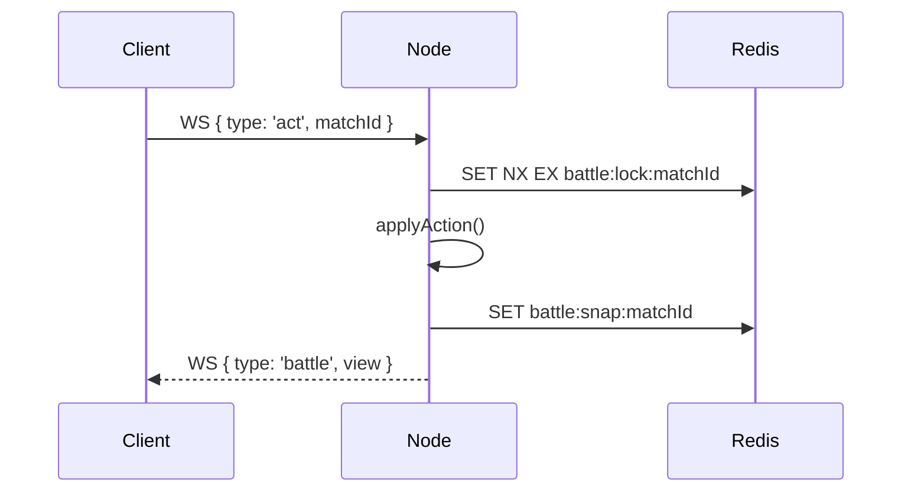

# obsidian-docs — Faithful DigiWorld documentation in Obsidian

You are writing documentation for the **DigiWorld** project into the user's
Obsidian vault at `~/xenon/Digiworld/`. This skill defines the **conventions**
and the **hard constraint**: every claim must be verifiable in the codebase.

## The vault

- **Vault root**: `~/xenon`
- **Project folder**: `~/xenon/Digiworld/`
- **MCP server**: `obsidian` (kobsidian-mcp, filesystem-first — no Obsidian
  needs to be running). Available after `opencode` restart.
- **Fallback**: standard `Write` / `Edit` / `Read` tools work directly on the
  vault path — the MCP is nicer for search/tags/graph, but not required.

Everything you write lives under `~/xenon/Digiworld/`. The user browses the
notes in Obsidian and expects them to feel native (wikilinks resolve, tags
appear in the graph, YAML frontmatter is well-formed).

## The one hard rule: FAITHFUL

Documentation drifts. This vault DOES NOT.

- **Every technical claim must be grounded in `codegraph_codegraph_explore`
  output or a direct file `read`.** Never write behavior from memory.
- **Cite the file + line range** in the note body (e.g.
  `[cluster/index.ts](backend/src/cluster/index.ts:58)`) so the next reader
  can verify without a scavenger hunt.
- **Copy the enum / union / const shape verbatim** when documenting types,
  don't paraphrase — TypeScript unions decay silently when transcribed.
- **When a claim can't be verified, mark it** with `> [!warning] Unverified`
  and a follow-up TODO. Never smooth over uncertainty.
- **Numbers, thresholds, TTLs, rates** — take them from `config.ts` /
  `settings/engine.ts` / actual constants. Never guess "probably 30 seconds".

If you can't find the source, say so in the note. A gap is honest; a
plausible fabrication is a landmine.

## Folder structure

```
Digiworld/
├── 00 — DigiWorld MOC.md         ← the hub, entry point
├── Architecture/
│   ├── Architecture Overview.md
│   ├── Cluster Coordination Layer.md
│   ├── Database Adapter.md
│   └── ...
├── API/
│   ├── HTTP Surface.md
│   ├── WebSocket Protocol.md
│   └── ...
├── Systems/
│   ├── Combat.md
│   ├── Farm.md
│   ├── Currency.md
│   ├── Weather System.md
│   ├── OAuth.md
│   └── ...
├── Ops/
│   ├── Environments.md
│   ├── Multi-node Deployment.md
│   └── ...
├── ADRs/                         ← Architecture Decision Records, dated
│   ├── 2026-07-31 — Standalone Admin SPA.md
│   └── ...
└── Runbooks/                     ← operational how-tos
    └── ...
```

`00 — ` prefix on the MOC keeps it at the top of alpha-sorted lists.

## Every note starts with YAML frontmatter

```yaml
---
tags:
  - digiworld/architecture      # taxonomy tag
  - digiworld/api               # (add more as fit)
aliases:
  - HTTP API                    # alternate names for search
created: 2026-08-01
updated: 2026-08-01
grounded-in:                    # explicit source citations
  - backend/src/server.ts
  - backend/src/lobby/ws.ts
verified-at-commit: ee635a7     # commit hash the note reflects
---
```

Tags always start with `digiworld/` to keep them scoped to this project inside
a shared vault. Common sub-tags:

- `digiworld/architecture` — cross-cutting internals
- `digiworld/api` — HTTP / WebSocket / service contracts
- `digiworld/system` — a specific gameplay system (combat, farm, weather, …)
- `digiworld/ops` — deployment, env, runbooks
- `digiworld/adr` — architecture decisions
- `digiworld/moc` — map of content / index note

## Wikilink conventions

- Same folder: `[[Note Name]]`
- Alias syntax: `[[Note Name|display text]]`
- To a heading: `[[Note Name#Section]]`
- To a block: `[[Note Name#^block-id]]`
- Embed: `![[Note Name]]` (full) or `![[Note Name#Section]]`

For code references (which live outside the vault) use standard markdown
links to repo paths:

```markdown
See [`server.ts`](../../mnt/sdc/digiworld/backend/src/server.ts) or, safer,
the repo-relative reference: `backend/src/server.ts:198-260`.
```

Prefer the file path + line range over an absolute link — the user reads
these both in Obsidian and via the codebase.

## Callouts (Obsidian syntax)

Use them to structure notes:

```markdown
> [!info] Design intent
> Server-authoritative combat means clients cannot compute damage.

> [!warning] Non-obvious
> Sessions live in Redis KV, NOT Postgres. Restart clears them if
> `CLUSTER=memory`.

> [!example] Concrete flow
> `POST /api/auth/login` → argon2id verify → `createSession()` → signed cookie.

> [!todo] Follow-up
> Verify the `matchmaking.pair` widening cadence (config.ts vs queue.ts).

> [!bug] Known issue
> ...

> [!quote]
> Copied verbatim from the README when authoritative.
```

## Mermaid diagrams

Use fenced mermaid blocks. Keep them small and readable. Prefer
`sequenceDiagram` for flows, `flowchart LR` for topology, `classDiagram` only
when structure matters more than flow.

````markdown

````

## Dataview offline patterns

The vault does NOT have the Dataview plugin installed, but kobsidian-mcp
supports offline `dataview.fields.*` / `dataview.index` reads. Use YAML
frontmatter fields (`grounded-in`, `verified-at-commit`, `tags`) so the offline
Dataview can index them for later plugin activation.

Don't write live DQL blocks (`​```dataview`) until the plugin is enabled —
they'd render as raw code fences to a plain Obsidian instance.

## Map of Content (MOC) pattern

The MOC (`00 — DigiWorld MOC.md`) is the ONLY entry point that gets
promoted. It links out to everything and NEVER duplicates a concept — it
directs.

Structure:

```markdown
# DigiWorld MOC

> [!info] What is this?
> One-line description of the project.

## Architecture
- [[Architecture Overview]]
- [[Cluster Coordination Layer]]
- [[Database Adapter]]

## API
- [[HTTP Surface]]
- [[WebSocket Protocol]]

## Systems
- [[Combat]]
- [[Farm]]
- [[Currency]]
- [[Weather System]]
- [[OAuth]]

## Ops
- [[Environments]]
- [[Multi-node Deployment]]

## ADRs (Architecture Decisions)
- [[2026-07-31 — Standalone Admin SPA]]
```

Never bury a note without a MOC link. Orphan notes are documentation debt.

## Writing workflow (per note)

1. **Pick the scope** — one note answers ONE question. If two, split.
2. **Investigate with codegraph** — `codegraph_codegraph_explore` on the
   relevant symbols. Read the source it returns. Never guess.
3. **Draft the note** with frontmatter first (tags, `grounded-in`,
   `verified-at-commit`), then body.
4. **Cite as you go** — file + line for every non-trivial claim.
5. **Link related notes** — wikilinks in-body, not just at the bottom.
6. **Update the MOC** — new note must appear there.
7. **Verify** — read your own note back, check that every wikilink target
   exists (or will) and every code citation is real.

Do NOT write speculative future work into notes; that belongs in a separate
`Roadmap.md` or in the repo `ROADMAP.md`.

## When to use kobsidian-mcp tools

After opencode restart, the `obsidian` MCP gives you tools scoped to the
vault. Prefer them over raw `Read`/`Write` when:

- **Searching notes for a term** → `notes.search` (respects Obsidian syntax,
  finds wikilinks and tags across the vault).
- **Following a tag** → `tags.notes` gives every note carrying it.
- **Backlinks** → `links.backlinks` for the reverse graph.
- **Vault stats** → `stats.vault` before a big reorg.
- **Renaming a note without breaking links** → the MCP updates every
  backlink; a raw `mv` does not.

For pure content authoring on a single new note, `Write` is fine.

## Anti-patterns (BLOCKING)

- **Documenting behavior from memory** — the codebase drifts, your memory
  drifts faster. Always ground.
- **Wikilinks to notes that don't exist** — leaves dangling references in
  the graph. Create the stub or use a plain word.
- **Copying README paragraphs into notes** — the README is one source of
  truth; the vault is another. Cite the README, don't mirror it.
- **Mixing systems in one note** — combat + farm in one file = neither
  discoverable. One system per note.
- **Frontmatter without `grounded-in`** — makes the note un-auditable.
- **"TBD" / "TODO" without a follow-up** — mark it `> [!todo]` with WHAT
  needs verifying and WHERE it should live.

## The FAITHFUL check (before saving)

Before you write the file, ask:

1. Every technical claim → cite file + line?
2. Every type / enum / union → verbatim from source, not paraphrased?
3. Every number / threshold → from config or constant, not invented?
4. Every wikilink target → exists or is planned in this pass?
5. Frontmatter `grounded-in` populated?
6. Note appears in the MOC?

If any answer is "no", fix it before writing. Documentation you can't defend
is worse than none — it lies to the next reader.
