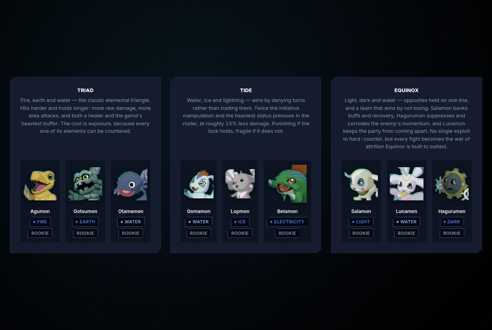
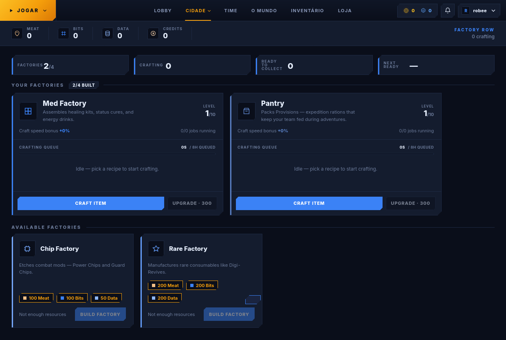
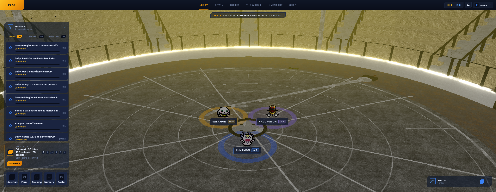
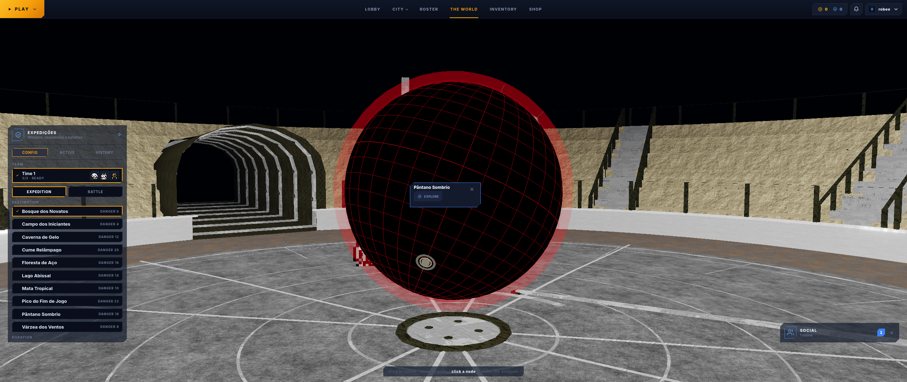

# DigiWorld

DigiWorld is a Digimon-inspired 3v3 real-time MMO built with Node.js and TypeScript. It combines server-authoritative combat, a persistent world and progression systems, and an admin-driven content pipeline in a single monorepo.

## Screenshots

<p align="center">
  
  
</p>
<p align="center">
  
  
</p>

## Overview

- **Server-authoritative gameplay:** battle resolution, progression, and economy logic run on the backend.
- **Real-time multiplayer:** Fastify HTTP APIs with native WebSocket support for lobby, chat, matchmaking, combat, and presence.
- **Content pipeline:** catalog ingestion and enrichment from external Digimon sources, with local asset management and admin tooling.
- **Progression & economy:** roster, farm, quests, shop, currencies, trading, and social systems.
- **Flexible deployment:** SQLite + in-memory coordination for local development, with PostgreSQL + Redis support for multi-node deployments.

## Tech Stack

| Layer | Technology |
| --- | --- |
| Runtime | Node.js, TypeScript |
| Backend | Fastify 5, `@fastify/websocket`, `ws` |
| Database | SQLite (`better-sqlite3`) / PostgreSQL (`pg`) |
| Coordination | In-memory cluster or Redis (`ioredis`) |
| Auth | Argon2id password hashing, signed HttpOnly session cookies |
| Validation | Zod |
| Frontend | React, Vite |
| Package management | pnpm workspaces |

## Repository Structure

```text
.
├── admin/                 # Admin frontend
├── backend/               # API, WebSocket server, game systems, migrations
├── frontend/              # Player-facing web client
├── shared/                # Shared TypeScript packages/types
├── data/                  # Local catalog/data assets
├── docs/                  # Documentation and screenshots
├── scripts/               # Utility scripts
├── seeds/                 # Seed content
└── docker-compose*.yml    # Local and multi-node deployment manifests
```

## Getting Started

### Prerequisites

- **Node.js** 22+ (Node 24 tested)
- **pnpm** 10+
- A native build toolchain for dependencies such as `better-sqlite3` and `argon2`
  - Debian/Ubuntu: `build-essential`
  - macOS: Xcode Command Line Tools (`xcode-select --install`)

### Installation

```bash
git clone https://github.com/robjunior/digiworldts.git
cd digiworldts
pnpm install
```

### Configuration

Copy the example environment file and adjust values as needed:

```bash
cp .env.example .env
```

Common environment variables:

| Variable | Default | Description |
| --- | --- | --- |
| `HOST` | `0.0.0.0` | HTTP bind address |
| `PORT` | `3000` | HTTP port |
| `NODE_ENV` | `development` | Runtime mode |
| `DATABASE` | `sqlite` | `sqlite` or `postgres` |
| `DATABASE_URL` | — | Required when `DATABASE=postgres` |
| `DB_PATH` | `data/digiworld.db` | SQLite database path |
| `CLUSTER` | `memory` | `memory` or `redis` |
| `REDIS_URL` | — | Required when `CLUSTER=redis` |
| `SESSION_SECRET` | auto-generated | Cookie signing secret (min. 32 chars when provided) |
| `ADMIN_BOOTSTRAP` | `closed` | Temporarily set to `open` to bootstrap the first admin account |

> **Security note:** registration is closed by default. To create the initial admin account, set `ADMIN_BOOTSTRAP=open`, register the admin user, then restore it to `closed`.

### Run in Development

```bash
pnpm dev
```

By default this starts the application with the local development configuration. Refer to `.env.example`, `RUNNING.md`, and `docker-compose*.yml` for environment-specific setup.

### Build & Run

```bash
pnpm build
pnpm start
```

### Docker

Single-node and multi-node compose files are included in the repository:

```bash
# Example: multi-node stack
docker compose -f docker-compose.multinode.yml up --build
```

Review the compose files and environment variables before using them outside local development.

## Core Systems

- **Authentication & sessions:** password auth, optional OAuth providers, server-side sessions
- **Combat:** turn-based 3v3 battles with server-side validation and event broadcasting
- **Matchmaking & lobby:** queueing, presence, chat, and room/DM flows
- **Roster & progression:** Digimon collection, party management, leveling, and rewards
- **Economy:** currencies, shop, market/trading flows, and resource generation
- **Admin tooling:** catalog/content management and operational controls

## Documentation

Additional project documentation is available in the repository:

- [`RUNNING.md`](RUNNING.md) — runtime and operations notes
- [`ROADMAP.md`](ROADMAP.md) — planned work and project direction
- [`docs/`](docs/) — architecture notes, runbooks, and supporting documentation

## Development Notes

- Prefer targeted, root-cause fixes and keep changes consistent with existing project conventions.
- Run relevant tests/checks for the area you modify (see workspace/package scripts).
- Do not commit secrets or local environment files.

## License

This project is licensed under the [MIT License](LICENSE), unless otherwise noted.
