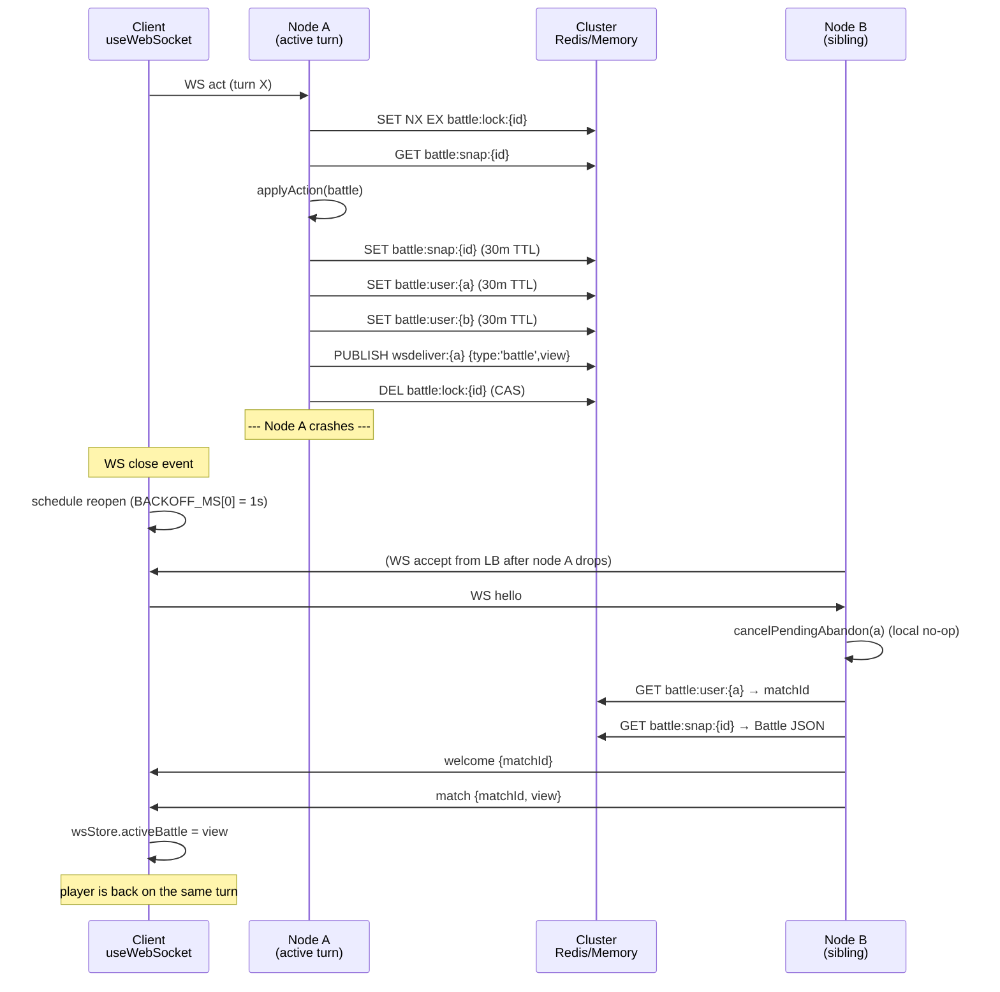

---
tags:
  - digiworld/adr
  - digiworld/architecture
  - digiworld/system
aliases:
  - Cross-node PvP Resume
  - Battle Snapshot Resume
  - Reconnect Grace
  - PvP Reconnect
  - ADR-006
created: 2026-08-06
updated: 2026-08-06
status: Accepted
grounded-in:
  - backend/src/battle/routes.ts
  - backend/src/lobby/ws.ts
  - backend/src/cluster/index.ts
  - backend/src/cluster/memory.ts
  - backend/src/cluster/redis.ts
  - backend/src/matchmaking/queue.ts
  - frontend/src/hooks/useWebSocket.ts
  - frontend/src/state/wsStore.ts
  - shared/src/battle.ts
verified-at-commit: HEAD
---

# 2026-08-06 — Cross-node PvP battle resume

> [!info] Status
> **Accepted** and shipped. Documents the design that lets an in-progress
> ranked PvP battle survive a node restart, a rolling deploy, and a
> 15-second client network hiccup — all with the same three primitives:
> a cluster-KV snapshot ([`battle/routes.ts:90`](backend/src/battle/routes.ts:90)),
> a node-local abandon grace ([`lobby/ws.ts:53`](backend/src/lobby/ws.ts:53)),
> and a single-socket exponential-backoff client
> ([`useWebSocket.ts:8`](frontend/src/hooks/useWebSocket.ts:8)).
> The story below stitches the three together end-to-end.

## Context

A ranked PvP match in DigiWorld is stateful and long:

- 3v3 turn-based, server-authoritative combat (see [[Combat]] and
  [[2026-06-01 — Server-authoritative combat]]).
- Every action mutates the `Battle` — HP, EN, ailments, turn cursor, buffs,
  cooldowns ([`shared/src/battle.ts:119-143`](shared/src/battle.ts:119)).
- End-of-match awards MMR ([`battle/routes.ts:242-249`](backend/src/battle/routes.ts:242))
  via [`persistAndAwardEnd`](backend/src/battle/routes.ts:244).
- Total wall time is 5–20 minutes.

Three failure modes must NOT lose that match:

1. **Node death or rolling deploy.** The two-node compose deploys with
   `game-node1` + `game-node2` behind nginx `ip_hash`
   ([[Multi-node Deployment]]). Restarting `game-node1` while a battle is
   mid-turn used to obliterate the fight — the whole `Battle` object lived
   in the node's memory, and the other node had never heard of it.
2. **Client network hiccup.** Wi-Fi flap, tab suspend, browser navigation
   from `/lobby` to `/combat` — every one of them closes the WebSocket.
   A naïve "close = forfeit" policy makes ranked feel like it's built on
   sand: any dropped packet costs MMR.
3. **Node hop under drain.** When ops drains a node
   ([[Cluster failover Redis to Redis]]), the socket disconnects and the
   client's next dial lands on a sibling node that has never touched this
   battle.

The two "naïve" resolutions both fail:

- **"Snapshot to Postgres every turn."** Correct, but Postgres write
  latency on every action turns 3v3 into a spinner. The turn-order strip
  in [`TurnOrderStrip.tsx`](frontend/src/components/combat3d/TurnOrderStrip.tsx)
  is unforgiving of anything over ~100 ms.
- **"Just keep the socket sticky."** `ip_hash` gives us stickiness under
  steady state, but a killed node cannot serve its stuck sockets — those
  connections have to re-land on a sibling and reconstruct the match. The
  battle has to live somewhere the sibling can read.

## Decision

**Three tiers, one shared substrate — the [[Cluster Coordination Layer]].**

The [`Cluster`](backend/src/cluster/index.ts:26) interface abstracted by
[[2026-07-01 — Cluster abstraction]] provides KV + TTL, distributed locks,
and pub/sub. Every PvP-resume primitive is a thin layer over it.

### Tier 1 — server: the snapshot IS the match

Battle state does NOT live in node memory. It lives in the cluster, and
every applied action re-writes the whole snapshot before the response
flushes.

Verbatim from [`battle/routes.ts:49-54`](backend/src/battle/routes.ts:49):

```typescript
const SNAPSHOT_TTL_SEC = 30 * 60;
const LOCK_TTL_SEC = 3;
const K_SNAP = (id: string): string => `battle:snap:${id}`;
const K_USER = (uid: string): string => `battle:user:${uid}`;
const K_LOCK = (id: string): string => `battle:lock:${id}`;
const WSDELIVER = (uid: string): string => `wsdeliver:${uid}`;
```

Four cluster keys per active match:

| Key | Backend primitive | Purpose |
|---|---|---|
| `battle:snap:{matchId}` | KV, TTL 30 min | Full `Battle` JSON — every field the engine needs to resume |
| `battle:user:{userId}` | KV, TTL 30 min | Reverse index: user → matchId. The reconnect entry point |
| `battle:lock:{matchId}` | Lock, TTL 3 s | Serializes turn dispatch across nodes |
| `wsdeliver:{userId}` | Pub/sub channel | Cross-node WebSocket delivery — any node can push to any user's socket |

The write is done by [`saveSnapshot()`](backend/src/battle/routes.ts:90),
called once at [`createBattleForPair`](backend/src/battle/routes.ts:204)
and again from [`dispatchAction`](backend/src/battle/routes.ts:255) after
every applied non-terminal action:

```typescript
async function saveSnapshot(battle: Battle): Promise<void> {
  const cluster = await getCluster();
  const json = JSON.stringify(battle);
  await cluster.set(K_SNAP(battle.id), json, SNAPSHOT_TTL_SEC);
  await cluster.set(K_USER(battle.playerA), battle.id, SNAPSHOT_TTL_SEC);
  await cluster.set(K_USER(battle.playerB), battle.id, SNAPSHOT_TTL_SEC);
}
```

> [!warning] Why save on every action, not every round
> [`dispatchAction:250-255`](backend/src/battle/routes.ts:250) documents the
> lesson: saving only on round boundaries "threw all of it away between
> calls, so the next action reloaded a snapshot where it was still the
> same player's turn and they could act forever." Any mutation to
> `turnCursor`, hp, en, or ailments has to be durable BEFORE the response
> ships, or the next action reads a stale world.

Turn dispatch is guarded by
[`K_LOCK`](backend/src/battle/routes.ts:230). On Redis this is
`SET key token NX EX 3` + a Lua CAS unlock ([`cluster/redis.ts:129-138`](backend/src/cluster/redis.ts:129))
so an errant unlock cannot release someone else's turn:

```typescript
async lock(key: string, ttlSec: number): Promise<string | null> {
  const token = randomBytes(12).toString('hex');
  const ok = await this.main.set(key, token, 'EX', ttlSec, 'NX');
  return ok === 'OK' ? token : null;
}
```

Cross-node WS delivery uses `wsdeliver:{userId}` as a pub/sub channel.
Whichever node hosts the target user's live socket has a `psubscribe`
on `wsdeliver:*` and pushes the payload down that socket. The dispatcher
never has to know which node the recipient is on — it just publishes.

### Tier 2 — server: 15-second reconnect grace

A WebSocket `close` event is NOT proof of a real disconnect. The lobby
lives in `/lobby.html`, combat in `/combat.html` — navigating between
them closes and reopens the socket in the same second.
[`ws.ts:217-256`](backend/src/lobby/ws.ts:217) documents the fix in a
literal code comment:

```typescript
// A WS close does NOT immediately abandon the match: normal browser navigation
// (lobby.html → combat.html) closes the old socket while the user is
// mid-match. Instead we defer the abandon for DISCONNECT_GRACE_MS; if the user
// opens a new socket and sends `hello` within that window we cancel the
// pending abandon. Only real disconnects (browser closed, network down) hit
// the deferred handleDisconnect and forfeit the match.
```

The constant is `DISCONNECT_GRACE_MS = 15_000`
([`ws.ts:53`](backend/src/lobby/ws.ts:53)). On WebSocket `close`,
[`schedulePendingAbandon`](backend/src/lobby/ws.ts:237) starts a
`setTimeout` that will call
[`handleDisconnect`](backend/src/battle/routes.ts:275) — the function that
actually marks the opponent as winner and awards the abandoning-side MMR
loss. On `hello`, [`handleHello`](backend/src/lobby/ws.ts:264) cancels it:

```typescript
const handleHello: Handler = async (entry) => {
  cancelPendingAbandon(entry.userId);
  const inMatch = await getMatchView(entry.userId);
  // ...
  if (inMatch) safeSend(entry.socket, { type: 'match', matchId: inMatch.matchId, view: inMatch.view });
};
```

### Tier 3 — client: ONE socket per tab, exponential backoff

[`useWebSocket.ts`](frontend/src/hooks/useWebSocket.ts) is not a per-mount
socket. It is a **module-scoped singleton** with reference-counted
consumers. The rationale is documented in a header comment
([`useWebSocket.ts:17-30`](frontend/src/hooks/useWebSocket.ts:17)):

```
The hook is called from App, Lobby, Spectate and Combat3DBody, several of
which mount at once. A per-call socket therefore opened N connections for
the same user, and the server keys `connections` by userId — so the newest
socket displaced the previous one, and the displaced socket's `close` then
tore down the live registration and dropped the user from the matchmaking
queue.
```

Reconnect is exponential:

```typescript
const BACKOFF_MS = [1_000, 2_000, 4_000, 8_000, 16_000, 30_000] as const;
const PING_INTERVAL_MS = 25_000;
```

([`useWebSocket.ts:8-10`](frontend/src/hooks/useWebSocket.ts:8))

- On open, `reconnectAttempt` resets to `0` and a 25-second `ping` loop starts
  ([`useWebSocket.ts:77-88`](frontend/src/hooks/useWebSocket.ts:77)).
- On close, if we still want a socket (`wanted=true`), schedule a redial at
  `BACKOFF_MS[reconnectAttempt] ?? 30_000`
  ([`useWebSocket.ts:100-115`](frontend/src/hooks/useWebSocket.ts:100)).
- The first retry fires in **1 s** — well inside the server's 15-s grace.

### Frontend state hydration — one shape, both paths

The zustand store in
[`wsStore.ts:108-113`](frontend/src/state/wsStore.ts:108) has a single
handler for `match` and `battle`:

```typescript
case 'match':
  set({ activeMatchId: msg.matchId, activeBattle: msg.view, battleEvents: [], battleOutcome: null });
  return;
case 'battle':
  set((state) => (state.activeMatchId === msg.matchId ? { activeBattle: msg.view } : state));
  return;
```

The client does not need to know whether a `type: 'match'` payload is the
first turn of a brand-new fight or a resume after a reconnect — the store
overwrites `activeBattle` either way, and the `<Combat3DBody>` route
renders from `activeBattle`.

### End-to-end flow



## Consequences

### Positive

- **Node death is transparent.** Killing `game-node1` mid-fight and letting
  the client redial `game-node2` resumes the same turn from the snapshot.
  Verified in [`test/cluster-crossnode.mts`](backend/test/cluster-crossnode.mts)
  where two `RedisCluster` instances against one Redis prove KV, ZSET,
  lock, and pub/sub all cross instance boundaries (18/18 pass, cited in
  [[2026-07-01 — Cluster abstraction]]).
- **Rolling deploys are free.** With snapshots durable in Redis and
  `battle:user:{uid}` sitting as a reverse index, drain-and-replace on one
  node moves that node's active matches to a sibling within one client
  backoff window.
- **Brief hiccups are free too.** The 15-s grace covers the entire
  reconnect budget of the client's first three backoff steps
  (1 s + 2 s + 4 s = 7 s), leaving room for a slow DNS or LB failover.
  Wi-Fi flap = no MMR loss.
- **Matchmaking rides the same substrate.** The queue is a cluster ZSET
  with a distributed pair-lock
  ([`matchmaking/queue.ts:137-181`](backend/src/matchmaking/queue.ts:137));
  a queued player whose node dies keeps their queue slot and pairs off
  the sibling. The same `pnpm dev` (memory backend) code path exercises
  this without needing Redis.
- **Cross-node WS delivery is one publish.** `dispatchAction` does not
  care which node hosts the recipient — it publishes to
  `wsdeliver:{userId}` and every node's `psubscribe('wsdeliver:*')` in
  the lobby forwards the payload to the local socket if it holds one.
- **The `Battle` type is backward-compatible.** Newer fields on `Battle`
  (`damageRate`, `sceneId`, per-unit `activeBuffs`, `skillCooldowns`) are
  optional with engine defaults
  ([`shared/src/battle.ts:46-50, 137-142`](shared/src/battle.ts:46)), so
  a rolling deploy can drop a code update mid-battle without a snapshot
  reload failing schema validation.
- **Single-socket client kills a whole class of races.** Before the
  singleton, multiple mounts (App + Lobby + Spectate + Combat3DBody) each
  opened their own WebSocket, and the server's per-user `connections`
  map ([`ws.ts:139`](backend/src/lobby/ws.ts:139)) displaced older
  sockets — whose `close` handlers then dequeued the user from
  matchmaking. Now: one tab, one socket, refcount goes to zero only when
  the last consumer unmounts.

### Negative

- **Snapshot TTL is a soft ceiling.** `SNAPSHOT_TTL_SEC = 30 * 60`
  ([`battle/routes.ts:49`](backend/src/battle/routes.ts:49)) means a
  battle where BOTH players are disconnected simultaneously will be
  GC'd if neither reconnects inside 30 minutes. In practice this is
  fine — server-authoritative combat has no way to advance without live
  actors — but it is a real edge case. The turn `TTL` is also `30 min` —
  a mid-fight snapshot is effectively "paused" for up to that long.
- **`pendingAbandons` is node-local.** The 15-s grace timer lives in a
  `Map<userId, Timeout>` on ONE node ([`ws.ts:227`](backend/src/lobby/ws.ts:227)).
  If a client's `close` fires on node A and their reconnect lands on
  node B (rare under `ip_hash`, common under drain), node A's timer
  keeps ticking. Two saving graces: (a) if node A DIED, the timer
  died with it — no forfeit; (b) if node A is alive but the client
  went to node B, the client's `hello` reaches node B but the abandon
  timer on node A still runs to completion. This is the one PvP-resume
  path where forfeit can happen despite the player being reconnected;
  the mitigation is that `ip_hash` steers reconnects back to the same
  node under steady state, and drains are announced (see
  [[Cluster failover Redis to Redis]]).
- **Every action costs one write + three sets to the cluster.** On
  Redis this is a ~1-2 ms tax — negligible relative to a 3v3 turn's
  human-scale cadence, but not free. Enabling `enableAutoPipelining`
  ([`cluster/redis.ts:32`](backend/src/cluster/redis.ts:32)) buys most
  of it back.
- **Client backoff caps at 30 s.** After the 6th failed dial the
  reconnect interval plateaus at 30 s
  ([`useWebSocket.ts:8, 111`](frontend/src/hooks/useWebSocket.ts:8)),
  so a long outage on the LB will have the client polling every 30 s
  forever. Fine for a browser tab, would be wrong for a mobile push
  scenario — not a target here.

### Neutral

- **The `type: 'battle'` message is used for BOTH new-turn updates and
  reconnect rehydration.** Same shape, same store handler — the
  duplication in wire messages is a feature: the client stays stateless
  about how it got the view.
- **Memory backend gets the same code path for free.** All the primitives
  the design leans on (KV+TTL, locks, pub/sub) are implemented in
  [`MemoryCluster`](backend/src/cluster/memory.ts) with in-process
  `Map`/`EventEmitter`/`setTimeout`. `pnpm dev` on `CLUSTER=memory`
  exercises the same reconnect-grace, snapshot-save, and rehydrate paths
  that Redis runs in production.
- **Matchmaking widening brackets keep working across reconnects.** Queue
  entries carry `queuedAt`; the widening
  ([`matchmaking/queue.ts:150-157`](backend/src/matchmaking/queue.ts:150))
  is `now - queuedAt`, and the `mm:meta:{userId}` KV persists across a
  brief disconnect (5-min TTL from
  [`matchmaking/queue.ts:26`](backend/src/matchmaking/queue.ts:26)). A
  player who reconnects inside 15 s does NOT lose their earned bracket
  widening.

## Rejected alternatives

### Snapshot to Postgres on every action

Correct durability, wrong latency. A 3v3 turn dispatch already reads a
loadout + `game_settings.damage_rate` on match start — adding a
`UPDATE battle_snapshots SET blob = $1 WHERE id = $2` on every action
pushes the observed action → response latency past the ~100 ms budget the
[`TurnOrderStrip`](frontend/src/components/combat3d/TurnOrderStrip.tsx)
animation is tuned around. Redis is `≤2 ms` end-to-end; Postgres is
`10–40 ms` at the same node co-location.

### Sticky sessions only, no cluster snapshot

`ip_hash` gets us 90% of what stickiness needs, but a node that goes down
takes its in-memory `Battle` objects with it. Redis-backed snapshots are
the difference between "the node died and the fight is gone" and "the
node died and the fight resumes on the sibling in 1 s."

### Client-side snapshot save-and-replay

Store the full `Battle` in `localStorage` and let the client replay on
reconnect. Rejected — it violates server-authoritative combat
([[2026-06-01 — Server-authoritative combat]]). A malicious client could
mutate its stored snapshot and hand back a fabricated view.

### Longer reconnect grace (e.g., 60 s)

Rejected as griefing bait. A losing player would `close` the tab to
"pause" the match for a full minute to think — or to consult with a
friend. 15 s covers wifi flap and browser navigation without giving up
tempo.

## Verification

- **[`test/cluster-crossnode.mts`](backend/test/cluster-crossnode.mts)**
  spins up two `RedisCluster` instances against one Redis and passes
  18/18 checks — including the locked-write / read-from-other-instance
  case that IS the PvP resume flow, just renamed.
- **Cluster interface parity** is enforced structurally — both backends
  implement the exact same [`Cluster`](backend/src/cluster/index.ts:26)
  interface ([[Cluster Coordination Layer]]).
- **Manual smoke**: with the two-node compose
  ([`docker-compose.multinode.yml`](docker-compose.multinode.yml)) — start
  a ranked match, `docker compose kill game-node1`, watch the client
  redial `game-node2` within 1–2 s, `hello`, `match` payload arrives,
  turn resumes. Sibling to the cross-node infrastructure test in
  [[Multi-node Deployment#Cross-node testing]].
- **The 15-s grace was tuned empirically.** Longer than the observed
  reconnect budget for the 6-step exponential backoff at the low end
  (1+2+4+8 = 15 s) and short enough that a real quit is punished within
  the same turn cadence.

## Related

- [[Combat]] — the underlying combat engine + `Battle` type
- [[Matchmaking and MMR]] — the queue that fed the pair, also cluster-backed
- [[Cluster Coordination Layer]] — the KV/lock/pub-sub interface underneath
- [[WebSocket Protocol]] — the `hello` / `welcome` / `match` / `battle` / `event` / `end` message shapes
- [[Multi-node Deployment]] — the deploy shape this ADR assumes
- [[2026-07-01 — Cluster abstraction]] — the ADR that lets any of this
  work on both `memory` and `redis`
- [[2026-06-01 — Server-authoritative combat]] — the invariant that
  forbids client-side snapshot replay
- [[Cluster failover Redis to Redis]] — the runbook that puts this design
  under real ops load
- [[Recover a stuck matchmaking queue]] — the sibling recovery path when
  the queue itself gets wedged
