---
tags:
  - digiworld/adr
aliases:
  - Dungeon Extraction ADR
  - Dungeon Crawler Refactor
  - ADR-009
created: 2026-08-07
updated: 2026-08-07
status: Proposed
grounded-in:
  - backend/src/dungeons/repo.ts
  - backend/src/dungeons/routes.ts
  - backend/src/dungeons/tiled-import.ts
  - backend/src/dungeons/traps.ts
  - backend/src/farm/engine.ts
  - backend/src/roster/evolve.ts
  - backend/src/world/pve-battle.ts
  - backend/src/items/grant.ts
  - shared/src/digimon.ts
  - shared/src/dungeon.ts
verified-at-commit: f52d9d7b
---

# 2026-08-07 — Dungeon crawler + extraction refactor

> [!info] Status
> **Proposed** — not yet shipped. This ADR captures the decision to
> refactor the current tile-based dungeon system ([[Dungeons]]) into a
> **dungeon crawler with extraction mechanics**. Implementation is
> phased under feature flags (see [[Dungeon Extraction]] for the
> target architecture and `.omo/plans/dungeon-crawler-extraction.md`
> for the operational rollout plan).

## Context — the current system ([[Dungeons]])

The MVP dungeon system is a **tile-based grid crawler** with these
properties (all grounded in `verified-at-commit: 4e70621` of the
[[Dungeons]] note, cross-verified at `f52d9d7b`):

- **Persistent run state** in [`user_dungeon_runs`](backend/src/db/migrations/006_dungeons.sql:20)
  — position, `defeated_encounters`, `collected_items`, `unlocked_doors`,
  `oneshot_triggered_ids`, `started_at`, `completed_at`.
- **Loot flow**: server calls `defeatEncounter(userId, dungeonId, encId)`
  in [`dungeons/repo.ts`](backend/src/dungeons/repo.ts:518) after a
  battle win. That function grants encounter `loots` into the player's
  standard [`player_inventory`](backend/src/items/grant.ts:5) via
  `SQL_GRANT_REWARD_ITEM` **immediately** — no separation between
  "found in run" and "brought in".
- **Party wipe**: causes `revive_at` timers on downed mons
  ([`pve-battle.ts`](backend/src/world/pve-battle.ts) `awardPveBattleRewards`)
  but the encounter stays undefeated and the run is not terminated.
  **No loot confiscation** — since loot already landed in `player_inventory`.
- **Exit**: `POST /api/dungeon/:id/complete` sets `completed_at` in
  [`repo.completeRun`](backend/src/dungeons/repo.ts). There is no
  "extraction" concept — a run just ends.
- **Boss detection**: [`DungeonEncounter`](shared/src/dungeon.ts)
  supports `difficulty: 'boss'` but the code treats it as a rarity flag
  for wild-mon generation, not as an end-of-run trigger.
- **Multi-floor**: [`dungeons.parentId`](shared/src/dungeon.ts) exists as
  a general parent pointer but no code path treats parent/child as floors.
  Floors are practically composed via
  [`dungeon_warps.target_dungeon_id`](backend/src/db/migrations/006_dungeons.sql).
- **Client rendering**: 2D DOM grid + CSS sprites in
  [`frontend/src/components/dungeon/DungeonGrid.tsx`](frontend/src/components/dungeon/DungeonGrid.tsx)
  — one cell per tile, `gidCellStyle` computes the background-image
  offset from the joined tileset. Movement is Manhattan-1 adjacency,
  server-authoritative via CAS
  `SQL_UPDATE_RUN_POSITION_CAS` ([`repo.ts`](backend/src/dungeons/repo.ts)).
- **Tiled TMJ import**: [`dungeons/tiled-import.ts`](backend/src/dungeons/tiled-import.ts:96)
  parses map layers (`parseTiledJson`) and produces a normalized
  `TiledImportPayload` — but every non-floor layer collapses into the
  same walkability check (tile `gid` presence).

Two existing subsystems the refactor will reuse:

- **[[Farm|Factories]]** — [`FactoryTypeId`](backend/src/farm/engine.ts:238)
  already declares `'med' | 'chip' | 'rare' | 'pantry'`. The **Chip Factory**
  (`chip`) and **Rare Factory** (`rare`) exist today; the seeded recipes
  produce `Power Chip / Guard Chip / Digi-Revive` (see `SEED_RECIPES` at
  [`engine.ts:282-299`](backend/src/farm/engine.ts:282)).
- **Item-gated evolution** —
  [`EvolveEdge`](shared/src/digimon.ts:72) already supports
  `requiredItemId` and `requiredItemQty`. [`evolveRoster`](backend/src/roster/evolve.ts:201)
  consumes the item atomically via `removeItem` inside the swap tx.
  **No code changes needed to add "evolution key" items** — only
  content (catalog XML edges + shop_items rows).

## The pressure

The current dungeon loop has three gameplay defects:

1. **No stakes** — you never lose loot, so exploration is riskless. A
   30-minute revive after a wipe is minor; loot already banks
   immediately.
2. **No progression sink** — loot goes into the same pool as shop
   purchases and quest rewards. There is no reason to prefer dungeon
   loot vs any other source.
3. **No connection to evolution** — evolution items exist as a schema
   feature ([`EvolveEdge.requiredItemId`](shared/src/digimon.ts:78))
   but no catalog entry uses them; every evolution is level-gated only.
   The farm produces provisions, buffs, and revives — nothing that
   feeds evolution.

The Digimon Story genre expects a tight **explore → drop → craft →
evolve** loop. Today that loop has a missing middle.

## Decision

Refactor the dungeon system into a **dungeon crawler + extraction
hybrid** with the following load-bearing choices. Each choice was
weighed against alternatives during a design pass (`ses_022f4520`
sibling) and is captured verbatim below.

### D1 — Two-inventory model: **Kit** (bring in) + **Stash** (per-run)

Introduce two new persistence surfaces distinct from
[`player_inventory`](backend/src/db/schema.sql):

- **`dungeon_kits` + `dungeon_kit_items`** — user-authored **presets**
  of items to bring into a dungeon. Presets are templates; nothing
  is escrowed at edit time.
- **`dungeon_run_stash`** — the **ephemeral run inventory** that holds
  everything the player brought AND everything they picked up during
  the run. Rows carry `origin: 'kit' | 'loot'` so extraction reports
  can show provenance.

Loot that today lands in `player_inventory` via
[`SQL_GRANT_REWARD_ITEM`](backend/src/dungeons/repo.ts:518) is
redirected to `dungeon_run_stash`. The redirect is gated by a feature
flag so the change is reversible per-user.

> [!info] Naming rationale
> "Loadout" is already in use for combat-party resolution
> (`loadPartyLoadout` at [`roster/routes.ts:234`](backend/src/roster/routes.ts:234)).
> **Kit** = pre-selected preset. **Stash** = per-run bag. Both are
> new terms with no collision.

### D2 — Wipe policy: **kit + loot both forfeited**

When all three party members faint inside a dungeon:

1. Server sets `user_dungeon_runs.state = 'wiped'` (new column).
2. `DELETE FROM dungeon_run_stash WHERE user_id = ? AND dungeon_id = ?`
   — **everything the player brought AND found is destroyed**.
3. Resources gained during the run (see D4) are zeroed.

No preservation. This is the extraction game contract — bringing
gear is a bet, not a savings account.

**Rejected alternatives:**

- **Preserve kit, only forfeit loot** — invites a spawn-kill loop
  (bring 10 revives, farm boss, extract). Kills the risk narrative.
- **Preserve unused kit items** — technically defensible via the
  `origin` field, but adds engine complexity for a narrow benefit and
  softens the failure signal.

### D3 — Kit only carries **items**; resources are ONLY gained inside the dungeon

The kit holds `dungeon_kit_items` (consumables, revives, extraction
scrolls, buff modules) — never Meat / Bits / Data.

Resources during the run accumulate into three counters on
`user_dungeon_runs`:

- `stash_meat  INTEGER NOT NULL DEFAULT 0`
- `stash_bits  INTEGER NOT NULL DEFAULT 0`
- `stash_data  INTEGER NOT NULL DEFAULT 0`

These do NOT occupy inventory slots. On extraction, they merge into
[`resources`](backend/src/farm/engine.ts) atomically (same
`WHERE amount >= ?` guarded UPDATE pattern as
`upgradeBuilding`). On wipe, they are zeroed.

Stack rule: **one slot per unique `item_id`, `qty` unbounded within a
slot**. Kit capacity is a **number of unique item types** — with
optional per-`kit_class` caps via new `shop_items.kit_class` +
`kit_max_qty` columns (e.g. `revive: max 3`, `extraction: max 1`).

### D4 — Extraction paths: physical, teleport, challenge, wipe

`user_dungeon_runs.state` moves from binary (`completed_at IS NULL`)
to a finite state machine:

```mermaid
stateDiagram-v2
    [*] --> active: enterDungeon(dungeonId, kitId?)
    active --> extracted: walked_out (exit tile)
    active --> extracted_by_teleport: use extraction-scroll item
    active --> cleared_challenge: dungeon challenge condition met
    active --> wiped: party wipe (all 3 fainted)
    extracted --> [*]: stash → inventory + resources
    extracted_by_teleport --> [*]: stash → inventory + resources
    cleared_challenge --> [*]: stash → inventory + resources + bonus
    wiped --> [*]: stash purged; resources purged
```



- **Physical walk-out**: existing `dungeon_warps.target_dungeon_id = null`
  extended with a boolean `is_exit`. Stepping onto that tile triggers
  extraction confirmation.
- **Extraction scroll**: new item + new `ItemEffect { kind:
  'extract_dungeon' }`. Cannot be used during combat (validated in
  `pve-battle`). Recipe: high-cost in the Rare Factory.
- **Challenge condition**: new `dungeons.challenge_kind` column with
  values `'boss_defeated' | 'all_encounters_defeated' | 'reach_tile' |
  'collect_item' | 'survive_waves' | 'none'` plus a
  `challenge_config: JSON` for per-kind params. Admin-authored per
  dungeon.

### D5 — Multi-floor via warps + `dungeon_group_id`

Reject "one dungeon row with a `floors: JSON` column" (refactor too
invasive; breaks admin CRUD contract). Instead: **each floor is a
separate `Dungeon` row** connected by
[`dungeon_warps`](backend/src/dungeons/repo.ts), grouped by a new
`dungeons.dungeon_group_id` column.

**Stash persistence**: when the player warps from floor N to floor N+1
of the SAME `dungeon_group_id`, the stash **transfers by group_id**,
not by `dungeon_id`. `user_dungeon_runs` becomes keyed by
`(user_id, dungeon_group_id)` for grouped dungeons and remains keyed
by `(user_id, dungeon_id)` for single-floor.

Admin cost: authoring a 5-floor dungeon = 5 dungeon rows + 4 warps + 1
group_id. Explicitly accepted trade-off.

### D6 — Item rarity as a first-class column

Add `shop_items.rarity INTEGER NOT NULL DEFAULT 0` with the enum:

```typescript
// shared/src/item-rarity.ts (proposed)
export const RARITIES = ['common', 'uncommon', 'rare', 'epic', 'legendary'] as const;
export type Rarity = typeof RARITIES[number];
```

Weight curve (base, admin-tunable per dungeon via rarity tables — see
[[Dungeon Extraction]]):

| Rarity | Base drop weight | Bonus at evolution outcome |
|---|---|---|
| Common (0)     | 60% | +0 hp, +0 en, +0 combat |
| Uncommon (1)   | 25% | +5 hp, +5 en, +2 combat each |
| Rare (2)       | 10% | +15 hp, +10 en, +5 combat each |
| Epic (3)       |  4% | +30 hp, +20 en, +10 combat each; +1 tier_2 skill unlock |
| Legendary (4)  |  1% | +50 hp, +30 en, +15 combat each; +2 tier_2 + 1 identity_finisher |

Rarity influences four systems (each is a self-contained hook):

1. **Loot drop weight** — base curve above.
2. **Evolution outcome bonus** — added in the evolve tx via new helper
   `applyRarityEvolutionBonus(row, rarity)` in
   [`roster/evolve.ts`](backend/src/roster/evolve.ts).
3. **Default equipped skills** — [`getDefaultEquippedForStage`](backend/src/skills/pool.ts:69)
   gains an optional `evolutionRarity` param that biases the sort
   toward `tier_2 = true` skills at epic+ and includes
   `slot_role = 'identity_finisher'` at legendary.
4. **UI/UX** — border color, sort order, filter, coin market listings.

### D7 — Evolution items: **Cypher** (family × tier × rarity)

Add a **generic, cross-Digimon** evolution key item family:

- **Family** (11): `Blaze / Cryo / Tide / Zephyr / Terra / Verdant /
  Volt / Chrome / Nova / Void / Null` — one per element in
  [`Element`](shared/src/digimon.ts).
- **Tier** (3): `T1 / T2 / T3` — **gates which target species** an
  `EvolveEdge` unlocks. Admin authors the `(family, tier)` pair per
  edge. Same tier can serve many edges (a `Blaze Cypher T2` unlocks
  any `T2 Fire` evolution across the roster).
- **Rarity** (5): as D6. **Modulates the bonus** at evolution, does
  NOT gate.

Item id shape (V1 storage — see D8): `itm-cypher-<family>-<tier>-r<0..4>`.
User-facing name: `<Rarity> <Family> Cypher <Tier>` (e.g.
`Legendary Blaze Cypher II`).

**Total SKU footprint**: 11 families × 3 tiers × 5 rarities = **165
seeded rows** in `shop_items`. Generated by a new seeder; the admin
never hand-types these.

Recipes (in the Rare Factory) consume:

- **N × Element Shard: `<element>`** (drops from dungeons; carry
  rarity)
- **M × Attribute Shard: `<attribute>`** (drops from dungeons; carry
  rarity — one per Digimon attribute: Vaccine / Virus / Data / Free /
  Unknown)
- **K × Chip A/B/C** (Chip Factory outputs; no rarity)
- **P bits** (resource)
- **`craft_time_ms`** scaled by tier

The recipe **inherits the maximum rarity** from the `type =
'fragment'` inputs — captured in a new `farm_recipes.inherit_rarity_from`
column (`'fragment' | null`). Non-fragment inputs (chips, bits) do NOT
contribute rarity.

### D8 — Rarity storage: **per-SKU stacking** (Option A)

Store one `shop_items` row per `(family, tier, rarity)` triple. `qty`
stacks within a rarity. **165 rows** total for the Cypher tree.

**Rejected**: per-instance rarity via a new
`player_inventory_instances(id, user_id, item_id, rarity, qty)` table.
More flexible but requires refactoring every `grantItem` /
`removeItem` call site
([`items/grant.ts`](backend/src/items/grant.ts)) and every loot flow.
Deferred to V2 if content pressure demands it.

### D9 — Item type taxonomy for admin filter dropdowns

Add `shop_items.item_type TEXT NOT NULL DEFAULT 'consumable'` with the
enum:

```
'consumable'      -- healing, energy, cures
'evolution_key'   -- Cyphers
'fragment'        -- Element/Attribute Shards
'chip'            -- Chip A/B/C
'door_key'        -- items that open dungeon doors
'extraction'      -- extraction scrolls
'buff_material'   -- factory inputs for buffs
'quest'           -- quest-locked items
'cosmetic'        -- future
'misc'            -- fallback
```

Admin dropdown filter contract:

| UI surface | Filter |
|---|---|
| `EvolutionEdgeEditor.requiredItemId` | `item_type = 'evolution_key'` |
| `DoorEditor.keyItemId` | `item_type = 'door_key'` |
| `RecipeEditor.requires_items` | `item_type IN ('fragment', 'chip', 'buff_material')` |
| `KitEditor.items` | `item_type NOT IN ('fragment', 'chip', 'evolution_key')` |

Prevents the current cluttering of a single "pick an item" dropdown
that shows all 200+ items.

### D10 — Tiled layer contract with per-layer collision

Formalize a canonical layer set. Each `dungeon_tiles` row gets a
`layer_kind` column:

| `layer_kind` | Walkability |
|---|---|
| `floor` | walkable |
| `walls` | blocked |
| `doors` | blocked until unlocked |
| `water` | blocked by default; walkable with `itm-swimsuit`-class item |
| `pit` | blocked (or trap-tile trigger) |
| `decoration` | transparent to collision |
| `hidden` | ignored until trigger |

`moveRun` in [`dungeons/repo.ts`](backend/src/dungeons/repo.ts:452)
gets a pre-computed `walkable_mask_json` on the `dungeons` row
(populated at import time) so hot-path movement is a `Set<"x,y">`
lookup rather than a per-tile gid check.

Tiled importer ([`tiled-import.ts`](backend/src/dungeons/tiled-import.ts))
gets hard-fail warnings for: no `floor` layer, spawn point outside a
`floor` tile, `challenge_kind = 'reach_tile'` with an unreferenced
target tile.

## Concrete example — Agumon (`skb-50`)

Grounded in the catalog XML
([`backend/data/catalog/digimons.xml:108-130`](backend/data/catalog/digimons.xml:108)).
Agumon (Rookie / Vaccine / Fire / Reptile) evolves into 5 Champions:

| Target | Attribute | Element | Cypher required | Rationale |
|---|---|---|---|---|
| Greymon (`skb-326`) | Vaccine | Fire | `Blaze Cypher I` | Canonical Champion — T1 baseline |
| GeoGreymon (`skb-54`) | Vaccine | Fire | `Blaze Cypher II` | Premium Fire Champion — T2 |
| Coredramon Green (`skb-209`) | Virus | Fire | `Blaze Cypher II` | Fire element but Virus alignment — same Cypher, admin decides |
| Raptordramon (`skb-25`) | Vaccine | Steel | `Chrome Cypher II` | Steel is rare — T2 default |
| Numemon (`skb-70`) | Virus | Fire | `Corruption Chip` (V2 alt) or `Blaze Cypher I` | Bad-ending; cheap alternate path is future scope |

**Insight**: four of five Agumon evolutions can share `Blaze Cypher II`
because they're all Fire Champions. The player farms one Cypher,
picks which target species to actualize at
`POST /api/roster/:monId/evolve { targetCatalogId }`. The Cypher
unlocks the pool of `T2 Blaze` evolutions; the target selection
picks one.

Cross-Digimon reuse:

- `Blaze Cypher II` also serves: Guilmon → Growlmon (Fire Champion),
  Coronamon → Firamon, Meramon → SkullMeramon (if promoted), etc.
- `Blaze Cypher I` serves: Guilmon → basic Growlmon variants, and any
  Rookie → Fire Champion baseline.

165 SKU footprint is sized for a roster of ~430 Digimon (per README
scraped catalog count).

## Consequences

### Positive

- **Risk-reward gameplay loop** matches the extraction genre expectations.
- **Rarity + tier** create two orthogonal progression axes: raw
  power (rarity) vs unlock breadth (tier). Player can chase either.
- **Fragment reuse** across recipes means low content-authoring cost —
  11 elements + 5 attributes + 3 chips = 19 fragment SKUs cover most
  recipes.
- **Evolution keys are craft-gated, not RNG-gated** — deterministic
  progression once the player farms enough Shards.
- **All rarity-tier bonuses live at evolve-time**, so respec (via
  future de-evolution?) is straightforward — the roster row carries
  no rarity-history dependency.
- **Reuses existing infrastructure**:
  [`EvolveEdge.requiredItemId`](shared/src/digimon.ts:78) exists;
  [`FactoryTypeId 'chip'`](backend/src/farm/engine.ts:238) exists;
  [`FactoryTypeId 'rare'`](backend/src/farm/engine.ts:238) exists;
  [`crafting_jobs`](backend/src/farm/engine.ts) auto-queue exists.

### Negative

- **165 seeded shop_items** for Cyphers alone. Manageable via seeder
  but bloats admin listings unless filter dropdowns (D9) ship in the
  same phase.
- **Wipe policy (D2) is punishing.** Community feedback may push
  toward D2's rejected alternatives. Kill-switch flag lets us soften
  post-launch.
- **Fragment drop tables** need per-dungeon tuning to avoid legendary
  starvation. Requires a rarity-table admin (see [[Dungeon Extraction]]).
- **State machine migration** — existing `user_dungeon_runs` rows
  need backfill of `state = 'extracted' if completed_at IS NOT NULL else 'active'`.
  Straightforward SQL, but must land BEFORE the redirect flag (D1)
  activates.
- **Multi-floor group state** — `user_dungeon_runs` PK changes from
  `(user_id, dungeon_id)` to `(user_id, dungeon_group_id)` for grouped
  dungeons. Migration must preserve single-floor runs by defaulting
  `dungeon_group_id = dungeon_id`.

### Neutral

- **Combat engine untouched.** `use_item` in
  [`battle/engine.ts::applyAction`](backend/src/battle/engine.ts:408)
  keeps its current contract. Only the inventory source (stash vs
  player_inventory) shifts, and that's a call-site swap in
  `pve-battle.actInPveBattle`.
- **Frontend rendering (`DungeonGrid.tsx`) stays 2D DOM+CSS.**
  `layer_kind` is a data-only refactor. The 3D rewrite on
  `feat/scene-2.5d` is a parallel orthogonal effort.
- **Existing quests referencing dungeon completion**
  (`bumpDefeatObjectives`, `bumpCollectObjectives`) continue to fire
  from the same code path — `defeatEncounter` still runs on a battle
  win; only the loot destination changes.

## Rollout

Phased under feature flags (`flag:*`). Each phase is
independently shippable; phase 3 is the only one with visible
gameplay impact.

| Phase | Ships | Kill-switch | Blocks players? |
|---|---|---|---|
| **F1** | Rarity column + rarity badge in inventory UI | `flag:rarity-visible` | No |
| **F2** | Kit + Stash schema + endpoints (dry run — loot still to `player_inventory`) | `flag:dungeon-kit-enabled` | No |
| **F3** | Loot redirect to stash + wipe forfeiture + extraction scroll | `flag:dungeon-extraction` | **Yes — gameplay change** |
| **F4** | Challenge state machine + `state` column | `flag:dungeon-challenge` | No (default `boss_defeated`) |
| **F5** | Tiled `layer_kind` + walkable mask | — | No (admin-only) |
| **F6** | Fragment drops + rarity tables + Cypher recipes | `flag:evolution-crafting` | No (additive) |
| **F7** | Rarity evolution bonuses + skill unlock hooks | `flag:rarity-bonuses` | **Yes — balance change** |
| **F8** | Admin editor updates (item_type filters, challenge editor) | — | No (admin-only) |
| **F9** | Multi-floor `dungeon_group_id` | — | No (additive) |

Full operational sequence in
`.omo/plans/dungeon-crawler-extraction.md`.

## Related

- [[Dungeon Extraction]] — target-state architecture (PLANNED, marked
  as such in the note)
- [[Dungeons]] — current-state (V1) reference, will be marked legacy
  once F3 ships
- [[Combat]] — the battle engine hook point
  (`use_item` + `dungeonContext`)
- [[Farm]] — the factory that produces Cyphers
- [[Roster and Party#Evolution]] — the evolution swap point where
  rarity bonuses land
- [[Currency]] — resources that flow through stash on extraction
- [[HTTP Surface]] — the endpoint diff (also in the plan doc)

## Open questions (deferred to Momus review)

> [!todo] Fragment drop distribution per-dungeon
> The initial rarity weights (60/25/10/4/1) are a starting point.
> Per-dungeon overrides via the `dungeon_rarity_tables` admin surface
> ([[Dungeon Extraction]]) are the tuning lever. Playtest data
> after F6 should feed back into defaults.

> [!todo] Cypher tier assignment convention
> Every `EvolveEdge` needs an admin-authored `(family, tier)`
> pair. Do we seed with a heuristic (`T1` for lowest-XP evolution,
> `T2` for premium, `T3` for late-game) or leave every existing edge
> `null` and require an admin pass? Suggested: seeder writes
> `(deriveFamily(target.element), 'T1')` for every edge; admin promotes
> to `T2`/`T3` per curation.

> [!todo] Extraction scroll recipe cost
> Draft: `500 meat + 800 bits + 1000 data + 6h` in the Rare Factory
> plus one legendary `Warp Fragment` (boss-only drop, chance < 0.05).
> Requires playtest to avoid trivializing extraction.

> [!todo] Cross-node stash consistency
> `dungeon_run_stash` writes are per-user + per-dungeon. Concurrent
> pickups on cross-node are unlikely (a player is on one node at a
> time) but the write pattern should still use the same guarded
> `WHERE qty >= ?` idiom as [`farm/engine.ts`](backend/src/farm/engine.ts)
> to survive retry storms.
