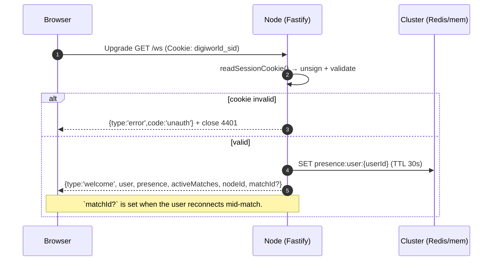

---
tags:
  - digiworld/api
  - digiworld/architecture
aliases:
  - WS
  - WS Protocol
  - Realtime Protocol
created: 2026-08-01
updated: 2026-08-01
grounded-in:
  - shared/src/ws.ts
  - backend/src/lobby/ws.ts
  - backend/src/cluster/index.ts
README.md
verified-at-commit: 97f72ba
---

# WebSocket Protocol

> [!info] Endpoint
> **`GET /ws`** — expects the signed `digiworld_sid` cookie on the upgrade
> request. Missing / invalid cookie → JSON `{type:'error',code:'unauth'}` +
> close code **`4401`**.

Every message on the wire is JSON, one message per WS frame. Types are
generated from `shared/src/ws.ts` and imported by both backend and
frontend — the source of truth is that file, not this note.

## Single socket per user

The backend enforces exactly one live WS per `userId`. Opening a second
connection **displaces the first** — the older socket receives:

```json
{ "type": "error", "code": "displaced", "message": "signed in from another tab" }
```

…and is closed. This is intentional (prevents duplicate presence, chat
echo, and match-action races) but bites when running two browsers / a QA
Playwright alongside a real tab. Use a different user for parallel testing.

## Handshake



`welcome.presence` is the current online list. `activeMatches` is the total
open battle count across the cluster.

## Client → server messages

Source: [`WSClientMessage`](shared/src/ws.ts:29) union. Six variants.

| Type       | Shape                                                                | Purpose                                          |
| ---------- | -------------------------------------------------------------------- | ------------------------------------------------ |
| `hello`    | `{ type: 'hello' }`                                                  | Client-side handshake tickle. No-op server-side. |
| `ping`     | `{ type: 'ping' }`                                                   | Keepalive. Server replies `{type:'pong'}`.       |
| `chat`     | `{ type: 'chat', text: string, room?: string }`                      | Send a chat line. `room` omitted → global.       |
| `queue`    | `{ type: 'queue', join: boolean }`                                   | Join / leave the matchmaking queue.              |
| `act`      | `{ type: 'act', matchId: string, action: Action }`                   | Submit a combat action. See [[Combat#Actions]].  |
| `spectate` | `{ type: 'spectate', matchId: string, join: boolean }`               | Subscribe / unsubscribe to a live match's events. |

> [!warning] Frame size cap
> Frames > **~64 KB** get rejected with `{type:'error',code:'payload-too-large'}`.
> Verify the exact cap in [`backend/src/lobby/ws.ts`](backend/src/lobby/ws.ts).

## Server → client messages

Source: [`WSServerMessage`](shared/src/ws.ts:73) union. Fourteen variants.

| Type                       | Shape (abridged)                                                                                              | When                                                                            |
| -------------------------- | ------------------------------------------------------------------------------------------------------------- | ------------------------------------------------------------------------------- |
| `welcome`                  | `{ type, user, presence, activeMatches, nodeId, matchId? }`                                                    | On connect                                                                      |
| `pong`                     | `{ type: 'pong' }`                                                                                             | Reply to `ping`                                                                 |
| `presence`                 | `{ type, users: PresenceUser[], count: number }`                                                              | Every 3 s + on connect / disconnect                                             |
| `chat`                     | `{ type, from, displayName, text, at, room? }`                                                                | On any inbound chat routed to this socket                                       |
| `queue`                    | `{ type, status: 'idle'\|'waiting'\|'matched', size }`                                                        | Queue state changes                                                             |
| `match`                    | `{ type, matchId, view: BattleView }`                                                                          | On pairing — both players receive it                                            |
| `battle`                   | `{ type, matchId, view: BattleView }`                                                                          | Full state snapshot after an action                                             |
| `event`                    | `{ type, matchId, events: BattleEvent[] }`                                                                     | Fine-grained action log (damage numbers, ailments) for UI animation             |
| `end`                      | `{ type, matchId, view, outcome: 'win_a'\|'win_b'\|'draw'\|'flee_a'\|'flee_b' }`                              | Match ended (result + XP + wallet grants already applied server-side)           |
| `spectate`                 | `{ type, matchId, status: 'joined'\|'left'\|'full'\|'not-found'\|'already-in-match', view?, count? }`         | Reply to a `spectate` client message                                            |
| `scene-defaults-updated`   | `{ type, at }`                                                                                                 | Admin saved new per-arena scene defaults; client invalidates its module cache   |
| `scene-updated`            | `{ type, sceneId }`                                                                                            | A named scene entity mutated                                                    |
| `weather-triggered`        | `{ type, sceneId, weather: WeatherConfig, durationMs, startedAt }`                                            | Admin triggered a runtime weather override                                       |
| `error`                    | `{ type: 'error', code: WSErrorCode, message: string }`                                                        | See error codes below                                                            |

`BattleView`, `BattleEvent`, `Action`, `WeatherConfig` are shared types —
follow the wikilinks below to their notes when written.

## Error codes

Source: [`WSErrorCode`](shared/src/ws.ts:48). Twenty-one values. The union
also carries `(string & {})` so future codes deserialise as opaque strings
without breaking the client.

| Code                  | Trigger                                                                       |
| --------------------- | ----------------------------------------------------------------------------- |
| `unauth`              | Cookie missing / invalid / expired. Companion close code `4401`.              |
| `displaced`           | A newer socket for the same user connected; this one is closing.              |
| `bad-json`            | Frame body wasn't valid JSON.                                                 |
| `bad-message`         | JSON parsed but didn't match a `WSClientMessage` variant.                     |
| `chat-rate-limit`     | > 4 messages in an 8-second sliding window per user.                          |
| `lobby-full`          | `MAX_LOBBY_CONNECTIONS` reached — socket refused.                             |
| `queue-full`          | Matchmaking queue at hard cap.                                                |
| `in-match`            | Client tried to queue while already in a live match.                          |
| `loadout-invalid`     | Party roster fails validation at queue time.                                  |
| `payload-too-large`   | Frame exceeded the per-frame byte cap.                                        |
| `not-your-turn`       | `act` sent when the other side has priority.                                  |
| `not-your-unit`       | `action.unit` references a mon owned by the opponent.                         |
| `unit-down`           | Actor is downed (HP ≤ 0).                                                     |
| `not-enough-energy`   | Skill cost > actor's current EN.                                              |
| `skill-not-found`     | `action.skillId` not on this unit's 4-skill pool.                             |
| `target-invalid`      | Target index out of range or wrong side for the action.                       |
| `target-down`         | Target is downed (fine for revives, blocked otherwise).                       |
| `match-not-found`     | `matchId` doesn't map to a live snapshot in the cluster.                      |
| `match-ended`         | `matchId` was live but has already resolved.                                  |
| `internal-error`      | Unexpected exception; server logs it, client sees the code + generic message. |

## Rate limits (server-enforced)

- **Chat** — 4 messages per 8-second sliding window per user. Fifth message
  → `{code:'chat-rate-limit'}`. See [`chat` handler](backend/src/lobby/ws.ts).
- **Presence broadcast** — every 3 s to every connected socket.
- **Matchmaking pairing tick** — every 500 ms. Level bracket widens **+5
  every 3 seconds** a user has been queued.

## Cross-node delivery (Redis mode)

Every message that has to reach a specific user rides one of these cluster
primitives — see [[Cluster Coordination Layer]] for the primitives themselves.

| Channel                     | Kind                | Who publishes                              | Who subscribes                                          |
| --------------------------- | ------------------- | ------------------------------------------ | ------------------------------------------------------- |
| `chat:global`               | pub/sub             | any node with a `chat` (no room) inbound   | every node → broadcast to all its local sockets         |
| `wsdeliver:{userId}`        | pub/sub (psubscribe) | any node needing to reach a specific user  | every node has `wsdeliver:*` psubscribe; forwards to the socket-owning node |
| `presence:user:{userId}`    | KV, TTL 30 s        | node hosting the socket, refreshed every 15 s | scanned every 15 s for the global online list         |
| `scene:defaults:updated`    | pub/sub             | admin save → `POST /api/admin/scene-defaults` | every node → fans `scene-defaults-updated` to all local sockets |
| `weather:triggered`         | pub/sub             | admin trigger → `POST /api/admin/weather/trigger` | every node → fans `weather-triggered` to all local sockets |

In `CLUSTER=memory` (single node) the same code path runs against
`MemoryCluster` (an EventEmitter under the hood) — behaviour is identical
for the subset we use. See
[`backend/src/cluster/memory.ts`](backend/src/cluster/memory.ts).

## Reconnection semantics

- **New socket** — full welcome. If the user is in a live match,
  `welcome.matchId` is set; the client can then re-request the current
  `BattleView` via a targeted `spectate`/`act` cycle (verify — the fresh
  view is normally pushed automatically after `welcome`).
- **Displaced** — the OLD socket receives `{code:'displaced'}` and closes;
  the NEW socket becomes the sole endpoint. Presence + battle state remain
  intact (they live in the cluster).
- **Server node restart** — battle snapshots hydrate from
  `battle:snap:{matchId}` (Redis mode); memory mode loses them. Sessions
  hydrate from `session:{token}`. Matchmaking queue hydrates from
  `mm:queue` ZSET.

## Verifying against source

Before trusting any specific field or size limit in this note, run:

```bash
codegraph explore "WSServerMessage WSClientMessage WSErrorCode"
codegraph explore "lobbyWsPlugin chat.rate handleChat handleAct"
```

The union types + the WS plugin handler are the sole source of truth. This
note trails them by whatever delta accumulates between updates.

## Related

- [[HTTP Surface]]
- [[Cluster Coordination Layer]]
- [[Combat]] — what `act` actually does, and how `event`s are generated
- [[Weather System]] — origin of `weather-triggered`
- [[Scenes]] — origin of `scene-defaults-updated` and `scene-updated`
