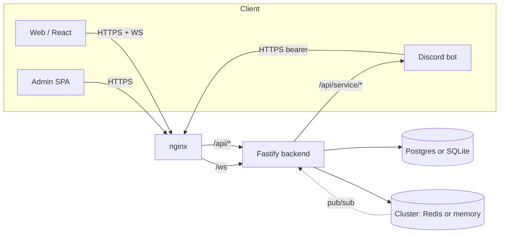

---
tags:
  - digiworld/architecture
aliases:
  - Architecture
  - Stack Overview
  - System Overview
created: 2026-08-01
updated: 2026-08-01
grounded-in:
  - README.md
  - backend/src/server.ts
  - backend/src/cluster/index.ts
  - backend/src/db/adapter.ts
verified-at-commit: 97f72ba
---

# Architecture Overview

> [!info] TL;DR
> Single Fastify process, one `/ws` endpoint, one `DbAdapter` (SQLite or
> Postgres), one `Cluster` (memory or Redis). Two backends per layer let
> the same code run as a zero-dep local demo OR a real horizontally-scaled
> deployment.

## The stack, top-to-bottom

| Layer                  | Choice                                        | File                                                    |
| ---------------------- | --------------------------------------------- | ------------------------------------------------------- |
| HTTP                   | Fastify 5                                     | `backend/src/server.ts`                                 |
| Realtime               | `ws` via `@fastify/websocket`                 | `backend/src/lobby/ws.ts`                               |
| Auth                   | Argon2id + `@fastify/cookie` signed cookies   | `backend/src/auth/session.ts`, `backend/src/auth/routes.ts` |
| Persistence            | `DbAdapter` interface (SQLite ⇔ Postgres)     | `backend/src/db/adapter.ts`, `postgres.ts`, `sqlite.ts` |
| Coordination           | `Cluster` interface (memory ⇔ Redis via ioredis) | `backend/src/cluster/index.ts`                          |
| Validation             | Zod v4 (schemas double as runtime + TS types) | Every `routes.ts`                                       |
| Catalog                | XML via `fast-xml-parser` (edit-safe)         | `backend/src/digimon/xml.ts`                            |

## Layered dependency graph

Two things collapse in single-node mode: nginx is optional (frontend can
hit the backend directly), and `Cluster` runs entirely in-process
(`MemoryCluster`). Every write path stays the same — the abstraction is
picked at boot time by [`config.CLUSTER`](backend/src/config.ts) and
[`config.DATABASE`](backend/src/config.ts).

## Boot sequence

`backend/src/server.ts::main()` orchestrates the boot in this exact order —
each step depends on the previous:

1. **Cluster init** — [`getCluster()`](backend/src/cluster/index.ts:58)
   picks memory or redis, logs `cluster.init`.
2. **Catalog load** — `data/catalog/digimons.xml` parsed via Zod, logs
   `boot.catalog`.
3. **Asset verifier** — walks the loaded XML, re-downloads any missing /
   truncated portrait/dot; logs `boot.verify`.
4. **DB init** — [`getDb()`](backend/src/db/index.ts) instantiates
   `SqliteAdapter` or `PgAdapter`, applies `schema*.sql`, then runs
   [`runMigrations()`](backend/src/db/migrator.ts) over
   `backend/src/db/migrations/NNN_*.sql`. Ledger table `schema_versions`
   prevents double-apply.
5. **Idempotent seeds** — shop items, farm recipes, skills catalog, quests,
   world objects, default onboarding, default game settings.
6. **Plugin registration** — every `Plugin` from `backend/src/*/routes.ts`
   is `app.register(...)`-ed; order matters for hooks but not for routes.
7. **Hydrate active state from cluster** —
   [`hydrateActiveMatches()`](backend/src/battle/routes.ts),
   `hydrateMatchmaking()` — so a fresh node picks up in-flight battles /
   queue from Redis (Memory mode: noop).
8. **`app.listen()`** — logs `server.listening`.
9. **Seasons ticker start** — background 60s tick that advances daily /
   weekly windows; logs `seasons.ticker.started`.

Shutdown is the inverse: `SIGTERM` triggers `server.shutdown.begin`, then
`seasons.ticker.stopped`, WS supersede, `server.shutdown.done`.

## Key design principles

> [!info] Server-authoritative combat
> Clients submit `{ type: 'act', matchId, action }` and receive full
> `BattleView` snapshots. **No client-side damage math.** Cheating is a
> lookup failure at worst. See [[Combat]].

> [!info] Closed-by-default admin bootstrap
> [`ADMIN_BOOTSTRAP=closed`](backend/src/config.ts) is the production
> default. The **first** user to register when it's `open` becomes admin
> (`is_admin=1`); every subsequent register is a regular player. The flag
> prevents a public deploy from being raced by an attacker.

> [!info] Cross-origin cookie contract
> [`backend/src/auth/session.ts::cookieOpts()`](backend/src/auth/session.ts:141)
> switches to `SameSite=None + Secure` when `CORS_ORIGINS` is non-empty —
> required so the standalone admin panel on a separate host actually gets
> the session cookie forwarded on `fetch()`.

> [!info] One SQL string, two dialects
> Every SQL constant uses `?` placeholders. `PgAdapter.query()` runs
> [`toPgPlaceholders()`](backend/src/db/adapter.ts) to rewrite `? … ?` →
> `$1 … $2` at execute time. Portability is validated by
> `test/postgres-portability.mts` — every `SQL_*` constant is `PREPARE`d
> against real Postgres via `@electric-sql/pglite`.

## What crosses nodes (Redis mode)

Same as [[Cluster Coordination Layer]], but summarised:

| Feature      | Cluster keys                                | Route                                     |
| ------------ | ------------------------------------------- | ----------------------------------------- |
| Sessions     | `session:{token}` (KV, TTL)                 | any node → any cookie                     |
| Presence     | `presence:user:{userId}` (KV, TTL 30 s)     | scan every 15 s                           |
| Chat         | `chat:global` (pub/sub) or `wsdeliver:{userId}` | fan-out to online sockets                  |
| Matchmaking  | `mm:queue` (ZSET) + `mm:pair-lock` (lock)   | any node pairs; lock serialises           |
| Battle state | `battle:snap:{matchId}` (KV, TTL 30 min)    | any node serves any action                |
| WS delivery  | `wsdeliver:{userId}` (pub/sub psubscribe)   | events route to the node hosting the WS   |

## Reading recipes

- **Where is `X` defined?** → `codegraph_codegraph_explore X` — returns the
  file + line + call graph, no need to grep.
- **Every place `Y` is called?** — same call, the "Blast radius" section.
- **A whole feature end-to-end** → run codegraph with the surface (route
  name + engine function). Follow the "calls" edges into DB / cluster.

## Related

- [[HTTP Surface]] — every REST endpoint
- [[WebSocket Protocol]] — the `/ws` contract
- [[Cluster Coordination Layer]] — what "cluster" actually means
- [[Database Adapter]] — the two DB backends
- [[Environments]] — how config decides which backend runs where
