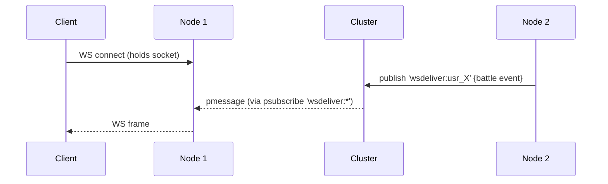

---
tags:
  - digiworld/architecture
aliases:
  - Cluster
  - Cluster Layer
  - Redis Layer
created: 2026-08-01
updated: 2026-08-01
grounded-in:
  - backend/src/cluster/index.ts
  - backend/src/cluster/memory.ts
  - backend/src/cluster/redis.ts
verified-at-commit: 97f72ba
---

# Cluster Coordination Layer

> [!info] TL;DR
> One [`Cluster`](backend/src/cluster/index.ts:26) interface, two backends
> — `MemoryCluster` (in-process EventEmitter + Maps) and `RedisCluster`
> (ioredis with two connections). Every multi-node feature — sessions,
> presence, chat, matchmaking, live battle state, cross-node WS delivery —
> rides these primitives. Picked at boot by `config.CLUSTER`.

## The interface

Verbatim from [`backend/src/cluster/index.ts:26-53`](backend/src/cluster/index.ts):

```typescript
export interface Cluster {
  readonly kind: 'memory' | 'redis';

  get(key: string): Promise<string | null>;
  set(key: string, value: string, ttlSec?: number): Promise<void>;
  del(key: string): Promise<number>;
  keys(pattern: string): Promise<string[]>;
  expire(key: string, ttlSec: number): Promise<boolean>;

  zadd(key: string, score: number, member: string): Promise<void>;
  zrem(key: string, ...members: string[]): Promise<number>;
  zrange(key: string, start: number, stop: number): Promise<ZMember[]>;
  zcard(key: string): Promise<number>;

  publish(channel: string, message: string): Promise<number>;
  subscribe(channel: string, handler: MessageHandler): Promise<Unsubscribe>;
  psubscribe(pattern: string, handler: MessageHandler): Promise<Unsubscribe>;

  lock(key: string, ttlSec: number): Promise<string | null>;
  unlock(key: string, token: string): Promise<boolean>;

  close(): Promise<void>;
}
```

Everything is async so callers write ONE code path against both backends.
[`getCluster()`](backend/src/cluster/index.ts:58) is the singleton factory
— call it, don't reach into the backends.

## MemoryCluster ([`memory.ts`](backend/src/cluster/memory.ts))

Zero-dep single-process implementation. Behavior is identical to Redis for
the subset the rest of the codebase uses.

- **KV** — `Map<string, {value, timer}>` with `setTimeout`-driven expiry.
  Timers get `.unref?.()` so a lingering timer doesn't hold the event loop.
- **Sorted set** — `Map<key, Map<member, score>>`. Sorted on read
  (by score then member), so writes are O(1) and reads O(n log n).
- **Pub/sub** — one `EventEmitter` with `channel:` prefixed events. Pattern
  subscriptions live in a parallel `Map<pattern, Set<handler>>`.
- **Locks** — one `Map<key, {token, timer}>`. Token is 12 random bytes hex.
  Missing token on unlock is a no-op (fencing).
- **`del`** is polymorphic: drops from both KV and ZSET, mirroring Redis's
  cross-type `DEL`.

Glob pattern support ([`memory.ts:181`](backend/src/cluster/memory.ts:181)):

```typescript
function globToRe(pattern: string): RegExp {
  const escaped = pattern.replace(/[.+^${}()|[\]\\]/g, '\\$&')
    .replace(/\*/g, '.*').replace(/\?/g, '.');
  return new RegExp(`^${escaped}$`);
}
```

Only `*` (any run) and `?` (single char) — matches Redis's `KEYS` /
`PSUBSCRIBE` grammar.

## RedisCluster ([`redis.ts`](backend/src/cluster/redis.ts))

Two ioredis connections: `main` for commands, `sub` for
`SUBSCRIBE`/`PSUBSCRIBE` (Redis blocks the connection while in subscriber
mode, so you MUST have a dedicated one).

```typescript
static async create(url: string): Promise<RedisCluster> {
  const main = new Redis(url, { maxRetriesPerRequest: 3, enableAutoPipelining: true });
  const sub = new Redis(url, { maxRetriesPerRequest: 3 });
  await Promise.all([main.ping(), sub.ping()]);
  return new RedisCluster(main, sub);
}
```

`enableAutoPipelining: true` on `main` lets ioredis coalesce concurrent
commands into pipelines automatically — big win when the request handler
issues 5–10 tiny reads per request.

### Distributed lock

`SET key token NX EX ttl` — atomic acquire. Unlock is a Lua CAS
([`redis.ts:19-24`](backend/src/cluster/redis.ts:19)):

```lua
if redis.call('get', KEYS[1]) == ARGV[1] then
  return redis.call('del', KEYS[1])
end
return 0
```

Passing the wrong token deletes NOTHING — prevents A from releasing B's
lock when A's `ttl` has expired and B has since acquired.

### KEYS via SCAN

Naive `KEYS pattern` blocks the whole Redis instance. `RedisCluster.keys`
uses SCAN cursor with `COUNT 200` batches
([`redis.ts:53-62`](backend/src/cluster/redis.ts:53)). O(N) work but paged.

### Pub/sub unsubscribe accounting

`subscribe`/`psubscribe` bump a listener count; the returned `Unsubscribe`
only calls `unsubscribe`/`punsubscribe` when the LAST handler goes away
([`redis.ts:107-125`](backend/src/cluster/redis.ts:107)). This lets multiple
subsystems subscribe to the same channel without stealing each other's
teardowns.

## What lives in the cluster

Full mapping — every key/channel across the codebase:

| Namespace                            | Kind       | TTL          | Owner                                  |
| ------------------------------------ | ---------- | ------------ | -------------------------------------- |
| `session:{token}`                    | KV         | 7 days       | [[Session cookies]]                    |
| `usessions:{userId}`                 | ZSET       | —            | [[Session cookies]] (revoke-all)       |
| `loginfail:user:{name}`              | KV         | 15 min       | [[Session cookies]] (throttle)         |
| `loginfail:ip:{ip}`                  | KV         | 15 min       | [[Session cookies]] (throttle)         |
| `presence:user:{userId}`             | KV         | 30 s         | [`backend/src/lobby/ws.ts`](backend/src/lobby/ws.ts) |
| `chat:global`                        | pub/sub    | —            | [[WebSocket Protocol]] (global chat)   |
| `wsdeliver:{userId}`                 | pub/sub    | —            | [[WebSocket Protocol]] (cross-node WS) |
| `mm:queue`                           | ZSET       | —            | matchmaking (score=queuedAt)           |
| `mm:meta:{userId}`                   | KV         | 5 min        | matchmaking (level bracket state)      |
| `mm:pair-lock`                       | lock       | short        | matchmaking (serialise pair()`)        |
| `battle:snap:{matchId}`              | KV         | 30 min       | [[Combat]] state snapshot              |
| `battle:lock:{matchId}`              | lock       | short        | [[Combat]] serialize mutations         |
| `battle:spectators:{matchId}`        | ZSET       | 30 min       | [[Combat]] spectator list              |
| `reset:{token}`                      | KV         | 15 min       | Password reset one-shot                |
| `oauth:state:{token}`                | KV         | 10 min       | [[OAuth]] CSRF state                   |
| `oauth:pending:{token}`              | KV         | 10 min       | [[OAuth]] hybrid decide                |
| `discordlink:code:{code}`            | KV         | 10 min       | legacy Discord code link               |
| `scene:defaults:updated`             | pub/sub    | —            | [[Scenes]] admin save                  |
| `weather:triggered`                  | pub/sub    | —            | [[Weather System]] admin trigger       |

> [!warning] Redis-specific
> All keys and channel names above work on `MemoryCluster` too — but the
> TTLs execute via `setTimeout` in-process, so a node crash drops everything
> that had TTL running.

## Cross-node WS delivery

The archetype flow ([[WebSocket Protocol]] details it) —



Every node runs a single `psubscribe('wsdeliver:*')`; the receiving node
looks up `userId` in its local socket map and forwards to it (or drops if
the socket isn't there — the user is on a different node).

## Testing

- **In-process** — memory backend is unit-testable without any external
  service.
- **Cross-node** — [`test/cluster-crossnode.mts`](backend/test/cluster-crossnode.mts)
  spins up TWO `RedisCluster` instances against one real Redis and verifies
  KV, ZSET, distributed lock (SET NX EX + Lua CAS), and pub/sub (chat +
  wsdeliver psubscribe) all work cross-instance. **18 / 18 pass** proving
  the substrate every multi-node feature rides on.

```bash
REDIS_URL=redis://127.0.0.1:6400 pnpm --filter @digiworld/backend test:cluster
```

## Design notes

> [!info] Why an interface, not raw ioredis calls?
> The interface is the boundary that lets the codebase run zero-dep locally
> (`CLUSTER=memory`, no Redis needed for `pnpm dev`) AND at scale. Every
> route file, WS handler, and background ticker sees `Cluster`, not Redis.

> [!info] Why not a persistent queue for chat / presence / matchmaking?
> Pub/sub loses messages if no subscriber is listening — that's the whole
> point here. Chat: if you're offline, you don't get the message.
> Presence: reboots reset it, that's correct. Matchmaking: the ZSET IS the
> queue, pub/sub is only for wake-up.

## Related

- [[Architecture Overview]] — where this sits in the stack
- [[WebSocket Protocol]] — every WS message that rides `wsdeliver:*`
- [[Session cookies]] — the primary KV consumer
- [[Combat]] — `battle:snap:*` + `battle:lock:*` details
