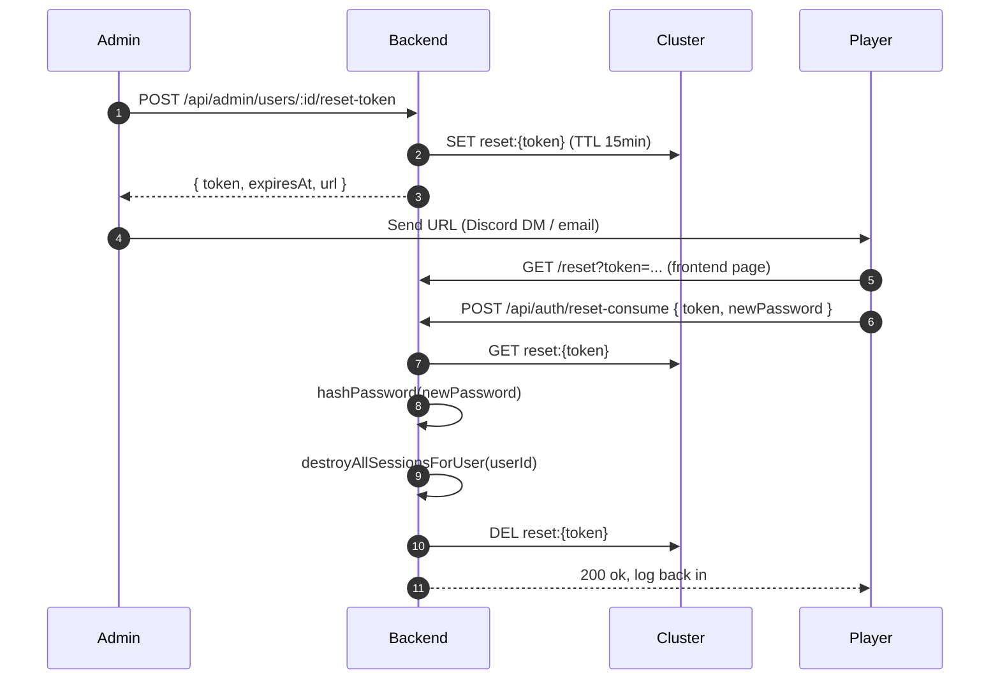

---
tags:
  - digiworld/runbook
  - digiworld/ops
aliases:
  - Password reset
  - Reset password
  - Player forgot password
  - Admin-issued reset token
created: 2026-08-01
updated: 2026-08-01
grounded-in:
  - backend/src/auth/reset.ts
  - backend/src/auth/session.ts
  - backend/src/admin/routes.ts
  - README.md
verified-at-commit: 13dc16b
---

# Reset a regular player's password

> [!info] When to use this
> A regular player forgot their password. They contact the admin (Discord,
> support channel, ticket). Two paths — one the player drives, one the
> admin drives directly.

## Path A — admin-issued reset token (recommended)

The safer path: the player picks their own new password. Admin never sees it.



### Steps

1. **Find the user id.**
   ```sql
   SELECT id, username, display_name FROM users WHERE username = ?;
   ```

2. **Issue the token.**
   ```bash
   curl -sS -X POST -b cookies.txt \
     https://<host>/api/admin/users/<userId>/reset-token
   ```
   Response:
   ```json
   {
     "token": "abcd...",
     "expiresAt": 1785544912345,
     "url": "https://<host>/reset?token=abcd..."
   }
   ```
   The token is stored at `reset:{token}` in the cluster with a 15-minute
   TTL. Single-use.

3. **Deliver the URL to the player.** Discord DM, email, the ticket
   channel — whatever channel the player used to reach you. **Do NOT
   post it in a shared channel** — anyone reading it can reset the
   password before the intended player does.

4. **Player consumes.** They open the URL → the frontend `/reset` page
   asks for a new password → POST `/api/auth/reset-consume`.

5. **Verify.** Player logs in with the new password. Old cookies (if
   any leaked) are dead — `destroyAllSessionsForUser(userId)` walked the
   `usessions:{userId}` ZSET and deleted every `session:{token}`.

### Rate limit

`POST /api/auth/reset-consume` is throttled to **10 attempts / IP / 15
min** ([`auth/reset.ts`](backend/src/auth/reset.ts) — verify the exact
counter). Legitimate use hits this ~zero times; brute-forcers cap out.

## Path B — admin hard reset (fast, admin sees password)

For when the admin needs to reset instantly (support script, urgent
issue, player can't receive the URL). The admin picks the new password
directly.

### Steps

1. **Find the user id** (same as Path A step 1).

2. **Set a new password.**
   ```bash
   curl -sS -X POST -b cookies.txt \
     -H 'content-type: application/json' \
     -d '{"newPassword":"<pick something long random>"}' \
     https://<host>/api/admin/users/<userId>/reset-password
   ```
   Backend argon2-hashes the password, updates `users.password_hash`, and
   calls `destroyAllSessionsForUser(userId)`.

3. **Deliver the password to the player.** Same channel discipline as
   Path A: private only, one-time use, tell them to change it themselves
   after logging in (they can use Path A on their own account? — verify
   — or a future `/api/auth/change-password` when it lands).

## Session invalidation guarantees

Both paths call
[`destroyAllSessionsForUser(userId)`](backend/src/auth/session.ts:123):

```typescript
export async function destroyAllSessionsForUser(userId: string): Promise<void> {
  const cluster = await getCluster();
  const tokens = await cluster.zrange(K_USER_SESSIONS(userId), 0, -1);
  await Promise.all(tokens.map((t) => cluster.del(K_SESSION(t.member))));
  await cluster.del(K_USER_SESSIONS(userId));
}
```

Every `session:{token}` for that user is dropped from the cluster; the
next request carrying an old cookie fails `resolveSession()` at step 2
(cluster GET returns null) → 401. Users on other tabs / devices get
kicked immediately.

## What can go wrong

> [!warning] Token URL leaked in a public channel
> The token becomes anyone's. Fix immediately:
> ```bash
> # Kill the token via the same admin
> redis-cli DEL reset:<token>
> # OR use Path B to force a password the leaker doesn't know
> ```

> [!warning] Player's cookies won't die
> If `CLUSTER=memory` and the backend restarts between reset-consume and
> the player's next request, the session store is fresh — old cookies
> were dropped by the restart itself. Not a problem in practice.
> On `CLUSTER=redis`, `destroyAllSessionsForUser` writes to the cluster
> — every node sees the deletion instantly.

> [!warning] The player is admin
> Admins can only be reset by another admin. If the last admin's
> password is lost → [[Recover a lost admin password]]. Path A + B both
> work on admin accounts (there's no `is_admin=1` guard on the
> reset-token endpoint beyond the caller-is-admin check).

## Rollback

The old password is gone. There is no rollback — the argon2 hash for
the old password is not stored. The player must use the new password
you just issued.

## Related

- [[Session cookies#Password reset (admin-issued token)]] — the exact
  contract
- [[HTTP Surface#Auth — password path]] — the endpoint list
- [[Cluster Coordination Layer]] — `reset:{token}` + `usessions:{userId}`
  + `session:{token}`
- [[Recover a lost admin password]] — no-user-visible-path fallback for
  admins
