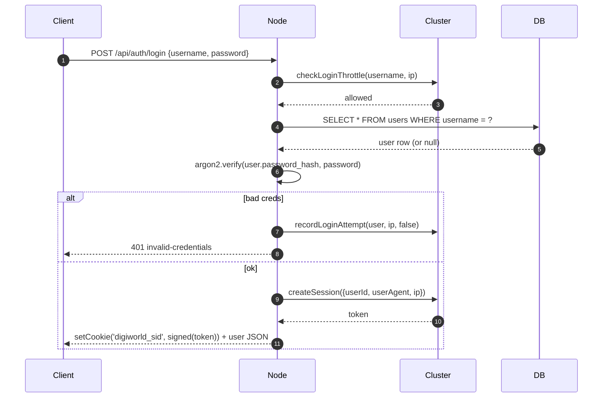
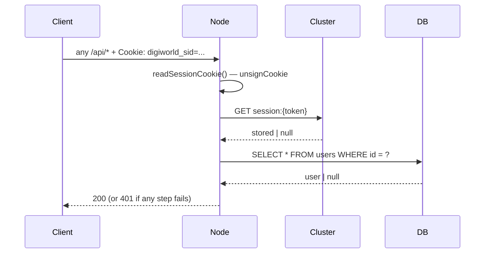

---
tags:
  - digiworld/architecture
  - digiworld/api
aliases:
  - Sessions
  - Cookies
  - Auth Cookies
  - Session Management
created: 2026-08-01
updated: 2026-08-01
grounded-in:
  - backend/src/auth/session.ts
  - backend/src/auth/routes.ts
  - backend/src/auth/password.ts
verified-at-commit: 97f72ba
---

# Session cookies

> [!info] TL;DR
> Argon2id + HttpOnly signed cookies. Session data lives in the cluster
> at `session:{token}` (KV, TTL 7 days by default). The user row is looked
> up from `users` on every `resolveSession()` — a disabled user can't ride
> a stale valid cookie. Cookies flip to `SameSite=None+Secure` automatically
> when `CORS_ORIGINS` is non-empty (so the standalone admin panel across
> hosts can authenticate).

## The cookie

Name: **`digiworld_sid`** ([`session.ts:26`](backend/src/auth/session.ts:26))

Options ([`session.ts:141-159`](backend/src/auth/session.ts:141)):

```typescript
const IS_DEV = config.NODE_ENV === 'development';
const HAS_CORS_ORIGINS = config.CORS_ORIGINS.split(',')
  .map((s) => s.trim())
  .filter((s) => s.length > 0).length > 0;

function cookieOpts(): {
  path: string;
  httpOnly: boolean;
  sameSite: 'lax' | 'none';
  secure: boolean;
  maxAge: number;
  signed: boolean;
} {
  const sameSite: 'lax' | 'none' = HAS_CORS_ORIGINS ? 'none' : 'lax';
  const secure = HAS_CORS_ORIGINS ? true : !IS_DEV;
  return { path: '/', httpOnly: true, sameSite, secure, maxAge: TTL_SEC, signed: true };
}
```

Two modes:

| Mode | `CORS_ORIGINS` | `SameSite` | `Secure`             | Use case                                                    |
| ---- | -------------- | ---------- | -------------------- | ----------------------------------------------------------- |
| Monolith | empty       | `Lax`      | `NODE_ENV=production` only | Single origin — player frontend + backend on same host      |
| Cross-origin | non-empty | `None`     | ALWAYS               | Standalone admin panel on `admin.example.com` fetching `example.com` |

> [!warning] `SameSite=None` requires `Secure`
> The spec rejects the combo `SameSite=None` without `Secure`. That's why
> `Secure` is always forced when cross-origin is on — even in dev.
> The admin panel bypasses this locally via the Vite proxy in
> [`admin/vite.config.ts`](admin/vite.config.ts) which rewrites
> `Set-Cookie` (strips `Secure`, coerces `SameSite=None` → `Lax`) so a
> production cookie is accepted on plain HTTP dev.

`signed: true` — the cookie is signed with `SESSION_SECRET` via
`@fastify/cookie`. Every read
([`session.ts:169-175`](backend/src/auth/session.ts:169)) calls
`req.unsignCookie(rawString)`; invalid signature → `null`. Tamper-proof
without opening the DB.

## Session storage in the cluster

Two keys per session ([`session.ts:32-33`](backend/src/auth/session.ts:32)):

```typescript
const K_SESSION = (token: string): string => `session:${token}`;
const K_USER_SESSIONS = (userId: string): string => `usessions:${userId}`;
```

- **`session:{token}`** — KV, TTL = `SESSION_TTL_HOURS * 60 * 60` (default
  7 days, configurable via env). Value:
  ```typescript
  type StoredSession = {
    userId: string;
    createdAt: number;
    expiresAt: number;
    userAgent: string | null;
    ip: string | null;
  };
  ```
- **`usessions:{userId}`** — ZSET, member = token, score = `expiresAt`.
  Powers `destroyAllSessionsForUser()` on password reset.

## The four operations

### `createSession({userId, userAgent?, ip?})`

Token = 64 hex chars from
[`newSessionToken()`](backend/src/util/ids.ts). Store both keys, look up
the user row (throws if the id doesn't resolve — belt-and-braces against
mis-callers), return `{ token, user, expiresAt }`.
See [`session.ts:63-80`](backend/src/auth/session.ts:63).

### `resolveSession(token?)`

Every authenticated route calls this. Steps
([`session.ts:82-109`](backend/src/auth/session.ts:82)):

1. **Reject on length ≠ 64** — cheap prefilter.
2. **`GET session:{token}`** — miss → null.
3. **Parse JSON** — malformed → `DEL session:{token}` + null. Corrupted
   entries self-heal.
4. **Expiry check** — past TTL → `DEL` both keys + null.
5. **User row lookup** — missing OR `disabled=1` → `DEL session:{token}` +
   null. A disabled user can't ride an unexpired cookie.
6. **Sliding renewal** — if remaining life < `TTL/2`, extend TTL to full
   again on both `session:{token}` and the ZSET.
7. Return `{ token, user, expiresAt }`.

### `destroySession(token)`

Read the stored session to find `userId`, ZREM the token, DEL the KV entry.
Called on `POST /api/auth/logout`
([`session.ts:111-121`](backend/src/auth/session.ts:111)).

### `destroyAllSessionsForUser(userId)`

ZRANGE the whole `usessions:{userId}` set, DEL every `session:{token}`
therein, then DEL the ZSET itself. Called on:

- `POST /api/auth/reset-consume` — password reset via admin-issued token
- `POST /api/admin/users/:id/reset-password` — admin hard reset
- OAuth unlink triggers this on the paired identity when applicable

See [`session.ts:123-128`](backend/src/auth/session.ts:123). This is what
guarantees a leaked cookie is dead the moment the password rotates.

## Login throttling

Two counter keys with TTL 15 min
([`session.ts:181-183`](backend/src/auth/session.ts:181)):

```typescript
const WINDOW_SEC = 15 * 60;
const MAX_ATTEMPTS_PER_USER = 8;
const MAX_ATTEMPTS_PER_IP = 20;
```

`recordLoginAttempt(username, ip, success)` only increments on failure —
successful logins reset the pressure. `checkLoginThrottle(username, ip)`
returns `{ allowed: false, reason, retryInSec }` when either counter is at
the max.

The counters live in the cluster (`loginfail:user:{name}`,
`loginfail:ip:{ip}`), so multi-node deployments share the throttle. A
brute-forcer can't hop nodes to bypass it.

## Password hashing — [`auth/password.ts`](backend/src/auth/password.ts)

`argon2id` via the `argon2` npm package. Every hash is unique per user
(salt is baked in the encoded string). OWASP-recommended parameters — see
the file for the exact `argon2.argon2id` type + memory/time cost.

Placeholder hashes for OAuth-only users: `argon2id(randomBytes(48))`. The
plaintext is discarded — no password sign-in can ever succeed against it.

## Full auth flow (password path)



Every subsequent request:



## First-user-is-admin bootstrap

- **`ADMIN_BOOTSTRAP=closed`** (default) — `POST /api/auth/register`
  returns `403 registration-closed`.
- **`ADMIN_BOOTSTRAP=open`** — the **first** `SELECT COUNT(*) FROM users`
  == 0 registration flags `is_admin=1`; every subsequent one is a regular
  player.

Bootstrap procedure:

1. Set `ADMIN_BOOTSTRAP=open`, restart.
2. Register the admin through the UI.
3. Set `ADMIN_BOOTSTRAP=closed`, restart.

Public deploys should keep it closed at all times except the brief boot-
strap window; an attacker's HEAD request on the register URL can otherwise
race the intended admin.

## Password reset (admin-issued token)

`POST /api/admin/users/:id/reset-token` issues a 15-minute cluster token
stored at `reset:{token}`. User consumes at `/reset?token=…` which POSTs
`/api/auth/reset-consume { token, newPassword }`:

1. Look up the token, verify not expired, extract `userId`.
2. Hash the new password.
3. **`destroyAllSessionsForUser(userId)`** — every live cookie for that
   user is now dead.
4. UPDATE `users.password_hash`.
5. DEL `reset:{token}` — single-use.

Rate-limited to **10 attempts / IP / 15 min** by the same throttle path.

## Anti-patterns

> [!warning] Never write to `users.password_hash` outside `password.ts`
> Every write path goes through `hashPassword()` so the argon2 params stay
> centrally tunable. Bypassing it silently degrades every fresh hash.

> [!warning] Never read the cookie in JS-accessible contexts
> `HttpOnly=true` is not a suggestion. The whole point is that a stored-XSS
> vector can't exfiltrate the session token. If a frontend component thinks
> it needs the token, it's wrong — call `/api/auth/me` instead.

## Related

- [[HTTP Surface#Auth — password path]]
- [[OAuth]] — the OAuth cookie contract (identical, on top of a separate
  identity linkage)
- [[Cluster Coordination Layer]] — where `session:*`, `usessions:*`,
  `loginfail:*` live
- [[Architecture Overview#Cross-origin cookie contract]]
