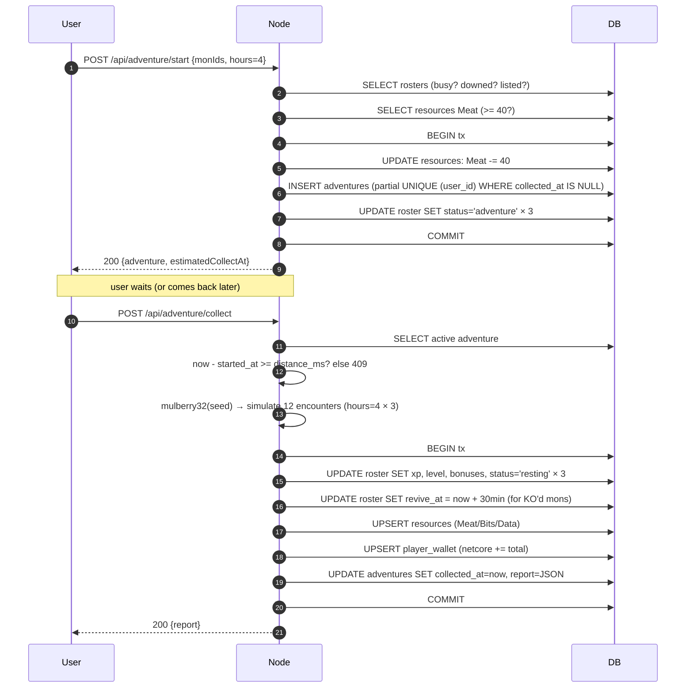

---
tags:
  - digiworld/system
  - digiworld/api
aliases:
  - Adventure
  - Idle Expeditions
  - Provisions
  - Idle Content
created: 2026-08-01
updated: 2026-08-01
grounded-in:
  - backend/src/adventure/engine.ts
  - backend/src/adventure/routes.ts
  - backend/src/world/pve-battle.ts
verified-at-commit: 4e70621
---

# Adventure

> [!info] TL;DR
> Idle 3-mon expeditions. Pick 3 mons + 1–8 hours, pay a **progressive
> Meat cost** (per-hour rate grows with duration; 1h=10, 8h=220).
> Up to `ADVENTURE_MAX_ACTIVE` (3) teams run concurrently. Server runs
> `hours × 3` encounters on a **seeded PRNG** so the report is fully
> reproducible from `(seed, distance_ms, party snapshot)`. Rewards:
> Meat / Bits / Data / NetCore / XP + **found-digimon data** — every
> encounter rolls a real wild species, listed in the report's rewards
> and registered in the Digidex (`player_species_data`). 30 % chance a
> defeated mon gets KO'd (30-min revive timer).

## Constants — [`adventure/engine.ts`](backend/src/adventure/engine.ts)

Verbatim from [`engine.ts`](backend/src/adventure/engine.ts):

```typescript
const MS_PER_HOUR = 3_600_000;
export const ADVENTURE_MIN_HOURS = 1;
export const ADVENTURE_MAX_HOURS = 8;
export const MEAT_PER_HOUR = 10;             // base hourly rate
export const MEAT_ESCALATION_PER_HOUR = 5;   // +5 to hourly rate per extra hour
export const ADVENTURE_MAX_ACTIVE = 3;       // concurrent teams per user
export const MEAT_RESOURCE = 'Meat';
const ENCOUNTERS_PER_HOUR = 3;
const KO_CHANCE_ON_LOSS = 0.3;
const KO_REVIVE_MS = 30 * 60 * 1000;
const PARTY_SIZE = 3;
const SPECIES_PERCENT_PER_ENCOUNTER = 4;     // Digidex percent fill per found encounter
```

Semantics:

- **1–8 hours** — the tunable dial. Longer = more encounters + more
  reward, more meat.
- **Progressive meat cost** — hour *i* costs `MEAT_PER_HOUR +
  MEAT_ESCALATION_PER_HOUR × (i-1)` (sum of the arithmetic progression,
  see `meatCostForHours()`): 1h=10, 2h=25, 3h=45, 4h=70, 5h=100, 6h=135,
  7h=175, 8h=220. Deducted upfront from the `Meat` resource in one atomic
  transaction. `hours=8` costs 220 meat (was a flat 80 pre-escalation).
- **3 teams max** — `ADVENTURE_MAX_ACTIVE` concurrent expeditions;
  enforced by a per-slot partial UNIQUE (below).
- **3 encounters per hour** — so `hours=8` produces 24 encounters.
- **30 % KO chance on loss** — matches [[Combat]] pve-battle semantics.
- **30-minute revive** — a KO'd mon has `revive_at = now + 30min`
  written to their roster row.
- **Party size = 3** — strict; not tunable.

## The multi-team constraint

Table: `adventures(id, user_id, mon_ids, distance_ms, meat_spent,
started_at, collected_at, seed, report, slot, created_at)`.

The critical index (created by migration 107):

```sql
-- Partial UNIQUE (user_id, slot) WHERE collected_at IS NULL
-- Enforces at most ADVENTURE_MAX_ACTIVE (3) active expeditions per user,
-- race-safe: concurrent starts claiming the same slot lose the UNIQUE.
```

An in-flight adventure row has `collected_at IS NULL` and a `slot` in
`0..ADVENTURE_MAX_ACTIVE-1` — the engine assigns the **smallest free
slot** (count check + in-tx slot select). Historical rows keep their old
slot and are excluded from the index.

The partial index is what makes the "max teams" rule race-safe at the
DB level — `POST /api/adventure/start` checks the active count first
and returns `409 active-adventures-limit`; a rare slot-claim race
between two concurrent starts is caught by the UNIQUE and mapped to the
same error (the tx rolls back, meat refunded).

## Storage model (header comment verbatim)

```
adventures                  = one row per expedition. Partial UNIQUE on
                              (user_id, slot) WHERE collected_at IS NULL
                              enforces at most ADVENTURE_MAX_ACTIVE
                              concurrent expeditions per user.
player_roster.status        = 'adventure' while a mon is on a run;
                              flipped back to 'resting' on collect.
resources[Meat]             is decremented at start with the
                              progressive meatCostForHours() rate.
player_species_data         +1 kill percent-fill per found encounter,
                              so adventure encounters register in the Digidex.
```

## Determinism (reproducible reports)

```
seed is chosen at start (crypto-random 32-bit). collectAdventure
runs a seeded mulberry32 PRNG so the report is fully reproducible
from (seed, distance_ms, party snapshot). Re-collect is idempotent
because collected_at + report_json are written in the same tx.
```

Practical consequence: the SAME adventure with the SAME seed always
produces the SAME report. Support debugging is straightforward — copy
`(seed, mon_ids, distance_ms)` from the DB and replay.

## HTTP surface — [`adventure/routes.ts`](backend/src/adventure/routes.ts)

Three endpoints, all auth-gated.

| Method | Path                            | Body / Response                                                                    |
| ------ | ------------------------------- | ---------------------------------------------------------------------------------- |
| GET    | `/api/adventure`                | All active teams + last-collected + meat + config                             |
| POST   | `/api/adventure/start`          | `{ monIds: string[3], hours: 1..8 }` → active adventure + estimated collect time    |
| POST   | `/api/adventure/collect`        | `{ adventureId? }` → full `AdventureReport` with encounters + rewards + XP + KOs (omit `adventureId` when only one team is active) |

Zod on start ([`routes.ts:22-25`](backend/src/adventure/routes.ts:22)):

```typescript
const StartSchema = z.object({
  monIds: z.array(z.string().min(1)).length(3),
  hours: z.number().int().min(ADVENTURE_MIN_HOURS).max(ADVENTURE_MAX_HOURS),
});
```

### Start errors

```typescript
export type StartAdventureError =
  | 'mon-not-found'                    // 404
  | 'invalid-party-size'               // 400  (not 3)
  | 'duplicate-mon'                    // 400  (same mon twice)
  | 'invalid-hours'                    // 400  (out of range)
  | 'mon-busy'                         // 409  (already on adventure / in battle)
  | 'mon-downed'                       // 409  (KO'd, waiting on revive_at)
  | 'mon-listed'                       // 409  (listed on the digimon market)
  | 'active-adventures-limit'          // 409  (ADVENTURE_MAX_ACTIVE teams already in the field)
  | 'insufficient-meat';               // 402
```

### Collect errors

```typescript
export type CollectAdventureError =
  | 'no-adventure'    // 404
  | 'not-ready';      // 409  (still before started_at + distance_ms)
```

## The lifecycle



## Report shape

```typescript
type AdventureReport = {
  encounters: AdventureEncounter[];
  wins: number;
  losses: number;
  xpDeltas: AdventureXpDelta[];        // per-mon before/after
  totals: {
    meat: number;
    bits: number;
    data: number;
    netcore: number;
  };
  koMonId: string | null;              // if a mon KO'd this run
  foundDigimons: AdventureFoundDigimon[]; // unique wild species seen
};

type AdventureEncounter = {
  index: number;
  wildLevel: number;
  wildCatalogId: string;               // species rolled from the catalog
  wildName: string;
  wildStage: Stage;
  wildElement: Element;
  outcome: 'win' | 'loss';
  meat: number; bits: number; data: number; netcore: number;
  xpPerMon: number;
  koMonId: string | null;              // per-encounter KO
};

type AdventureFoundDigimon = {
  catalogId: string;
  name: string;
  stage: Stage;
  element: Element;
  count: number;                       // encounters that rolled this species
};
```

Aggregated wins/losses + per-encounter breakdown for the client to
replay dramatically ("You defeated 8, lost 4. RockyMon fell in
encounter 6 …"). `foundDigimons` is the "digimons encontrados" reward
list — unique species in first-seen order; the Report panel renders
them as sprite chips under the loot.

## Wild PvE integration

[`world/pve-battle.ts`](backend/src/world/pve-battle.ts) is the shared
substrate for BOTH world-map PvE encounters AND adventure encounters —
same damage math, same MMR-less outcome resolution, same KO semantics
(as of the dungeon removal it is stubbed; adventures carry the PvE
logic).

Adventure encounters DON'T grant MMR (they're not PvP). They DO grant
XP scaled by opponent level differential + honor the global `xpRate`
setting ([`awardXp`](backend/src/progression/xp.ts)).

Every encounter rolls a **real wild species** (`pickWildDigimon`): the
catalog pool is stage-gated by expedition length (1–2h → up to Rookie,
3–4h → Champion, 5–6h → Ultimate, 7–8h → Mega), weighted so Rookies
dominate and higher stages are rarer. On collect, each species found is
upserted into `player_species_data` (`kills + 1`, `percent + 4` per
encounter, capped at 100) — the same table the Digidex registers from,
so adventures progress the bestiary.

## Meat — the choke point

Expeditions burn the **`Meat` resource** — the same pool the Farm
produces (per-building generation + daily check-ins) and the Nursery
feeds from. Cost is **progressive**: `meatCostForHours(hours)` sums an
arithmetic progression so each extra hour costs more meat per hour
(1h=10, 2h=25, 3h=45, 4h=70, 5h=100, 6h=135, 7h=175, 8h=220). Meat is
also hunted IN the field: every winning encounter banks
`1 + hours + rng*4` meat back, so a run partially feeds its own
return trip. Net positive over time, but you can't chain expeditions
endlessly without producing meat.

Deduction is atomic-guarded ([`engine.ts`](backend/src/adventure/engine.ts)):

```sql
UPDATE resources
   SET amount = amount - ?, updated_at = ?
 WHERE user_id = ? AND resource = 'Meat' AND amount >= ?
```

Same guarded-UPDATE pattern as [[Farm#Upgrade math]] — if
`amount < needed`, `changes = 0` → 402 `insufficient-meat`.

## Global multipliers

- **`xpRate`** — global admin dial. Applies to adventure XP the same way
  it applies to combat XP. See [[Combat]] + [[HTTP Surface#Game
  settings + Admin ops]].
- **`damageRate`** — used at pve-battle level, so an admin bump affects
  adventures too.

## What can go wrong

> [!warning] Meat deducted, adventure INSERT fails
> The atomic transaction covers both the deduction AND the insert. If
> either step throws, the tx ROLLBACKs. Meat is only spent when
> the row lands.

> [!warning] Party changes mid-adventure
> The party is snapshotted into `mon_ids` at start. Selling / renaming
> / evolving a mon during the adventure is fine — the collect will apply
> XP + KO writes to whatever id is in `mon_ids`, even if the mon's
> level / catalog changed in the meantime. **Deleting the mon**
> (through admin route) would leave a dangling `mon_ids` — verify the
> collect handles this gracefully.

> [!warning] KO but revive_at behind clock
> The 30-min revive is written on collect (not per-encounter). If the
> player collects hours after the adventure ended, the effective revive
> was `collected_at + 30min` — the mon is unavailable for another 30 min
> from now, not from encounter time. Intentional; matches PvE loss
> semantics.

> [!warning] Collect at exactly `started_at + distance_ms`
> Boundary condition — the check is `now - started_at >= distance_ms`,
> so equality is READY. No edge case.

## What's NOT here (yet)

- **Rare / boss encounters** — every encounter is a random pool draw.
  No "epic" encounters that only fire ~1 % of the time.
- **Adventure zones / biomes** — the pool is currently one blob (verify
  in [`engine.ts`](backend/src/adventure/engine.ts)). A future refinement
  would gate by biome / player-picked zone.
- **Group adventures** — one user's 3 mons, always. No co-op.
- **Cancel mid-adventure** — the mons are locked in until collect.
  Cancellation would need a refund policy on meat.

## Related

- [[Currency]] — Meat in / NetCore out
- [[Combat]] — the pve-battle substrate this rides on
- [[Farm]] — where Meat gets INTO the economy
- [[HTTP Surface]] — grep for `/api/adventure`
- [[Farm#Player wallet vs resources]] — the wallet split
  (Meat/Bits/Data vs NetCore) that adventures pay into
