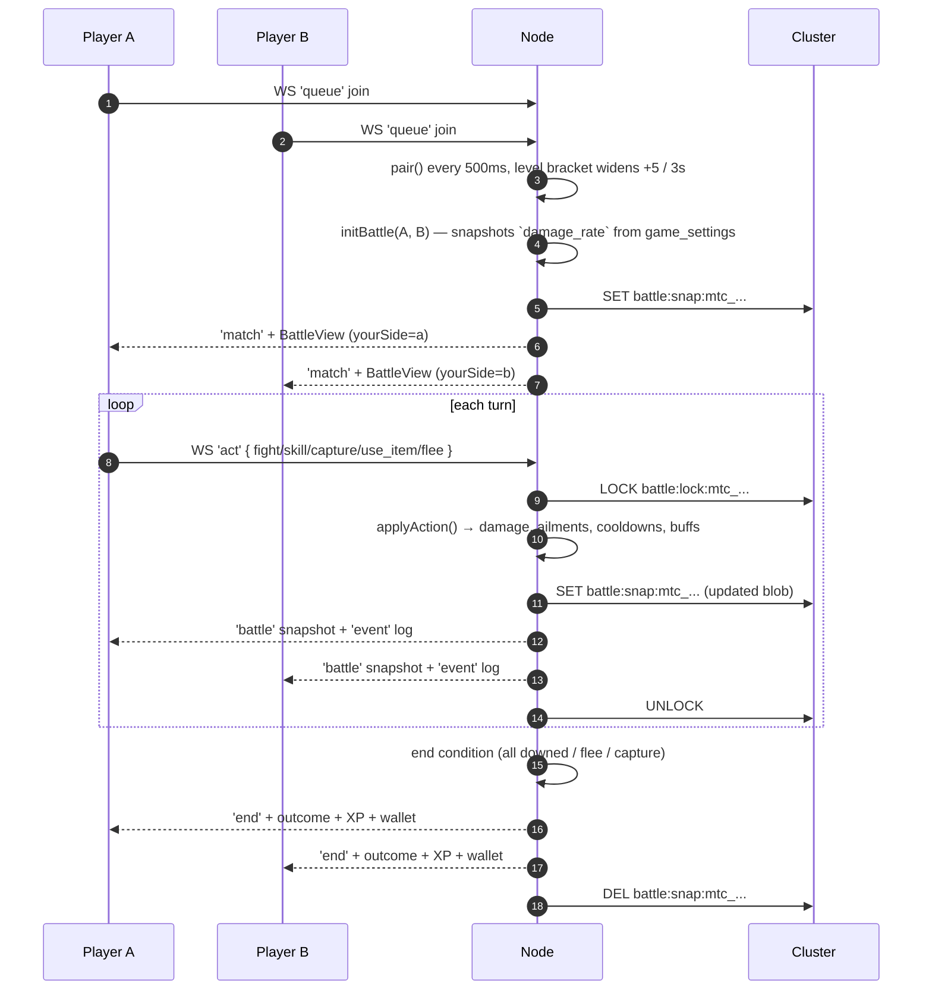

---
tags:
  - digiworld/system
  - digiworld/api
aliases:
  - Battle
  - Battle System
  - Combat System
created: 2026-08-01
updated: 2026-08-01
grounded-in:
  - shared/src/battle.ts
  - backend/src/battle/engine.ts
  - backend/src/battle/routes.ts
  - backend/src/battle/spectate.ts
verified-at-commit: 97f72ba
---

# Combat

> [!info] TL;DR
> Server-authoritative 3v3 turn-based. Clients send `{ type: 'act', matchId,
> action }`, backend runs [`applyAction()`](backend/src/battle/engine.ts),
> mutation persists to `battle:snap:{matchId}` in the cluster, both sides
> receive a full [`BattleView`](shared/src/battle.ts:161) snapshot + fine-
> grained [`BattleEvent[]`](shared/src/battle.ts:78) for animation.
> **Zero client-side damage math** — cheating is a lookup failure at worst.

## Data model — `shared/src/battle.ts`

### Sides + slots

```typescript
export type BattleSide = 'a' | 'b';
export type SlotIndex = 0 | 1 | 2 | 3 | 4 | 5;
export type UnitId = `${BattleSide}:${SlotIndex}`;

export const MAX_PARTY_SIZE = 3;
export const MAX_WILD_PARTY_SIZE = 6;

export type BattleMode = 'pvp' | 'pve';
```

`SlotIndex` goes up to 5 because PvE wild parties can have up to 6 monsters
(`MAX_WILD_PARTY_SIZE`) — see [[Dungeons]] and [[Adventure]]. PvP is capped at
3 (`MAX_PARTY_SIZE`).

### Unit

```typescript
export type BattleUnit = {
  id: UnitId;
  side: BattleSide;
  slot: SlotIndex;
  templateId: string;
  name: string;
  element: Element;
  attribute: Attribute;
  resistances?: ResistanceMap;
  level: number;
  hp: number;      hpMax: number;
  en: number;      enMax: number;
  atk: number;     def: number;
  spd: number;     int: number;
  skills: Skill[];
  ailments: Ailmented[];
  activeBuffs?: ActiveBuff[];
  evade?: number;
  skillCooldowns?: Record<string, number>;
  wildInfo?: WildInfo;
};
```

`activeBuffs` and `skillCooldowns` are optional for backward compat with
pre-P1 `battle:snap:*` blobs; engine defaults to `[]` / `{}` when absent.

### Actions

```typescript
export type Action =
  | { type: 'fight'; unitId: UnitId; targetId: UnitId }
  | { type: 'skill'; unitId: UnitId; skillId: string; targetId: UnitId }
  | { type: 'capture'; unitId: UnitId; targetId: UnitId }
  | { type: 'use_item'; unitId: UnitId; targetId: UnitId; itemId: string }
  | { type: 'flee' };
```

> [!warning] Server resolves item effects
> The wire-type `use_item` action carries only `itemId`. The server looks
> up the `shop_item`, decodes payload, and passes the resolved `ItemEffect`
> to `applyAction` via `ApplyContext.itemEffect`. **Clients NEVER supply
> the effect** — trust boundary lives in `world/pve-battle`.

Item effects ([`shared/src/battle.ts:59`](shared/src/battle.ts:59)):

```typescript
export type ItemEffect =
  | { kind: 'heal_pct'; pct: number }
  | { kind: 'en_pct'; pct: number }
  | { kind: 'clear_ailments' }
  | { kind: 'atk_bonus'; amount: number }
  | { kind: 'def_bonus'; amount: number }
  | { kind: 'revive' };
```

### Constants (verbatim, [`shared/src/battle.ts:181-196`](shared/src/battle.ts:181))

```typescript
export const MISS_CHANCE = 0.08;
export const CRIT_CHANCE = 0.15;
export const CRIT_MULT = 1.6;
export const CHAIN_MULT = 1.4;
export const AILMENT_TURNS_DEFAULT = 3;
export const EN_REGEN_PER_TURN = 6;

export const BASE_HIT_PCT = 92;
export const MIN_HIT_PCT = 20;
export const MAX_HIT_PCT = 98;
export const BLIND_ACCURACY_PENALTY = 30;

export const CAPTURE_BASE = 0.15;
export const CAPTURE_HP_FACTOR = 0.75;
export const CAPTURE_RARE_MULT = 0.5;
export const CAPTURE_MAX = 0.95;

export const CONTROL_AILMENTS: readonly Ailment[] =
  ['freeze', 'stun', 'sleep', 'petrify', 'confusion', 'charm'];
```

## Damage math (per README, engine verifies)

```
damage = (atk * 0.4 + skill.power)
       * crit          // 1.6 when crit fires (15% chance), else 1.0
       * affinity      // 1.5 weak / 1.0 neutral / 0.5 resist / 0 immune
       * defMitigation // f(def)
       * randomJitter  // 0.9 – 1.1
       * damageRate    // frozen per-match multiplier, admin-tunable
```

- **Miss chance** — 8 % base, modified by evade and blind ailment
  (`BLIND_ACCURACY_PENALTY` = 30 % accuracy penalty)
- **Crit** — 15 % chance, ×1.6 multiplier
- **Chain** — subsequent hits on the same target within a turn
  (`CHAIN_MULT` = 1.4× on `wasHit`)
- **Element affinity** — `fire > nature > water > fire` (chain), `electric >
  water`. Weak = ×1.5, resist = ×0.5, immune = ×0. Full element table in
  [`shared/src/digimon.ts`](shared/src/digimon.ts).

## Ailments

Two families:

**Damage-over-time** (tick every turn, `AILMENT_TURNS_DEFAULT` = 3 turns):
- `burn` — 6 % hpMax per turn
- `poison` — 5 % hpMax per turn

**Control** ([`CONTROL_AILMENTS`](shared/src/battle.ts:198)):
- `freeze`, `stun`, `sleep`, `petrify`, `confusion`, `charm` — actor skips
  the turn. `turn-skip` event with `reason: 'defeated' | 'locked'`.

`weaken` reduces effective defense — targeted, not turn-skipping.

## Battle lifecycle



## Match end + wallet grants (per README)

| Outcome                | NetCore | XP scale                                    |
| ---------------------- | ------- | ------------------------------------------- |
| Win (`win_a`/`win_b`)  | **60**  | Scaled by opponent level differential       |
| Draw                   | **25**  | Reduced share                                |
| Loss (or `fled_*`)     | **15**  | Consolation, small                          |
| Capture (`captured_a`) | see PvE | Captured mon joins player's roster          |

Zero Credits are ever granted from gameplay — see [[Currency]] for why.

## `damageRate` freezing

[`initBattle`](backend/src/battle/routes.ts) reads
`game_settings.damage_rate` **at match start** and freezes it into
`battle.damageRate`. Every `applyAction` uses that per-match value; admin
sliders don't disturb in-flight matches. The field is optional on the
persisted blob for backward compat — `applyAction` falls back to `1.0`
when absent ([`shared/src/battle.ts:136-140`](shared/src/battle.ts:136)):

> Global damage multiplier fetched from `game_settings.damage_rate` at
> match init and frozen for the match's lifetime. Optional for backward
> compat with in-flight `battle:snap:*` blobs from before the field was
> added — `applyAction` falls back to `1.0` when absent.

## Cross-node persistence

Every mutation upserts the FULL `Battle` JSON blob to
`battle:snap:{matchId}` in the cluster. On boot,
[`hydrateActiveMatches()`](backend/src/battle/routes.ts) reports the count.

- **`CLUSTER=redis`** — any node in the deployment can serve any player's
  actions. Mutations serialize via `battle:lock:{matchId}` (SET NX EX + Lua
  CAS release).
- **`CLUSTER=memory`** — same code path, but snapshots die with the node.

## Battle events (fine-grained log)

Every `applyAction` returns a **snapshot** (`BattleView`) AND an **event
list** (`BattleEvent[]`) for animation. Events include:

- `action` — the actor + target + damage + cue (`crit`/`miss`/`resist`/
  `weak`/`immune`/`chain`/`attr-advantage`/`capture-*`/`item-*`)
- `ailment-tick`, `ailment-expired`
- `unit-down`
- `turn`, `turn-skip` (with reason `defeated | locked`)
- `round-start` — carries initiative order snapshot
- `end` — outcome, winner, `pvpMmr` before/after/delta

The UI plays events in sequence; the snapshot is the recovery state if a
client falls behind.

## Spectator mode

`GET /api/battle/spectate/:matchId` returns the current `BattleView`
(side-A perspective, enemy stats redacted) + `spectatorCount`. WS
`{type:'spectate', matchId, join:true}` subscribes the socket to live
`event`/`battle`/`end` fanout.

- Up to **20 spectators per match**
- Tracked in `battle:spectators:{matchId}` (ZSET, TTL 30 min)
- Cleaned up automatically on match end

## Testing

- **[`test/battle-combo.mts`](backend/test/battle-combo.mts)** — 47 checks
  on the combat engine. **3 pre-existing failures** from a balance rebalance
  (commit `3b37a23`) where test expectations drifted; NOT gating.
- **`test:cluster-crossnode`** — proves battle state cross-node consistency
  in Redis mode.

## Related

- [[Architecture Overview]]
- [[WebSocket Protocol]] — `act`, `battle`, `event`, `end`, `spectate`
- [[Cluster Coordination Layer]] — `battle:snap:*` + `battle:lock:*`
- [[Session cookies]] — authenticates the WS carrying `act`
- [[Currency]] — post-match wallet grants
