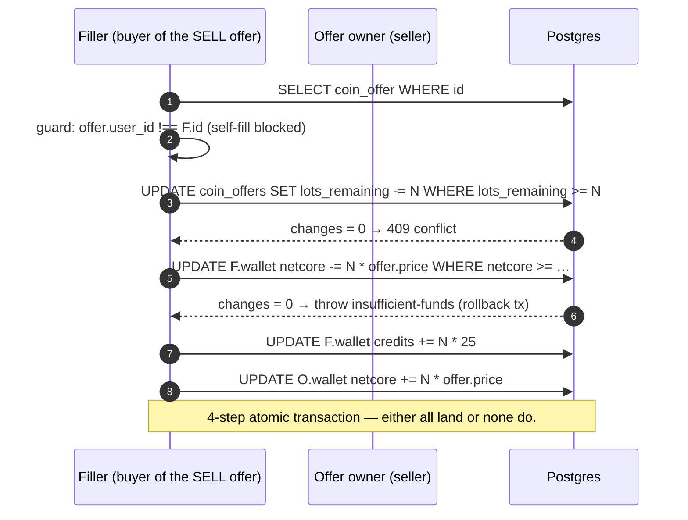

---
tags:
  - digiworld/system
aliases:
  - Economy
  - Wallet
  - Coin Market
  - NetCore
  - Credits
created: 2026-08-01
updated: 2026-08-01
grounded-in:
  - backend/src/market/coins.ts
  - backend/src/service/routes.ts
  - backend/src/db/migrations/042_dual_currency_columns.sql
  - backend/src/db/migrations/043_dual_currency_tables.pg.sql
  - backend/src/db/migrations/044_market_listings_netcore.sql
  - README.md
verified-at-commit: 97f72ba
---

# Currency

> [!info] TL;DR
> Two currencies, deliberately separated so that real-money value CAN NEVER
> be minted by gameplay. **NetCore** (NTC) is grinded — battle rewards,
> quests, dailies. **Credits** (CR) is bought — the Discord bot's PIX flow
> is the only mint path. Both live in `player_wallet(user_id, credits,
> netcore, updated_at)`. Players trade the two on the [[#Coin market]] at
> a player-set price, Tibia-Coin style.

## The two-currency table

|                        | **NetCore (NTC)**                                                        | **Credits (CR)**                                        |
| ---------------------- | ------------------------------------------------------------------------ | ------------------------------------------------------- |
| Role                   | earned / grind                                                           | premium / paid                                          |
| Sources                | PvP match end, PvE wins, adventure encounters, quest rewards, daily      | real-money PIX purchase via the Discord bot ONLY        |
| Spent on               | Digimon Market listings, NetCore-priced shop goods                       | Credit-priced premium shop goods                        |
| Transferable? (player↔player) | yes, on the [[#Coin market]]                                       | ONLY via the [[#Coin market]]                           |

**Nothing in gameplay grants Credits.** Every loot, quest, daily, and
battle path grants NetCore. Credits enter the economy exclusively through
`POST /api/service/wallet-credit`
([`backend/src/service/routes.ts`](backend/src/service/routes.ts)) — the
bearer-authenticated M2M endpoint the Discord bot calls after MercadoPago
settles a PIX payment. Idempotency-ledgered in `service_grant_log`.

> [!warning] Trust boundary
> `POST /api/service/wallet-credit` is gated by `SERVICE_TOKEN_DISCORD`.
> Missing / wrong token → 401. The Discord bot proves it paid; the game
> backend proves it granted. If either half is compromised, credits leak
> — but each half is auditable independently.

## Coin market ([`backend/src/market/coins.ts`](backend/src/market/coins.ts))

Players trade the two currencies with each other, Tibia-Coin style. There
is **no server-fixed exchange rate** — the price is set by the poster of
each offer.

### The lot

```typescript
const CREDITS_PER_LOT = 25;
```

Every offer is denominated in **lots of 25 Credits** at a player-chosen
`pricePerLot` (in NetCore). The lot is the atomic granularity — you can
buy 1 lot (25 CR) or 100 lots (2500 CR), but never 0.5 lots.

### Offer shape

```sql
CREATE TABLE coin_offers (
  id             TEXT PRIMARY KEY,
  user_id        TEXT NOT NULL,
  side           TEXT CHECK (side IN ('sell', 'buy')),
  lots_total     INTEGER NOT NULL,
  lots_remaining INTEGER NOT NULL,
  price_per_lot  INTEGER NOT NULL,
  created_at     BIGINT NOT NULL,
  cancelled_at   BIGINT,
  completed_at   BIGINT
);
```

- **Sell** — poster offers CR, asks NTC
- **Buy** — poster offers NTC, asks CR
- **`lots_remaining`** — decremented on fills; when zero, `completed_at`
  is set

### Post-time escrow

The asset LEAVES the wallet at post time, otherwise the same balance
could be spent twice ([`coins.ts:102-124`](backend/src/market/coins.ts:102)):

```typescript
if (side === 'sell') {
  const creditsToEscrow = lots * CREDITS_PER_LOT;
  const res = await t.run(
    `UPDATE player_wallet SET credits = credits - ?, updated_at = ?
     WHERE user_id = ? AND credits >= ?`,
    [creditsToEscrow, now, user.id, creditsToEscrow]
  );
  if (res.changes === 0) return;   // Insufficient funds — rolls the tx
}
```

The guarded `WHERE credits >= ?` is the concurrency floor: two concurrent
posts from the same wallet can't both succeed if only one has coverage.

### Partial fills

Fills may be partial. Concurrent fills against the same offer would
otherwise oversell it — the fix is a single guarded UPDATE
([`coins.ts:202-209`](backend/src/market/coins.ts:202)):

```typescript
const res = await t.run(
  `UPDATE coin_offers
     SET lots_remaining = lots_remaining - ?,
         completed_at = CASE WHEN lots_remaining - ? = 0 THEN ? ELSE completed_at END
   WHERE id = ?
     AND cancelled_at IS NULL AND completed_at IS NULL
     AND lots_remaining >= ?`,
  [lots, lots, now, offerId, lots]
);
if (res.changes === 0) {
  resultError = 'conflict';
  return;
}
```

The `lots_remaining >= ?` guard is the atomicity: two concurrent
`filll(30)` calls against an offer with 40 lots left — one wins (10
remaining), the other rolls with `conflict`.

### Fill flow



Buy offers are the mirror image: filler pays credits, receives netcore.

### Cancel

Cancelling refunds only the **unfilled** remainder
([`coins.ts:153-165`](backend/src/market/coins.ts:153)):

```typescript
if (off.side === 'sell') {
  const creditsToRefund = off.lots_remaining * CREDITS_PER_LOT;
  await t.run(`UPDATE player_wallet SET credits = credits + ? …`,
    [creditsToRefund, now, user.id]);
}
```

The `cancelled_at IS NULL AND completed_at IS NULL AND lots_remaining > 0`
guard on the UPDATE makes cancel idempotent — a double-cancel refunds
zero, not double.

## HTTP surface

| Method | Path                                | Auth | Purpose                                        |
| ------ | ----------------------------------- | ---- | ---------------------------------------------- |
| GET    | `/api/market/coins`                 | user | 50 sell + 50 buy + own offers + wallet + lastPrice |
| POST   | `/api/market/coins/offer`           | user | `{ side, lots, pricePerLot }` — escrow + insert    |
| POST   | `/api/market/coins/cancel/:id`      | user | Cancel + refund unfilled remainder                 |
| POST   | `/api/market/coins/fill/:id`        | user | `{ lots }` — atomic fill                           |

Errors:
- `400 invalid-input` — Zod validation fail, or self-fill
- `402 insufficient-funds` — filler / poster wallet under
- `409 conflict` — offer already cancelled / completed / oversold

## Discord bot mint path

The bot handles PIX purchases end-to-end
([`discord/src/payments/mercadopago.ts`](discord/src/payments/mercadopago.ts)),
then calls the backend M2M endpoint:

```
POST /api/service/wallet-credit
Authorization: Bearer $SERVICE_TOKEN_DISCORD
Body: { userId, credits, orderId, amountBrl }
```

Backend inserts into `service_grant_log(order_id UNIQUE, ...)` FIRST, then
bumps `player_wallet.credits`. A duplicate `orderId` (retry after a
network blip) collides on the UNIQUE and is a no-op — payments never
double-mint.

`CREDITS_PER_BRL` (default `100`) is captured in the log row on insert,
so changing the env-configured rate never rewrites already-paid orders.
See [[Environments#Optional variables]].

## Post-match wallet grants

Per [[Combat#Match end]]:

- **Win** — 60 NTC + XP scaled by opponent level differential
- **Draw** — 25 NTC
- **Loss / flee** — 15 NTC (consolation)

All NetCore, never Credits.

## Design notes

> [!info] Why not a server-fixed exchange rate?
> A fixed rate turns the game economy into a money-printer or a bottleneck.
> Player-set prices track the actual scarcity of Credits (fixed by real
> sales) against the flood of NetCore (minted every match). The market
> settles at what the market says.

> [!info] Why lots of 25?
> Small enough that a casual player can afford a lot at market rate;
> large enough that the order book stays manageable. 25 aligns with the
> Credits-per-BRL slice at typical price points (1 BRL ≈ 100 CR ≈ 4 lots).

> [!warning] The market redistributes; it doesn't mint
> Credits only originate from a paid `POST /api/service/wallet-credit`.
> Total CR supply grows ONLY when someone pays real money. The market
> shuffles them between wallets. If nobody buys new Credits, the total
> stays flat.

## Migrations

The dual-currency tables landed in three migrations:

- **`042_dual_currency_columns.sql`** — adds `credits` + `netcore` columns
  to `player_wallet`
- **`043_dual_currency_tables.{sqlite,pg}.sql`** — creates `coin_offers`
- **`044_market_listings_netcore.sql`** — adds NTC-priced listings to the
  digimon market

## Related

- [[HTTP Surface#Shop, Daily, Friends]] — shop items priced in NTC vs CR
- [[Combat#Match end + wallet grants]] — post-match NTC
- [[Session cookies]] — the auth on `POST /api/market/coins/*`
- [`discord/src/payments/`](discord/src/payments/) — Discord bot MP flow
