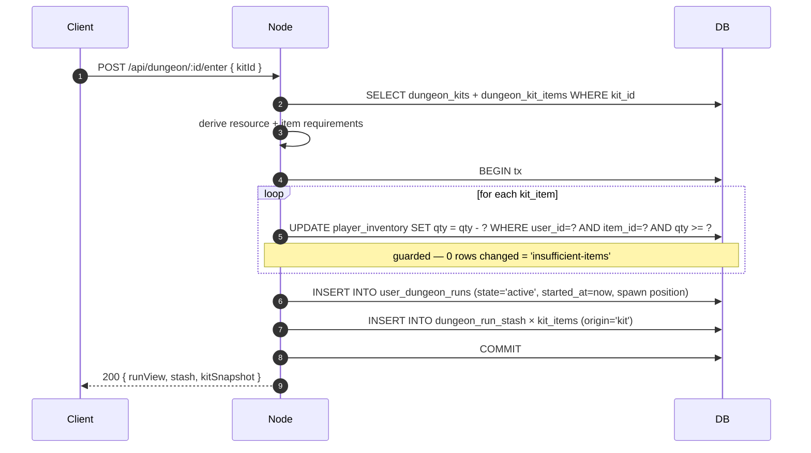
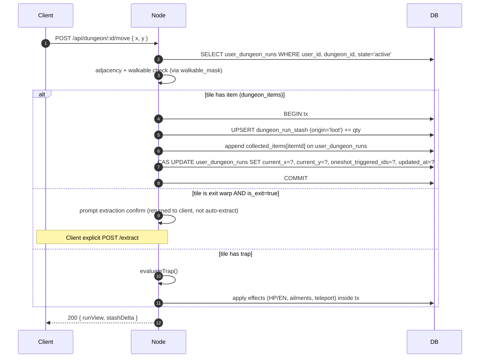
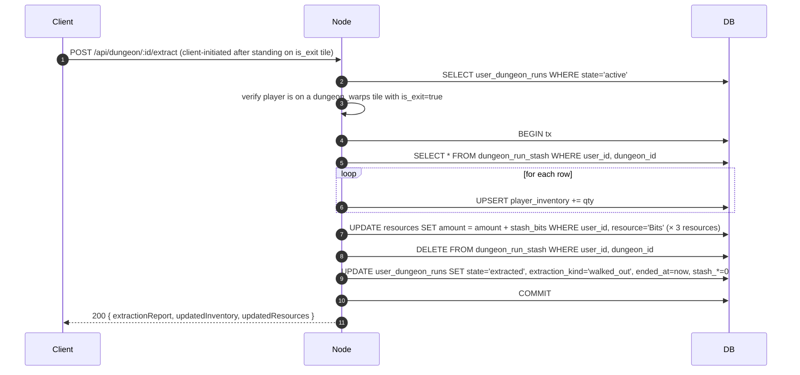

---
tags:
  - digiworld/system
  - digiworld/api
  - digiworld/planned
aliases:
  - Dungeon Extraction
  - Dungeon Crawler
  - Kit
  - Stash
  - Cypher
  - Fragment
status: Planned
created: 2026-08-07
updated: 2026-08-07
grounded-in:
  - backend/src/dungeons/repo.ts
  - backend/src/dungeons/routes.ts
  - backend/src/farm/engine.ts
  - backend/src/roster/evolve.ts
  - backend/src/world/pve-battle.ts
  - shared/src/digimon.ts
  - shared/src/dungeon.ts
verified-at-commit: f52d9d7b
---

# Dungeon Extraction

> [!warning] **PLANNED — not yet shipped**
> This note describes the **target-state** architecture defined in
> [[2026-08-07 — Dungeon crawler + extraction refactor]]. The
> currently-shipped dungeon system is documented in [[Dungeons]] and
> remains the source of truth until phase **F3** of the rollout
> lands. Every code citation below points to the CURRENT
> implementation surface that will be modified — not to unshipped
> code. Rollout details live in `.omo/plans/dungeon-crawler-extraction.md`.

> [!info] TL;DR
> Kit-based dungeon runs with **extraction mechanics**. Player builds
> a **Kit** of consumables, enters the dungeon, collects **Shards** +
> **Chips** + **resources** into a per-run **Stash**, and must **extract**
> (walk-out / scroll / challenge) to keep the loot. **Party wipe =
> total confiscation** (kit + stash + resources). Shards feed the
> factory to craft **Cyphers** — cross-Digimon evolution keys
> parameterized by `(family, tier, rarity)`. Tier gates which target
> species; rarity modulates the stat/skill bonus at evolution.

## Terminology (source of truth for the refactor)

| Term | Definition | Storage |
|---|---|---|
| **Kit** | User-authored preset of items to bring into a dungeon | `dungeon_kits` + `dungeon_kit_items` |
| **Stash** | Per-run ephemeral inventory (kit items + found loot) | `dungeon_run_stash` |
| **Shard** | Raw material dropped from mobs, carries rarity | `shop_items.item_type = 'fragment'` |
| **Chip** | Universal crafting material (no rarity), produced by Chip Factory | `shop_items.item_type = 'chip'` |
| **Cypher** | Evolution key item, `(family, tier, rarity)` triple | `shop_items.item_type = 'evolution_key'` |
| **Family** | Element axis for a Cypher (Blaze / Cryo / …) | Encoded in item_id + user-facing name |
| **Tier** | T1 / T2 / T3 — gates which target species unlocks | Encoded in item_id + user-facing name |
| **Rarity** | 0–4 — modulates the evolution outcome bonus | `shop_items.rarity` |
| **Extraction** | The act of leaving the dungeon with the stash preserved | `user_dungeon_runs.state = 'extracted' \| 'extracted_by_teleport' \| 'cleared_challenge'` |
| **Wipe** | Party wipe → total forfeiture | `user_dungeon_runs.state = 'wiped'` |

## Data model (proposed schemas)

### Kit — preset persistence

```sql
CREATE TABLE dungeon_kits (
  id           TEXT PRIMARY KEY,           -- 'kit_...'
  user_id      TEXT NOT NULL,
  name         TEXT NOT NULL,              -- "Boss Push", "Farm Common"
  created_at   BIGINT NOT NULL,
  updated_at   BIGINT NOT NULL,
  UNIQUE (user_id, name)
);

CREATE TABLE dungeon_kit_items (
  kit_id       TEXT NOT NULL REFERENCES dungeon_kits(id) ON DELETE CASCADE,
  item_id      TEXT NOT NULL,              -- FK conceitual → shop_items.id
  qty          INTEGER NOT NULL CHECK (qty > 0),
  slot_order   INTEGER NOT NULL,           -- ordering for UI display
  PRIMARY KEY (kit_id, item_id)
);
```

**Rule**: Kit is a template — nothing is escrowed from
[`player_inventory`](backend/src/items/grant.ts:5) at kit save time.
Escrow happens at `POST /api/dungeon/:id/enter { kitId }` (see
[Runtime flows](#runtime-flows)).

### Stash — per-run ephemeral bag

```sql
CREATE TABLE dungeon_run_stash (
  user_id      TEXT NOT NULL,
  dungeon_id   TEXT NOT NULL,              -- for grouped dungeons, this is the current floor's id
  item_id      TEXT NOT NULL,
  qty          INTEGER NOT NULL CHECK (qty >= 0),
  origin       TEXT NOT NULL CHECK (origin IN ('kit', 'loot')),
  updated_at   BIGINT NOT NULL,
  PRIMARY KEY (user_id, dungeon_id, item_id, origin)
);

-- On multi-floor dungeons (see [[#Multi-floor]]) the stash is keyed by
-- (user_id, dungeon_group_id) via a partial index. Same stash carries
-- across floors within the group; wiped/extracted terminates the group.
```

`origin` distinguishes brought-in (`kit`) from found (`loot`) for the
extraction report ("you brought 5 potions, found 3 potions, extracted
8"). Post-launch balance changes (e.g. "preserve unused kit items on
wipe") remain implementable without schema change.

### Resource pool — gained inside the run only

```sql
ALTER TABLE user_dungeon_runs ADD COLUMN stash_meat  INTEGER NOT NULL DEFAULT 0;
ALTER TABLE user_dungeon_runs ADD COLUMN stash_bits  INTEGER NOT NULL DEFAULT 0;
ALTER TABLE user_dungeon_runs ADD COLUMN stash_data  INTEGER NOT NULL DEFAULT 0;
```

**These do NOT occupy `dungeon_run_stash` rows.** Resources are pure
counters. The kit cannot pre-fund them — Meat / Bits / Data are only
gained inside a dungeon (mob drops, floor pickups).

Rationale for the split: resources are numerical, item slots are
enumerable. Mixing them creates UI churn ("does 500 Bits count as a
slot?") without gameplay benefit.

### State machine

```sql
ALTER TABLE user_dungeon_runs ADD COLUMN state TEXT NOT NULL DEFAULT 'active';
-- 'active' | 'extracted' | 'wiped' | 'extracted_by_teleport' | 'cleared_challenge'
ALTER TABLE user_dungeon_runs ADD COLUMN ended_at BIGINT;
ALTER TABLE user_dungeon_runs ADD COLUMN extraction_kind TEXT;
-- 'walked_out' | 'teleport_scroll' | 'challenge_win' | null (for wiped)
```

Existing `completed_at` stays populated for quest compatibility
(`bumpDefeatObjectives` / `bumpCollectObjectives` fire on the same
paths) but the client and new admin UIs read `state` as the source of
truth.

### Challenge condition (admin-authored, per dungeon)

```sql
ALTER TABLE dungeons ADD COLUMN challenge_kind TEXT NOT NULL DEFAULT 'boss_defeated';
-- 'boss_defeated' | 'all_encounters_defeated' | 'reach_tile'
-- | 'collect_item'  | 'survive_waves'         | 'none'
ALTER TABLE dungeons ADD COLUMN challenge_config TEXT;
-- JSON per kind:
--   boss_defeated:            { bossEncounterId }
--   all_encounters_defeated:  {} (implicit)
--   reach_tile:               { targetX, targetY }
--   collect_item:             { itemId, qty }
--   survive_waves:            { waveCount, spawnTable }
--   none:                     null (only physical extraction possible)
ALTER TABLE user_dungeon_runs ADD COLUMN challenge_progress TEXT;
-- JSON per kind — e.g. { wavesCleared: 3 } for survive_waves
```

Server evaluates the challenge on every relevant mutation
(`defeatEncounter`, `moveRun`, `pickUpItem`) and, on success, sets
`state = 'cleared_challenge'` in the same tx.

### Multi-floor grouping

```sql
ALTER TABLE dungeons ADD COLUMN floor_index INTEGER;         -- NULL = single-floor
ALTER TABLE dungeons ADD COLUMN dungeon_group_id TEXT;       -- NULL for single-floor;
                                                              -- default in migration = dungeons.id
```

Groups are just a shared identifier — no new table. `parent_id`
(existing, from [[Dungeons#Hierarchy]]) stays as visual breadcrumb
for admin. `dungeon_group_id` is the **runtime** grouping used by
`user_dungeon_runs` for stash persistence.

### Item taxonomy

```sql
ALTER TABLE shop_items ADD COLUMN item_type TEXT NOT NULL DEFAULT 'consumable';
-- 'consumable' | 'evolution_key' | 'fragment' | 'chip'
-- | 'door_key'   | 'extraction'     | 'buff_material'
-- | 'quest'      | 'cosmetic'       | 'misc'

ALTER TABLE shop_items ADD COLUMN rarity INTEGER NOT NULL DEFAULT 0;
-- 0=common | 1=uncommon | 2=rare | 3=epic | 4=legendary

ALTER TABLE shop_items ADD COLUMN kit_class TEXT;
-- 'consumable' | 'revive' | 'buff' | 'utility' | 'extraction' | null
ALTER TABLE shop_items ADD COLUMN kit_max_qty INTEGER;
-- soft cap per kit_class in a single Kit
-- Defaults: revive=3, extraction=1, others=10; null = no cap
```

Admin filter dropdown contract (V1):

| UI surface | Filter |
|---|---|
| `EvolutionEdgeEditor.requiredItemId` | `item_type = 'evolution_key'` |
| `DoorEditor.keyItemId` | `item_type = 'door_key'` |
| `RecipeEditor.requires_items` | `item_type IN ('fragment', 'chip', 'buff_material')` |
| `KitEditor.items` | `item_type NOT IN ('fragment', 'chip', 'evolution_key')` |
| `RarityTableAdmin.pool_tag` | free tag string on `shop_items` (V2) |

### Rarity tables (rolled drops)

```sql
CREATE TABLE dungeon_rarity_tables (
  id          TEXT PRIMARY KEY,           -- 'rt_forest_boss', 'rt_common_grunt'
  weights     TEXT NOT NULL,              -- JSON: {common:60, uncommon:25, rare:10, epic:4, legendary:1}
  pool_tag    TEXT NOT NULL,              -- matches shop_items.drop_pool
  min_rolls   INTEGER NOT NULL DEFAULT 1,
  max_rolls   INTEGER NOT NULL DEFAULT 3
);

ALTER TABLE dungeon_encounters ADD COLUMN rarity_table_id TEXT;
ALTER TABLE shop_items         ADD COLUMN drop_pool TEXT;
-- Tag string. Empty/null = not procedurally droppable.
-- Examples: 'fragment-fire', 'fragment-attribute', 'chip', 'consumable-common'
```

Encounter drop flow (proposed
`defeatEncounter` extension in [`dungeons/repo.ts`](backend/src/dungeons/repo.ts:518)):

1. Resolve fixed `loots` JSON (existing behaviour, but writes go to
   `dungeon_run_stash` instead of `player_inventory`).
2. If `rarity_table_id` is set, roll `min_rolls..max_rolls` times
   against the rarity weights, then pick a random `shop_items` row
   with matching `drop_pool` and `rarity`.
3. Grant each roll into `dungeon_run_stash` with `origin = 'loot'`.

Encounter difficulty already exists ([`DungeonEncounter.difficulty`](shared/src/dungeon.ts))
— rarity tables can be assigned per-difficulty defaults by the admin.

### Recipe extension for evolution items

```sql
ALTER TABLE farm_recipes ADD COLUMN requires_items TEXT NOT NULL DEFAULT '[]';
-- JSON: [{itemId: string, qty: number}]
ALTER TABLE farm_recipes ADD COLUMN inherit_rarity_from TEXT;
-- 'fragment' | null. When 'fragment', the output rarity =
-- MAX(rarity of consumed rows with item_type = 'fragment').
ALTER TABLE farm_recipes ADD COLUMN unlock_condition TEXT;
-- 'digidex_has_<catalogId>' | 'quest_completed_<questId>' | null
```

Advance loop in
[`farm/engine.ts::advanceFactory`](backend/src/farm/engine.ts) at
lines ~472-522 gains a pre-flight item deduction step:

- Same guarded UPDATE pattern as
  [`SQL_DEDUCT_RESOURCE`](backend/src/farm/engine.ts) —
  `UPDATE player_inventory SET qty = qty - ? WHERE user_id = ? AND item_id = ? AND qty >= ?`.
- **All-or-nothing**: if any `requires_items` row can't be deducted,
  the tx rolls back and the job stays queued (does not auto-cancel).
- If `inherit_rarity_from = 'fragment'`, compute the output rarity
  BEFORE deduct (query rarities of the target rows), then upsert the
  `(item_id, rarity)`-specific SKU on completion.

## Runtime flows

### Entering a dungeon with a kit



Errors:

- `kit-not-found` (404)
- `insufficient-items` (402) — response includes concrete `missing:
  [{itemId, needed, have}]` list, same shape as
  [`farm/engine.ts::UpgradeError`](backend/src/farm/engine.ts:231).
- `active-run-exists` (409) — one run per user per dungeon (or per
  group).

### Movement + loot pickup



Loot from **defeat encounter** follows the same
`origin = 'loot'` pattern — the refactor of
[`defeatEncounter`](backend/src/dungeons/repo.ts:518) swaps
`SQL_GRANT_REWARD_ITEM` (writes to `player_inventory`) for a new
`SQL_GRANT_STASH_ITEM` (writes to `dungeon_run_stash`).

### Combat during a dungeon run

Existing
[`world/pve-battle.ts`](backend/src/world/pve-battle.ts) hooks:

- `setPveDungeonContext(userId, dungeonId, encId)` at line ~85 —
  UNCHANGED. Establishes the dungeon↔battle link.
- `use_item` action — [`battle/engine.ts:408-443`](backend/src/battle/engine.ts:408)
  — UNCHANGED contract. But the inventory decrement site in
  `actInPveBattle` (currently
  [`SQL_DECREMENT_INVENTORY`](backend/src/world/pve-battle.ts:33))
  becomes conditional:

```typescript
// Pseudocode: inside actInPveBattle, on 'use_item'
if (dungeonContext.has(userId)) {
  await decrementStashItem(userId, dungeonId, itemId);   // stash
  await refundStashItem(userId, dungeonId, itemId);      // on failure
} else {
  await decrementInventory(userId, itemId);              // existing path
  await refundInventory(userId, itemId);                 // existing path
}
```

- `markWonDungeonEncounter` at line ~268 — UNCHANGED contract but
  calls the new `defeatEncounter` that routes loot to stash.

### Extraction — walk-out variant



### Extraction — scroll variant

`itm-extraction-scroll` (item_type = `'extraction'`) is a consumable
with a new `ItemEffect`:

```typescript
// shared/src/battle.ts — extends existing ItemEffect union
export type ItemEffect =
  | { kind: 'heal_pct'; pct: number }
  | { kind: 'en_pct'; pct: number }
  | { kind: 'clear_ailments' }
  | { kind: 'atk_bonus'; amount: number }
  | { kind: 'def_bonus'; amount: number }
  | { kind: 'revive' }
  | { kind: 'extract_dungeon' };  // NEW
```

Server rejects `extract_dungeon` in
[`battle/engine.ts::applyAction`](backend/src/battle/engine.ts:408)
with `item-invalid` (extraction requires the dungeon-runtime path, not
the battle-turn path). Instead, out-of-combat usage goes through:

```
POST /api/dungeon/:id/use-scroll { itemId }
  -> decrement stash (or player_inventory if pre-run item),
  -> same extraction flow as walk-out but state='extracted_by_teleport'
```

### Wipe

```mermaid
sequenceDiagram
  autonumber
  participant N as Node
  participant DB as DB
  Note over N: pve-battle detects all party mons defeated
  N->>DB: BEGIN tx
  N->>DB: DELETE FROM dungeon_run_stash WHERE user_id, dungeon_id
  N->>DB: UPDATE user_dungeon_runs SET state='wiped', ended_at=now, stash_meat=0, stash_bits=0, stash_data=0
  N->>DB: COMMIT
  N-->>C: WS 'battle' end message; next GET /api/dungeon/:id returns state='wiped'
```

No loot preservation. The wipe report on the client (returning to the
dungeon list) shows a "you lost N items + X bits" summary sourced from
the stash snapshot **before** the delete — computed server-side and
persisted in `user_dungeon_runs.challenge_progress` (repurposed as
`ended_reason_summary` for wipes).

## Rarity, tier, and family — the 3-axis model

Every Cypher SKU is a triple `(family, tier, rarity)`:

- **Family** — 11 values, one per [`Element`](shared/src/digimon.ts):

  | Element | Family name |
  |---|---|
  | Fire | Blaze |
  | Ice | Cryo |
  | Water | Tide |
  | Wind | Zephyr |
  | Earth | Terra |
  | Plant | Verdant |
  | Electricity | Volt |
  | Steel | Chrome |
  | Light | Nova |
  | Dark | Void |
  | Null | Null Codex |

- **Tier** — `T1 / T2 / T3`. Gates target species. Admin authors
  `(family, tier)` per `EvolveEdge`.
- **Rarity** — 0–4. Modulates bonus (see [`shared/src/item-rarity.ts` (proposed)](shared/src/item-rarity.ts)).

Item id shape: `itm-cypher-<family>-<tier>-r<0..4>` (V1 storage). E.g.:

- `itm-cypher-blaze-t1-r0` — Common Blaze Cypher I
- `itm-cypher-blaze-t2-r3` — Epic Blaze Cypher II
- `itm-cypher-chrome-t3-r4` — Legendary Chrome Cypher III

**165 SKUs** seeded programmatically. Admin never types these — but
they DO appear in filtered dropdowns for the
`EvolveEdge.requiredItemId` picker (D9 filter).

### Bonus curve

| Rarity | HP | EN | Combat stats (each) | Skill unlock |
|---|---|---|---|---|
| Common (0) | +0 | +0 | +0 | pool default |
| Uncommon (1) | +5 | +5 | +2 | pool default |
| Rare (2) | +15 | +10 | +5 | pool default + 1 extra pre-picked slot |
| Epic (3) | +30 | +20 | +10 | +1 `tier_2` skill unlock |
| Legendary (4) | +50 | +30 | +15 | +2 `tier_2` skills + `identity_finisher` |

`tier_2` and `slot_role` are already fields on
[`skills_catalog`](backend/src/db/schema.sql) — the refactor only
adds the biased selection in
[`skills/pool.ts::getDefaultEquippedForStage`](backend/src/skills/pool.ts:69).

Application point: a new helper
`applyRarityEvolutionBonus(row, rarity)` runs inside the evolve tx in
[`roster/evolve.ts::evolveRoster`](backend/src/roster/evolve.ts:224)
between `removeItem` and `SQL_SWAP_CATALOG`. The bonus is added on top
of the frozen stage pool — it does NOT consume pool capacity.

## Concrete example — Agumon

Grounded in
[`backend/data/catalog/digimons.xml:108-130`](backend/data/catalog/digimons.xml:108).
Agumon (`skb-50`, Rookie / Vaccine / Fire / Reptile) has 5 evolvesInto
edges:

```xml
<digimon id="skb-50" name="Agumon" ...>
  <evolutions>
    <evolve targetId="skb-25"/>   <!-- Raptordramon (Champion/Vaccine/steel) -->
    <evolve targetId="skb-54"/>   <!-- GeoGreymon (Champion/Vaccine/fire) -->
    <evolve targetId="skb-70"/>   <!-- Numemon (Champion/Virus/fire) -->
    <evolve targetId="skb-326"/>  <!-- Greymon (Champion/Vaccine/fire) -->
    <evolve targetId="skb-209"/>  <!-- Coredramon Green (Champion/Virus/fire) -->
  </evolutions>
</digimon>
```

Under the refactor, each `evolve` entry gains a `(family, tier)`
pair authored by admin (schema addition:
`EvolveEdge.requiredItemId` already exists; the seeder computes the
family from `target.element` and the tier from a curated table):

| Target | Element | Cypher required (item_id) | User-facing |
|---|---|---|---|
| Greymon (skb-326) | fire | `itm-cypher-blaze-t1-r*` | Blaze Cypher I |
| GeoGreymon (skb-54) | fire | `itm-cypher-blaze-t2-r*` | Blaze Cypher II |
| Coredramon Green (skb-209) | fire | `itm-cypher-blaze-t2-r*` | Blaze Cypher II (same!) |
| Raptordramon (skb-25) | steel | `itm-cypher-chrome-t2-r*` | Chrome Cypher II |
| Numemon (skb-70) | fire | `itm-cypher-blaze-t1-r*` | Blaze Cypher I (or V2 alt) |

Where `r*` is any rarity — the player only needs one rarity, and the
one they use determines the outcome bonus.

**Player workflow**:

1. Player farms a fire-themed dungeon. Drops `Element Shard: Fire`
   rarity 1 (uncommon).
2. Farms three more runs, one drop is rarity 3 (epic).
3. Player crafts in Rare Factory: `3× Fire Shard (mixed rarities) +
   1× Vaccine Shard + 2× Chip A + 500 bits (2h)` — output rarity =
   MAX(rarities) = **3 (epic)**.
4. Result: `Epic Blaze Cypher II` = `itm-cypher-blaze-t2-r3`, qty 1.
5. Player picks Agumon → GeoGreymon in the roster UI. The
   `EvolveEdge` for skb-54 references `itm-cypher-blaze-t2-r*`; server
   accepts any rarity of Blaze Cypher II, consumes the epic one,
   applies **+30 HP / +20 EN / +10 combat / +1 tier_2 skill**.

Same **Blaze Cypher II** can be spent later to promote a different
Digimon into a different `T2 Fire Champion` — the item is generic.

### Cross-Digimon reuse example

`Blaze Cypher I` (any rarity) unlocks (among others):

- Agumon → Greymon
- Coronamon → Firamon
- Guilmon → Growlmon (Rookie/Virus/Fire → Champion/Virus/Fire)
- Meramon → SkullMeramon (if the roster promotes Champion→Ultimate via
  Cypher too — same schema)

Same fragment stock feeds every fire-lineage user has.

## HTTP surface (proposed)

### New endpoints

| Method | Path | Auth | Purpose |
|---|---|---|---|
| GET    | `/api/dungeon/kits` | user | List kits |
| POST   | `/api/dungeon/kits` | user | Create `{name, items:[{itemId,qty,slotOrder}]}` |
| PUT    | `/api/dungeon/kits/:id` | user | Edit |
| DELETE | `/api/dungeon/kits/:id` | user | Remove |
| POST   | `/api/dungeon/:id/enter` | user | Start run with `{kitId?}` — escrows kit into stash |
| GET    | `/api/dungeon/:id/stash` | user | Snapshot of current run's stash + resource counters |
| POST   | `/api/dungeon/:id/extract` | user | Walk-out extraction (server verifies player on `is_exit` tile) |
| POST   | `/api/dungeon/:id/use-scroll` | user | `{itemId}` — teleport extraction (out of combat only) |
| GET    | `/api/admin/rarity-tables` | admin | List |
| POST/PUT/DELETE | `/api/admin/rarity-tables[/:id]` | admin | CRUD |

### Modified endpoints

| Path | Diff |
|---|---|
| `GET /api/dungeon/:id` | Response now includes `state`, `stashSummary`, `challenge`, `groupContext` fields |
| `POST /api/dungeon/:id/move` | Response includes `challengeProgress` and `extractionAvailable: boolean` |
| `POST /api/dungeon/:id/encounter/:encId/start` | 409 `run-not-active` when `state != 'active'` |
| `POST /api/dungeon/:id/complete` | Deprecated (kept as no-op for legacy client compat until F3 flag ships) |
| `GET /api/roster/:monId/evolutions` | Each option gains `requiredItemRarityOffered: Rarity[]` (based on player's inventory of the family/tier) and `expectedBonus: { hp, en, combat, skillUnlocks }` (previewed at the rarest available cypher) |

### WebSocket

No new WS event types for V1. Battle end already fans out via
`{type:'end', matchId, view, outcome}`
([`shared/src/ws.ts`](shared/src/ws.ts)); the client re-fetches
`GET /api/dungeon/:id` after the end event and sees `state='wiped'`
if applicable.

**V2 candidate**: `{type: 'dungeon-stash-updated', delta}` to enable
optimistic UI during combat drops.

## Tiled layer contract (D10 of the ADR)

`dungeon_tiles` gains a `layer_kind` column with the canonical set:

| `layer_kind` | Walkable | Notes |
|---|---|---|
| `floor` | ✅ | Base pisable layer. Required by every dungeon. |
| `walls` | ❌ | Blocked. Rendered z-above floor. |
| `doors` | ❌ until unlocked | Uses [`dungeon_doors`](backend/src/dungeons/doors.ts) row for gating. |
| `water` | ❌ default | Walkable if player has `shop_items.item_type = 'utility'` with tag `water_walk` (V2). |
| `pit` | ❌ | Blocked (or wired to a trap). |
| `decoration` | ✅ (transparent to collision) | Purely visual — no gid conflict resolution. |
| `hidden` | ignored | Only visible/rendered after admin-scripted trigger. |

Server pre-computes
`dungeons.walkable_mask_json: TEXT` at import time (in
[`applyTiledImport*`](backend/src/dungeons/repo.ts:606)) — a
JSON `string[]` of `"x,y"` entries. `moveRun`'s adjacency check
becomes an O(1) Set lookup.

Tiled importer hard-fail cases (return `422 tmj-invalid`):

- No `floor` layer present.
- `dungeons.spawn_x/spawn_y` not a walkable tile.
- `challenge_kind='reach_tile'` with `challenge_config.targetX/Y` not
  a walkable tile.
- `challenge_kind='boss_defeated'` with `bossEncounterId` missing from
  the parsed `<encounters>`.

## Kill-switches and phased rollout

See [[2026-08-07 — Dungeon crawler + extraction refactor#Rollout]] for
the F1–F9 table. Every phase is independently shippable; F3 is the
only one that changes visible gameplay semantics.

Feature flags read from the existing
[`flags`](backend/src/db/schema.sql) table (per-user + global) via
[`backend/src/flags/repo.ts`](backend/src/flags/repo.ts). Flag keys:

- `flag:rarity-visible`
- `flag:dungeon-kit-enabled`
- `flag:dungeon-extraction`
- `flag:dungeon-challenge`
- `flag:evolution-crafting`
- `flag:rarity-bonuses`

## Related

- [[2026-08-07 — Dungeon crawler + extraction refactor]] — the ADR
- [[Dungeons]] — current-state reference (legacy V1)
- [[Combat]] — `use_item` action + `dungeonContext`
- [[Farm]] — Chip Factory (materials) + Rare Factory (Cyphers)
- [[Roster and Party]] — evolution swap + skill pool selection
- [[Currency]] — resources flowing through stash on extraction
- [[HTTP Surface]] — full endpoint catalog

## Unshipped follow-ups (see ADR "Open questions")

> [!todo] Fragment drop distribution per-dungeon
> Baseline weights ship in F6. Per-dungeon overrides via
> `dungeon_rarity_tables` are the tuning surface. Playtest data
> feeds back into defaults.

> [!todo] Cypher tier seeding for existing evolutions
> Migration must assign `(family, tier)` to every existing
> `EvolveEdge` — proposal: family from `target.element`, tier default
> to `T1`, admin promotes to higher tiers.

> [!todo] Extraction scroll balance
> Recipe cost, drop rate of `Warp Fragment` (only from bosses,
> chance <0.05), and the `use-scroll` cooldown all need playtest.
