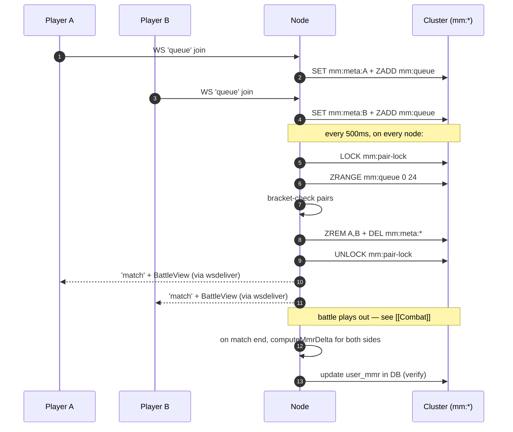

---
tags:
  - digiworld/system
  - digiworld/api
aliases:
  - Matchmaking
  - MMR
  - PvP Queue
  - Elo
  - Ranked
created: 2026-08-01
updated: 2026-08-01
grounded-in:
  - backend/src/matchmaking/queue.ts
  - backend/src/battle/mmr.ts
  - backend/src/lobby/ws.ts
  - shared/src/battle.ts
verified-at-commit: 13dc16b
---

# Matchmaking + MMR

> [!info] TL;DR
> **Matchmaking**: FIFO queue in a ZSET (`mm:queue`), pairs on TWO
> independent brackets (level gap + trainedness gap) that both widen with
> queue time. **MMR**: Elo K=32 starting at 1000, with a quality
> multiplier that rewards clean wins (high HP, few KOs, quick rounds)
> and softens punishment for messy losses. Both storages ride the
> [[Cluster Coordination Layer|Cluster]] abstraction — same code on
> memory + Redis.

## Matchmaking

### Storage — [`matchmaking/queue.ts`](backend/src/matchmaking/queue.ts)

Three cluster keys, verbatim from
[`queue.ts:22-35`](backend/src/matchmaking/queue.ts:22):

```typescript
const QUEUE_TTL_MS = 5 * 60 * 1000;
const BRACKET_START = 5;
const BRACKET_MAX = 20;
const BRACKET_WIDEN_MS = 3_000;

const TRAINEDNESS_BRACKET_START = 1_000;
const TRAINEDNESS_BRACKET_MAX = 10_000;
const TRAINEDNESS_BRACKET_WIDEN_MS = 3_000;

const PAIR_LOCK_KEY = 'mm:pair-lock';
const PAIR_LOCK_TTL_SEC = 2;
const QUEUE_KEY = 'mm:queue';
const META_KEY = (userId: string): string => `mm:meta:${userId}`;
```

| Key                      | Kind    | TTL         | Purpose                                                    |
| ------------------------ | ------- | ----------- | ---------------------------------------------------------- |
| `mm:queue`               | ZSET    | —           | member=userId, score=queuedAt (FIFO by time)               |
| `mm:meta:{userId}`       | KV      | 5 min       | JSON `QueueEntry` — party stats needed for pairing         |
| `mm:pair-lock`           | lock    | 2 s         | Serialises pairing across nodes (SET NX EX + Lua CAS)      |

### The QueueEntry

```typescript
export type QueueEntry = {
  userId: string;
  displayName: string;
  averageLevel: number;
  trainedness: number;    // party's avg total stat bonus (0..~10200)
  queuedAt: number;
};
```

`trainedness` is the party's average `hp+en+atk+def+int+spd` stat bonus.
Computed in [`roster/routes.ts::partyTrainedness()`](backend/src/roster/routes.ts).
Range: 0 (untrained) → ~10 200 (fully-trained Mega party under current
stage pools).

### Pairing brackets

Two independent bounds. **Both** must be satisfied for a match:

```
level bracket       → |avgLevel_a − avgLevel_b|     ≤ 5    + 5×⌊wait/3s⌋
trainedness bracket → |trainedness_a − trainedness_b| ≤ 1000 + 1000×⌊wait/3s⌋
```

- Bracket **widens** every 3 s the entrant has been queued, so nobody
  sits forever waiting for a perfect match.
- Caps at BRACKET_MAX (level 20) / TRAINEDNESS_BRACKET_MAX (10 000) after
  ~9 s and ~27 s of wait respectively.

> [!info] Why two brackets?
> Level alone doesn't reflect stat investment. Two level-30 parties can
> have vastly different stat bonuses if one grinded training and the
> other didn't. The trainedness bracket keeps the min-max spread pairable
> across investment levels.

### Atomic pair selection

`tryPair()` ([`queue.ts:143-190`](backend/src/matchmaking/queue.ts:143))
grabs the `mm:pair-lock` (2 s TTL), reads the first 25 queue members,
loads their metas, and walks the pair space:

```
for i in 0..N:
  a = entries[i]
  wait_a = now - a.queuedAt
  widen_level = min(20, 5 + floor(wait_a/3s) * 5)
  widen_trained = min(10000, 1000 + floor(wait_a/3s) * 1000)
  for j in i+1..N:
    b = entries[j]
    if |a.avgLevel - b.avgLevel| > widen_level: skip
    if |a.trainedness - b.trainedness| > widen_trained: skip
    ZREM both from mm:queue
    DEL both meta keys
    log 'mm.pair' + return { a, b }
return null
```

Under contention, only ONE node holds the lock at any moment — the
others get `null` from `tryPair()` and try again on the next tick.
`ZREM` is guarded by `removed < 2` — if the losing node had already
partially removed one, we skip that pair rather than half-pair someone.

### The pairing loop

Runs in [`backend/src/lobby/ws.ts`](backend/src/lobby/ws.ts) every
**500 ms** on every node. When `tryPair()` returns a pair, both users
receive:

```json
{ "type": "match", "matchId": "mtc_...", "view": BattleView }
```

routed via `wsdeliver:{userId}` — so a pair matched on node1 still
reaches a user hosted on node2.

### Queue caps

```typescript
if (size >= config.MAX_CONCURRENT_MATCHES * 4) return 'full';
```

A soft cap at 4× the concurrent-matches cap. Prevents Redis from
running away if matchmaking stalls.

### Stale purge

Entries stay in the queue for up to `QUEUE_TTL_MS = 5 min`. Explicit
purge ([`queue.ts::purgeStale`](backend/src/matchmaking/queue.ts:110))
sweeps entries older than that — called periodically (verify from the
lobby ticker) so a wedged client doesn't hold a slot forever.

## MMR — [`battle/mmr.ts`](backend/src/battle/mmr.ts)

Elo variant with quality shaping.

### Constants

```typescript
export const MMR_START = 1000;
export const MMR_K_FACTOR = 32;
```

Standard chess-style K=32. Every player boots at 1000. Extremes ceil at
whatever the meta produces — no artificial cap.

### Expected score (vanilla Elo)

```typescript
export function expectedScore(myMmr: number, oppMmr: number): number {
  return 1 / (1 + Math.pow(10, (oppMmr - myMmr) / 400));
}
```

At `oppMmr = myMmr + 400`, expected win rate = 9.1 % — matching classic
chess Elo curves.

### Actual vs expected (base Elo delta)

```
actual = win ? 1 : draw ? 0.5 : 0
delta_base = MMR_K_FACTOR * (actual - expected)
```

### Quality multiplier (the shaping)

Standard Elo says the delta is `K * (actual - expected)`. DigiWorld
multiplies this by a **quality** factor derived from HOW the match
played out:

```typescript
export function winQuality(winner: SidePerf, loser: SidePerf): number {
  const hpFactor = clamp(winner.hpFractionAlive * 2, 0.5, 1.5);
  const speedFactor = 1;  // reserved — currently a no-op
  const koFactor = 1 + 0.15 * (loser.downCount - winner.downCount);
  return clamp(hpFactor * speedFactor * koFactor, 0.5, 2.5);
}
```

- **`hpFactor`** — winner's average HP fraction × 2, clamped [0.5, 1.5].
  Winning at full HP → 1.5; winning with 1 HP left → 0.5.
- **`koFactor`** — 1 + 15 % per net-KO difference, so downing more of
  the opponent's units than you lost yourself increases the delta.
- Overall range: 0.5× (Pyrrhic) → 2.5× (dominant sweep).

### Speed factor (round shortening)

```typescript
export function speedFactorForRound(round: number): number {
  return clamp(12 / Math.max(round, 3), 0.6, 1.4);
}
```

Round 3 → 4.0 → clamped to 1.4 (fast finisher bonus).
Round 12 → 1.0 (neutral).
Round 30 → 0.4 → clamped to 0.6 (slog penalty).

### Final delta

Full computation ([`mmr.ts::computeMmrDelta`](backend/src/battle/mmr.ts:76)):

```typescript
if (myOutcome === 'win')   quality = winQuality(myPerf, oppPerf) * speed;
if (myOutcome === 'loss')  quality = 1 / (winQuality(oppPerf, myPerf) * speed);
if (myOutcome === 'draw')  quality = 1;

delta = MMR_K_FACTOR * quality * (actual - expected);

// Floor: winners get ≥ +1, losers get ≤ -1.
if (win && rounded < 1) return 1;
if (loss && rounded > -1) return -1;
```

The floor guarantees a match ALWAYS moves you at least 1 point in the
right direction — even a massive-favorite win against a huge underdog
still nudges up.

### Loser rating

For the loser side, quality is the **reciprocal** of the winner's
quality. If A wins with high quality (1.8), B loses with low quality
(1/1.8 ≈ 0.55). Softens the punishment for losing to a dominant
performer — B doesn't get the full base delta swing.

## The two systems in flight



## Anti-farming

MMR isn't a currency; you can't "spend" it. But high MMR gates matchmaking
against low MMR (no explicit filter, but the LEVEL bracket effectively
does the job since low-MMR = usually low-level).

> [!warning] Smurf accounts
> Nothing prevents an alt account. A veteran on a Rookie alt WILL crush
> people. Detection would need play-pattern heuristics — out of scope.

## What can go wrong

> [!warning] Trainedness field DRIFTED from stat pools
> The trainedness bracket was resized after the previous pool layout
> (which capped ~800 for a fully-trained party) got replaced by a wider
> range (~10 200 max). Any future stat-pool rebalance without bumping the
> bracket cap silently makes matchmaking looser or stricter. See the
> comment at [`queue.ts:29-35`](backend/src/matchmaking/queue.ts:29) for
> the full context.

> [!warning] MMR K-factor is constant
> Fresh accounts and 1000-match veterans both swing at K=32. In chess
> this is usually variable (K=40 for new, K=20 for masters). A future
> refinement would ramp K down as `matches_played` climbs.

> [!warning] Lock TTL 2 s vs long pairing walks
> If the queue has 25 members and matching is unusually slow, the lock
> could expire mid-walk and another node could start its own walk.
> Currently the ZREM guard is the safety net — but if that ever fails,
> two matches would be created for the same players.

## What's NOT here

- **Ranked seasons** — MMR isn't reset periodically; a player's MMR is
  their historical result.
- **Leaderboard** — no `GET /api/ranked/top` endpoint. Would be trivial
  to add (`ORDER BY mmr DESC`).
- **Rank tiers** — no bronze/silver/gold labels on MMR ranges.

## Related

- [[Combat]] — the battle that generates `SidePerf` inputs for MMR
- [[WebSocket Protocol]] — the `queue` client + `match` server messages
- [[Cluster Coordination Layer]] — where `mm:*` lives
- [[Multi-node Deployment#What crosses nodes]] — matchmaking is
  designed to cross nodes cleanly
