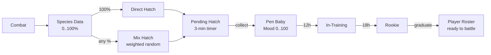

---
tags:
  - digiworld/system
  - digiworld/api
aliases:
  - Nursery
  - Pen
  - Hatching
  - Baby Digimon
  - Species Data
created: 2026-08-01
updated: 2026-08-01
grounded-in:
  - backend/src/nursery/data.ts
  - backend/src/nursery/routes.ts
  - backend/src/db/migrations/040_nursery_pen.pg.sql
  - shared/src/nursery.ts
verified-at-commit: 4e70621
---

# Nursery / Pen

> [!info] TL;DR
> Two stacked systems: **Species Data** (defeat-driven collectible;
> 25% / 10% / 1% per Rookie / non-Rookie / rare defeat) that unlocks
> hatching, and the **Pen** (Baby → In-Training → Rookie growth arc
> with time gates + petting + feeding for mood). Direct hatch requires
> 100% species data; **mix hatch** rolls the whole species pool
> weighted by percentage.

## Two systems, one flow



## Constants — [`nursery/data.ts`](backend/src/nursery/data.ts)

```typescript
export const HATCH_DURATION_MS = 3 * 60 * 1000;   // 3 minutes
export const HATCH_LEVEL = 5;                       // starting level on collect
export const BABY_STAGE_MS = 5 * 60_000;            // used inside data.ts (short-form)

const DATA_AMOUNT: Record<Tier, number> = {
  common: 25,      // Rookie / Baby / In-Training defeats
  uncommon: 10,    // Champion+ non-rare
  rare: 1,         // any `rare` template
};
```

And from [`nursery/routes.ts`](backend/src/nursery/routes.ts):

```typescript
const BABY_STAGE_MS       = 12 * 60 * 60_000;   // Baby → In-Training after 12h
const IN_TRAINING_STAGE_MS = 18 * 60 * 60_000;   // In-Training → Rookie after 18h (30h total in pen)
const MAX_PETS_PER_MON_PER_DAY = 3;
const PET_MOOD_DELTA  = 5;
const FEED_MOOD_DELTA = 8;
const FEED_MEAT_COST  = 5;
```

## Species Data collection

Each defeated mon awards data on the WINNING side's account, keyed by
the defeated mon's `catalogId`. Amount depends on rarity tier:

```typescript
export function rarityTier(rare: boolean, stage: Stage): Tier {
  if (rare) return 'rare';
  if (stage === 'Rookie' || stage === 'Baby' || stage === 'In-Training') return 'common';
  return 'uncommon';
}
```

Storage: `player_species_data(user_id, catalog_id, percent, kills, updated_at)`. Upsert
capped at 100:

```sql
INSERT INTO player_species_data (user_id, catalog_id, percent, kills, updated_at)
     VALUES (?, ?, ?, 1, ?)
  ON CONFLICT(user_id, catalog_id) DO UPDATE
     SET percent = LEAST(100, player_species_data.percent + excluded.percent),
         kills = player_species_data.kills + 1,
         updated_at = excluded.updated_at
```

`awardSpeciesData()` batches multiple defeats in one tx so a single PvE
battle with 3 wild mons upserts atomically. Called from
[`world/pve-battle.ts`](backend/src/world/pve-battle.ts) at match end.

## Hatch paths — [`hatchPathTo()`](backend/src/nursery/data.ts)

Given a target catalog id, find the Baby → In-Training → Rookie chain
that leads there. Two cases:

- **Target IS a Rookie** — walk BACKWARD from the Rookie using the
  reverse evolution graph, picking the earliest In-Training predecessor
  (alphabetically first if ties), then earliest Baby predecessor.
- **Target is Champion+** — BFS BACKWARD from the target through the
  reverse graph until a Rookie is reached, then apply the same
  in-training / baby lookup.

Missing steps in the graph log `nursery.hatchpath.missing-stage` and
fall back to the current stage (some Champions have no in-training
predecessor in the catalog).

## Direct hatch — 100% species data required

```typescript
export async function startDirectHatch(userId, catalogId): Promise<HatchStartResult> {
  const path = hatchPathTo(catalogId, catalog);
  if (!path) return { ok: false, error: 'no-path' };
  const row = await one<SpeciesDataRow>(SQL_SELECT_DATA_BY_ID, userId, catalogId);
  if (!row || row.percent < 100) return { ok: false, error: 'not-enough-data' };
  return insertPending(userId, path, () => runZeroSingle(userId, catalogId));
}
```

At 100% species data, the player can hatch that species DIRECTLY. Cost:
zero the species's percent (`runZeroSingle`) — you consume the data.

## Mix hatch — spend everything, get a weighted roll

```typescript
export async function startMixHatch(userId): Promise<MixHatchResult> {
  const dataRows = await listSpeciesData(userId);
  const entries = dataRows.filter((r) => r.percent > 0);
  const totalWeight = entries.reduce((sum, r) => sum + r.percent, 0);
  if (entries.length === 0 || totalWeight === 0) return { ok: false, error: 'no-data' };
  let roll = Math.random() * totalWeight;
  let picked = null;
  for (const entry of entries) {
    roll -= entry.percent;
    if (roll <= 0) { picked = entry; break; }
  }
  // ... consume ALL species data
  return { ok: true, pending, rolledCatalogId, totalWeight };
}
```

Weighted pick against the sum of percentages. Cost: zero EVERY species
percentage on the account (`runZeroAll`) — all-in gamble. Higher-percent
species are more likely; a Bakemon at 90% is 90× more likely than a
Champion at 1%.

`totalWeight` is returned so the UI can show odds: "Bakemon 45%
(45 / 100)".

## Pending hatch — the 3-minute timer

```sql
INSERT INTO player_pending_hatches (id, user_id, target_catalog, rookie_catalog, chip_items, hatch_at, created_at)
     VALUES (?, ?, ?, ?, ?, ?, ?)
-- hatch_at = now + HATCH_DURATION_MS (= now + 3min)
```

`GET /api/nursery/pending` lists pending hatches. `POST
/api/nursery/pending/:id/collect` mints the actual mon:

```typescript
export async function collectHatch(userId, hatchId): Promise<CollectResult> {
  const row = await one<PendingHatchRow>(SQL_SELECT_PENDING_BY_ID, hatchId, userId);
  if (!row) return { ok: false, error: 'not-found' };
  if (row.hatch_at > Date.now()) return { ok: false, error: 'not-ready' };
  // ... resolve babyId, mint roster row with status='nursery', starting at Baby
}
```

Row shape at collect: `status='nursery'`, `mood=50`,
`nursery_stage='Baby'`, `nursery_evolve_at = now + 12h`,
`nursery_chain = JSON.stringify({ babyCatalogId, inTrainingCatalogId,
rookieCatalogId })`.

Starting XP is set to `xpToReach(HATCH_LEVEL=5, startingStage='Baby')`
so the mon is level 5 from the moment it hatches. Skills are auto-picked
via [`getDefaultEquippedForStage()`](backend/src/skills/pool.ts).

## Pen — the growth arc

Once collected, the mon lives in `player_roster` with `status='nursery'`.
It cannot battle until it graduates. The pen mechanic drives graduation:

### Timers

- **Baby stage** — 12 h. `nursery_evolve_at = created_at + 12h`.
- **In-Training stage** — 18 h. After Baby → In-Training, `nursery_evolve_at
  = advance_time + 18h`.
- **Rookie** — no further advance. The mon can graduate immediately.

Total: **30 h** from Baby to graduate-ready Rookie. The advances
happen on demand — every read through `advancePenMon()` checks whether
`now >= nursery_evolve_at` and, if so, updates `catalog_id`,
`nursery_stage`, `nursery_evolve_at`. **No background ticker** — same
principle as [[Farm]]'s compute-on-read.

### Mood 0..100

Petting and feeding raise mood. Combat and evolution consume it (verify
in the roster/combat flow). Mood affects graduation-time bonuses
(verify) — a mon graduating with mood 100 vs mood 20 differs in
starting stat bonuses.

### Petting

```typescript
const MAX_PETS_PER_MON_PER_DAY = 3;
const PET_MOOD_DELTA = 5;
```

`POST /api/nursery/:monId/pet` bumps `mood += 5`, up to 3 pets per mon
per UTC day. Tracked in `pets_today` + `pets_day` (`YYYY-MM-DD` string).

### Feeding

```typescript
const FEED_MOOD_DELTA = 8;
const FEED_MEAT_COST = 5;
```

`POST /api/nursery/:monId/feed` deducts 5 Meat from `resources`, bumps
`mood += 8`. Guarded UPDATE — insufficient Meat → 402.

### Graduation

`POST /api/nursery/:monId/graduate` (verify endpoint) — allowed only
when `nursery_stage='Rookie'`. Flips status:

```sql
UPDATE player_roster
   SET status = 'resting',
       catalog_id = ?,
       nursery_stage = NULL,
       nursery_evolve_at = NULL,
       nursery_chain = NULL,
       updated_at = ?
 WHERE id = ? AND user_id = ?
```

Mon is now a normal Rookie in the roster — party-eligible, battle-ready.
Level is whatever it accumulated in the pen (starting at 5,
theoretically bumps if pen activities grant XP — verify).

## Related

- [[Roster and Party]] — where graduates land
- [[Combat]] — `awardSpeciesData()` is called at PvE match end
- [[Farm#Player wallet vs resources]] — Meat comes from farm production
- [[HTTP Surface]] — grep for `/api/nursery`
- [[Database Adapter]] — the guarded UPDATE + upsert patterns used
  throughout
