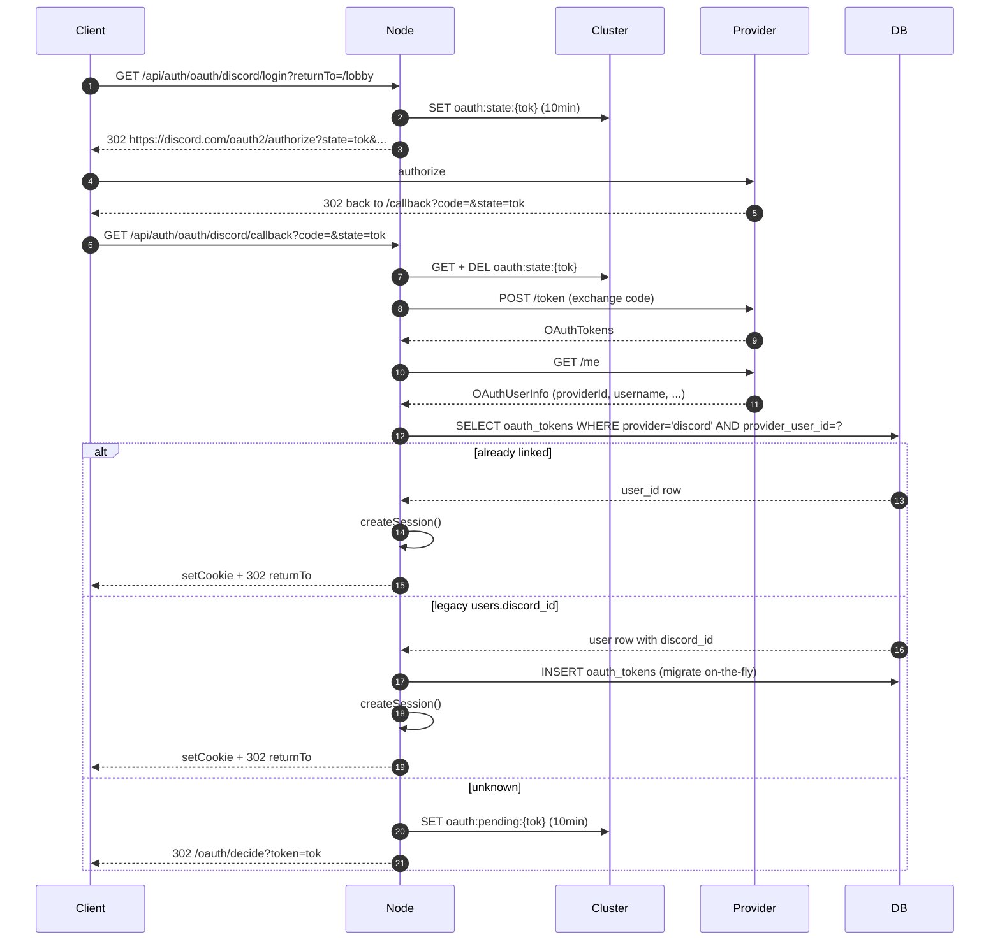

---
tags:
  - digiworld/system
  - digiworld/api
aliases:
  - Sign in with Discord
  - OAuth2
  - Social Login
  - Discord OAuth
  - Google OAuth
  - Facebook OAuth
created: 2026-08-01
updated: 2026-08-05
grounded-in:
  - backend/src/auth/oauth/types.ts
  - backend/src/auth/oauth/registry.ts
  - backend/src/auth/oauth/routes.ts
  - backend/src/auth/oauth/discord.ts
  - backend/src/auth/oauth/state.ts
  - backend/src/auth/oauth/store.ts
  - backend/src/auth/discord-link.ts
  - backend/src/db/migrations/045_oauth_tokens.sql
  - README.md
verified-at-commit: HEAD
---

# OAuth

> [!info] TL;DR
> Three providers already shipped — Discord, Google, Facebook — behind ONE
> [`OAuthProvider`](backend/src/auth/oauth/types.ts) interface. Adding
> another is one class + one registry line. All three drive the same
> "login OR link" hybrid flow via short-lived cluster tokens (state, pending).
> The [`oauth_tokens`](backend/src/db/migrations/045_oauth_tokens.sql) table
> holds identities; `users.discord_id` is mirrored on every Discord write
> so the legacy Discord bot lookup keeps working.

## Two entry points, one codepath

- **Login (unauthenticated user)** —
  `GET /api/auth/oauth/discord/login?returnTo=/lobby`
  → 302 Discord → user authorizes →
  `GET /api/auth/oauth/discord/callback?code=&state=`
  → session issued OR pending-decide 302

- **Link (authenticated user)** —
  `GET /api/auth/oauth/discord/link?returnTo=/account`
  → same handshake, but `state.initiatorUserId` binds the callback to the
  existing DigiWorld user

Both entry points share the callback and the state / pending token
machinery.

## The provider interface — [`types.ts`](backend/src/auth/oauth/types.ts)

```typescript
export type OAuthTokens = {
  readonly accessToken: string;
  readonly refreshToken?: string;
  readonly expiresIn?: number;
  readonly scope: string;
};

export type OAuthUserInfo = {
  readonly providerId: string;
  readonly username?: string;
  readonly email?: string;
  readonly avatarUrl?: string;
  readonly locale?: string;
};

export interface OAuthProvider {
  readonly id: string;
  authorizationUrl(state: string): string;
  exchangeCode(code: string): Promise<OAuthTokens>;
  refreshTokens(refreshToken: string): Promise<OAuthTokens>;
  fetchUserInfo(accessToken: string): Promise<OAuthUserInfo>;
}
```

Everything provider-specific — endpoint URLs, grant params, user-info shape
— hides behind these four methods. The routes stay 100 % provider-agnostic.

## Registry — [`registry.ts`](backend/src/auth/oauth/registry.ts)

Built lazily on first access, one-time per process. Providers with missing
or invalid config throw at construction so BOOT fails fast, not on the
first user click.

```typescript
function buildRegistry(): ReadonlyMap<string, OAuthProvider> {
  const enabled = new Set(config.OAUTH_ENABLED_PROVIDERS);
  const map = new Map<string, OAuthProvider>();
  if (enabled.has('discord'))  map.set('discord',  new DiscordOAuthProvider());
  if (enabled.has('google'))   map.set('google',   new GoogleOAuthProvider());
  if (enabled.has('facebook')) map.set('facebook', new FacebookOAuthProvider());
  log.info('oauth.registry.built', { providers: [...map.keys()] });
  return map;
}
```

`GET /api/auth/oauth/providers` returns `[...map.keys()]` — the frontend
renders one "Continue with X" button per enabled provider. No frontend
changes needed to add a new provider.

## The two short-lived cluster tokens

Both live in the cluster with a 10-minute TTL and are single-use.

### CSRF state — `oauth:state:{token}`

Zod-validated shape ([`types.ts:34`](backend/src/auth/oauth/types.ts:34)):

```typescript
export const OAuthStateSchema = z.object({
  v: z.literal(1),
  provider: z.string().min(1).max(32),
  mode: z.enum(['login', 'link']),
  returnTo: z.string().max(500).optional(),
  initiatorUserId: z.string().min(1).max(80).optional(),   // set for LINK mode
  issuedAt: z.number().int(),
}).strict();
```

Written on `/login` or `/link`, verified + consumed on `/callback`. A
tampered / expired / missing state → HTTP error, no session issued.

### Pending decide — `oauth:pending:{token}`

The hybrid path — an unknown Discord ID landed on the callback and needs
the user to pick "create a new account" or "link to existing account"
before we commit:

```typescript
export const OAuthPendingSchema = z.object({
  v: z.literal(1),
  provider: z.string().min(1).max(32),
  providerUserId: z.string().min(1).max(200),
  providerUsername: z.string().max(200).optional(),
  providerAvatar: z.string().max(500).optional(),
  providerEmail: z.string().max(320).optional(),
  accessToken: z.string().min(1),
  refreshToken: z.string().optional(),
  expiresIn: z.number().int().nonnegative().optional(),
  scope: z.string(),
  returnTo: z.string().max(500).optional(),
  issuedAt: z.number().int(),
}).strict();
```

The pending token carries the tokens too — so if the user picks "create",
the backend can write `oauth_tokens` without a second round-trip to the
provider.

## The full flow



## The decide page

`GET /oauth/decide?token=...` is a frontend route. The frontend calls
`GET /api/auth/oauth/pending/:token` to fetch a preview
(`provider`, `providerUsername`, `providerAvatar`, `canCreate`,
`returnTo`, `expiresAt`) — this **does not consume** the pending token.

Two choices:

- **Create a new account** — `POST /api/auth/oauth/decide {choice: 'create',
  pendingToken}`. Backend mints a placeholder-hash user
  (`argon2id(randomBytes(48))`), inserts `oauth_tokens`, mirrors
  `users.discord_id`, creates a session.
- **Log in and link to my existing account** — `POST … {choice: 'link',
  pendingToken, username, password}`. Backend verifies the password,
  inserts `oauth_tokens` on the existing user_id, mirrors
  `users.discord_id`, creates a session.

Both consume the pending token.

### `ADMIN_BOOTSTRAP` still gates the create path

When `ADMIN_BOOTSTRAP=closed` (production default), Discord login for an
unknown identity can still **link** to an existing account but cannot
**mint** a new one. The decide page hides "create" and
`POST /api/auth/oauth/decide` returns `403 registration-closed`. This
prevents OAuth becoming a backdoor around closed registration.

### Decide throttle

The `link` branch of `POST /api/auth/oauth/decide` is a password-verify
endpoint — a stolen or self-issued pending token gives an attacker an
otherwise-unrated password-guess surface against any username. As of
[[2026-08-05 — Login security hardening]] the link branch calls the
SAME `checkLoginThrottle` / `recordLoginAttempt` used by
`/api/auth/login`:

```typescript
const throttle = await checkLoginThrottle(body.data.username, req.ip);
if (!throttle.allowed) {
  return reply.code(429).header('Retry-After', String(throttle.retryInSec))
    .send({ error: throttle.reason });
}
```

See [`oauth/routes.ts:236-242`](backend/src/auth/oauth/routes.ts:236).
Counters live at `loginfail:user:{name}` and `loginfail:ip:{ip}` — the
same keys the password login path uses. An attacker cannot split
brute-force between `/api/auth/login` and `/api/auth/oauth/decide` to
avoid the cap: 8 fails on either endpoint (from any node) lock the
account for 15 minutes.

The link branch also uses the [`/api/auth/login`
dummy-hash pattern](backend/src/auth/routes.ts:288) — argon2 verify
ALWAYS runs, even when the username misses, so the response time
doesn't leak account existence:

```typescript
const existing = await one<UserRow>(SQL_SELECT_USER_BY_USERNAME, body.data.username);
const stored = existing?.password_hash ?? '$argon2id$v=19$m=19456,...';
const ok = await verifyPassword(stored, body.data.password);
if (existing === null || !ok || existing.disabled === 1) {
  await recordLoginAttempt(body.data.username, req.ip, false);
  return reply.code(401).send({ error: 'invalid-credentials' });
}
```

See [`oauth/routes.ts:244-251`](backend/src/auth/oauth/routes.ts:244).
Constant-time under the hood.

## Storage — `oauth_tokens` ([migration 045](backend/src/db/migrations/045_oauth_tokens.sql))

```sql
CREATE TABLE oauth_tokens (
  user_id            TEXT   NOT NULL REFERENCES users(id) ON DELETE CASCADE,
  provider           TEXT   NOT NULL,
  provider_user_id   TEXT   NOT NULL,
  access_token       TEXT,
  refresh_token      TEXT,
  expires_at         BIGINT,
  scope              TEXT,
  provider_username  TEXT,
  provider_email     TEXT,
  provider_avatar    TEXT,
  provider_locale    TEXT,
  created_at         BIGINT NOT NULL,
  updated_at         BIGINT NOT NULL,
  PRIMARY KEY (user_id, provider),
  UNIQUE (provider, provider_user_id)
);
```

Two uniqueness axes:

- **`PRIMARY KEY (user_id, provider)`** — one identity per user per
  provider. A user can be linked to Discord AND Google AND Facebook, but
  only ONE Discord identity per user.
- **`UNIQUE (provider, provider_user_id)`** — one DigiWorld user per
  Discord ID. Trying to link a Discord ID that's already bound to a
  different user → `409 already-linked`.

Portable between SQLite and Postgres — `INTEGER`/`BIGINT` for ms
timestamps, `REFERENCES users(id) ON DELETE CASCADE`.

## Legacy Discord code-link (mirrored on write)

Before OAuth landed, Discord identities were bound via
[`backend/src/auth/discord-link.ts`](backend/src/auth/discord-link.ts) — a
short-lived code the user typed into the bot. It writes to
`users.discord_id UNIQUE`.

Every `oauth_tokens` write for Discord ALSO mirrors to `users.discord_id`
so the bot's existing `SELECT * FROM users WHERE discord_id = ?` lookup in
[`backend/src/service/routes.ts`](backend/src/service/routes.ts) keeps
working transparently. The two paths converge on the same identity.

## Unlink

`DELETE /api/auth/oauth/:provider` (auth required):

1. DELETE `oauth_tokens` for `(user_id, provider)`
2. If provider = `discord`, also clear `users.discord_id`
3. Provider tokens are NOT revoked with the upstream provider — best-
   effort logout on our side; users can visit Discord's authorized-apps
   page for a hard revoke

## HTTP surface

Full table in [[HTTP Surface#Auth — OAuth (Discord / Google / Facebook)]].
Endpoints:

- `GET /api/auth/oauth/providers`
- `GET /api/auth/oauth/:provider/login`
- `GET /api/auth/oauth/:provider/link` (auth)
- `GET /api/auth/oauth/:provider/callback`
- `GET /api/auth/oauth/pending/:token`
- `POST /api/auth/oauth/decide`
- `DELETE /api/auth/oauth/:provider` (auth)
- `GET /api/auth/oauth/mine` (auth)

## Error codes ([`types.ts:69`](backend/src/auth/oauth/types.ts:69))

```typescript
export type OAuthErrorCode =
  | 'provider-disabled'    // enabled=false in env
  | 'provider-unknown'     // never heard of it
  | 'state-missing'        // no state or already consumed
  | 'state-expired'        // > 10min
  | 'pending-missing'      // no pending or already consumed
  | 'pending-expired'      // > 10min
  | 'registration-closed'  // 'create' choice with ADMIN_BOOTSTRAP=closed
  | 'auth-required'        // /link without a session
  | 'invalid-credentials'  // wrong password on 'link' choice
  | 'username-taken'       // 'create' with a colliding username
  | 'already-linked'       // provider_user_id already on another user
  | 'discord-error'        // upstream Discord returned an error
  | 'internal';
```

## Adding Google / Facebook / others

Purely a matter of implementing `OAuthProvider` and registering it. The
routes, state manager, store, and frontend button are all provider-
agnostic.

Sketch for a new provider `foo`:

```typescript
// backend/src/auth/oauth/foo.ts
export class FooOAuthProvider implements OAuthProvider {
  public readonly id = 'foo' as const;
  authorizationUrl(state) { /* build https://foo.example/authorize?... */ }
  async exchangeCode(code) { /* POST foo token endpoint */ }
  async refreshTokens(refreshToken) { /* POST foo token endpoint */ }
  async fetchUserInfo(accessToken) { /* GET foo /me */ }
}

// backend/src/auth/oauth/registry.ts
if (enabled.has('foo')) map.set('foo', new FooOAuthProvider());
```

Add `foo` to `OAUTH_ENABLED_PROVIDERS`, add
`FOO_OAUTH_CLIENT_ID/_CLIENT_SECRET/_REDIRECT_URI` to
[`config.ts`](backend/src/config.ts), done.

## Setup checklist per provider

For each provider you enable:

1. Register an app on the provider's developer portal.
2. Add ONE OAuth redirect URI that exactly matches
   `https://<host>/api/auth/oauth/<provider>/callback` (localhost is
   `http://localhost:3000/api/auth/oauth/<provider>/callback`).
3. Copy CLIENT_ID + CLIENT_SECRET into your env.
4. Add the provider id to `OAUTH_ENABLED_PROVIDERS` (comma-separated).
5. Restart. The "Continue with X" button auto-appears on `/login`.

Boot fails fast (before the port binds) if a provider is enabled but any
of its required env values is missing — no silent misconfiguration.

## Placeholder-hash accounts

OAuth-only users (the "create" branch of decide) get
`password_hash = argon2id(randomBytes(48))`. The plaintext is discarded so
no password sign-in can ever succeed against it — the user always comes
back via the provider, or through a future admin-issued "set password"
recovery flow.

## Related

- [[Session cookies]] — the cookie contract OAuth uses is identical to
  the password path; the decide-link branch now shares its login throttle
- [[HTTP Surface#Auth — OAuth (Discord / Google / Facebook)]]
- [[Cluster Coordination Layer]] — `oauth:state:*` + `oauth:pending:*`
- [[Environments#Required secrets]] — where the provider secrets belong
- [[2026-07-31 — OAuth hybrid decide]] — the ADR behind the decide flow
- [[2026-08-05 — Login security hardening]] — the ADR behind the
  decide-link throttle and dummy-hash timing defence
