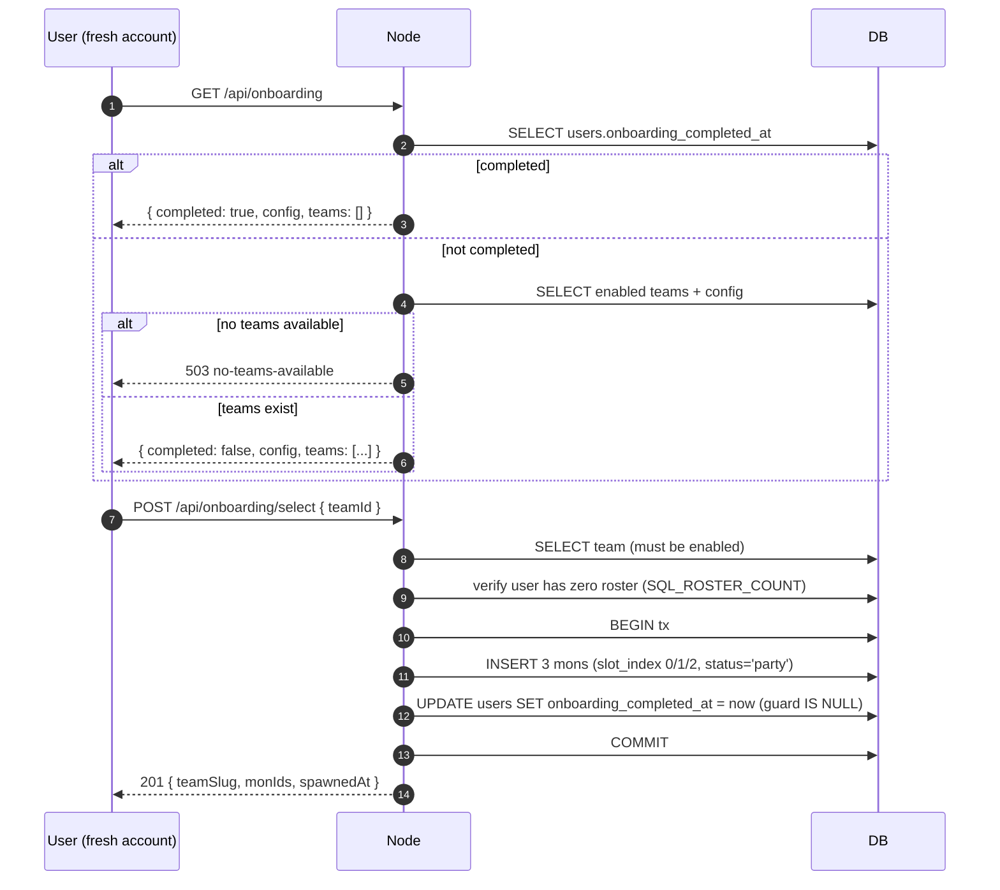

---
tags:
  - digiworld/system
  - digiworld/api
aliases:
  - Onboarding
  - Tutorial
  - First-run
  - Team Selection
  - Starter Team
created: 2026-08-01
updated: 2026-08-01
grounded-in:
  - backend/src/onboarding/engine.ts
  - backend/src/onboarding/routes.ts
  - backend/src/tutorial/routes.ts
verified-at-commit: 4e70621
---

# Onboarding and Tutorial

> [!info] TL;DR
> Two independent systems. **Onboarding** is the one-time team-picker
> that mints a fresh user's 3-mon starter party from admin-curated
> teams (`aggressive` / `balanced` / `wildcard` by default). **Tutorial**
> is the per-user "seen" state for in-app tooltips + walkthroughs,
> stored server-side (not localStorage) so it crosses devices and
> survives cache clears.

## Onboarding — [`onboarding/engine.ts`](backend/src/onboarding/engine.ts)

### Two tables

```
onboarding_config:
  id             INTEGER PK (singleton row, always id=1)
  intro_dialogue TEXT              -- prose shown on the picker screen
  bg_image       TEXT              -- background URL (http(s), /path, or data:image/*)
  updated_at     BIGINT

onboarding_teams:
  id                TEXT PK
  slug              TEXT UNIQUE
  name              TEXT           -- 1-48 chars
  description       TEXT
  mon_1_catalog_id  TEXT           -- three refs into the XML catalog
  mon_2_catalog_id  TEXT
  mon_3_catalog_id  TEXT
  sort_order        INTEGER
  enabled           INTEGER (0/1)
  created_at        BIGINT
  updated_at        BIGINT
```

### The 3 default teams

Seeded on boot via `seedDefaultOnboarding()` when the table is empty.
Verbatim:

```typescript
const DEFAULT_TEAMS: SeedTeam[] = [
  {
    slug: 'aggressive',
    name: 'Aggressive',
    description: 'Overwhelming offense. A fire-breather, a wolf with a chilling bite, and a saurian brawler.',
    monCatalogIds: ['skb-50', 'skb-151', 'skb-90'],
    sortOrder: 0,
  },
  {
    slug: 'balanced',
    name: 'Balanced',
    description: 'One from each element school. Fire attacker, water support, nature control — rounded for any matchup.',
    monCatalogIds: ['skb-136', 'skb-343', 'skb-348'],
    sortOrder: 1,
  },
  {
    slug: 'wildcard',
    name: 'Wildcard',
    description: 'Unusual and adaptable. A moon rabbit, a thunder beetle, and a wind pup — off-meta by design.',
    monCatalogIds: ['skb-2', 'skb-303', 'skb-701'],
    sortOrder: 2,
  },
];
```

Missing catalog IDs (e.g., the XML doesn't have `skb-303`) → the team
is SKIPPED at seed with `onboarding.seed.skip` warn log, not
half-inserted. Admins can add teams later via the CRUD endpoints.

### Team validation

At create / update ([`engine.ts::validateTeamInput`](backend/src/onboarding/engine.ts)):

- **`slug`** — 2–32 chars, `[a-z0-9_-]` only. Enforces URL-safe IDs.
- **`name`** — 1–48 chars.
- **`monCatalogIds`** — exactly 3, each a non-empty string that
  exists in the current XML catalog. Missing catalog IDs → 404
  `invalid-catalog-id`.
- **`description`** — no length cap in the validator (verify — probably
  bounded by DB TEXT limits).
- **`enabled`** — defaults to `true` (unless explicitly `false`).

### The `bg_image` SSRF/XSS guard

Non-trivial — the value gets interpolated into a CSS
`background-image: url("${bg}")` on the client. Verbatim guards
([`engine.ts::updateConfig`](backend/src/onboarding/engine.ts:195)):

```typescript
if (bg.length > 0) {
  const scheme = /^(https?:\/\/|\/|data:image\/)/i;
  if (!scheme.test(bg)) {
    return { ok: false, error: 'invalid-input',
             message: 'bgImage must be http(s):// URL, absolute path, or data:image/…' };
  }
  if (/["'\\<>\s]/.test(bg)) {
    return { ok: false, error: 'invalid-input',
             message: 'bgImage must not contain quotes, backslashes, angle brackets, or whitespace' };
  }
}
```

Two-part gate:

1. **Scheme allowlist** — only `http://`, `https://`, absolute path
   (`/foo.jpg`), or `data:image/*`. Blocks `javascript:`, `file:`,
   arbitrary schemes.
2. **Character blocklist** — no quotes, backslashes, angle brackets, or
   whitespace. Prevents CSS `url()` escape (`"); background: url(...)`)
   or HTML injection if the value leaks into an attribute.

Belt and braces — the SSRF vector needs BOTH a permissive scheme AND a
character that breaks out of the surrounding context. Either alone is
harmless.

### Player select flow



Race safety: `SQL_MARK_ONBOARDING_DONE` guards on `onboarding_completed_at
IS NULL`. Two concurrent selects → one wins the UPDATE (`changes = 1`),
the other sees `changes = 0` and the transaction throws — the roster
rollback keeps the losing user in the "not-yet-onboarded" state and
they retry.

Additional guard: the roster count check (`SQL_ROSTER_COUNT > 0` →
`already-onboarded`). Catches the edge case of a user who has mons but
`onboarding_completed_at` is null (e.g., pre-migration user, dev-time
`.db` reset).

### Skills auto-equip

Each of the 3 seed mons at level 5 gets its default skill loadout via
[`getDefaultEquippedForStage(element, stage)`](backend/src/skills/pool.ts)
— see [[Skills catalog#Default equipped]]. `equipped_skill_ids` is
serialized as JSON.

### Error taxonomy

```typescript
type OnboardingError =
  | 'not-found'              // 404 — team id / bad catalog id
  | 'duplicate-slug'         // 409
  | 'invalid-input'          // 400
  | 'invalid-catalog-id'     // 404
  | 'already-onboarded'      // 409
  | 'no-teams-available';    // 503 — admin never configured any
```

### HTTP surface — [`onboarding/routes.ts`](backend/src/onboarding/routes.ts)

**Player**

| Method | Path                             | Auth | Purpose                                               |
| ------ | -------------------------------- | ---- | ----------------------------------------------------- |
| GET    | `/api/onboarding`                | user | Snapshot for the picker (config + enabled teams)      |
| POST   | `/api/onboarding/select`         | user | `{ teamId }` — mint the 3-mon starter party            |

**Admin**

| Method | Path                                          | Auth  | Purpose                            |
| ------ | --------------------------------------------- | ----- | ---------------------------------- |
| GET    | `/api/admin/onboarding/config`                | admin | Fetch config singleton              |
| PUT    | `/api/admin/onboarding/config`                | admin | `{ introDialogue, bgImage? }`      |
| GET    | `/api/admin/onboarding/teams`                 | admin | List ALL teams (enabled + disabled) |
| GET    | `/api/admin/onboarding/teams/:id`             | admin | Fetch one                          |
| POST   | `/api/admin/onboarding/teams`                 | admin | Create                              |
| PUT    | `/api/admin/onboarding/teams/:id`             | admin | Update                              |
| DELETE | `/api/admin/onboarding/teams/:id`             | admin | Remove                              |

## Tutorial — [`tutorial/routes.ts`](backend/src/tutorial/routes.ts)

Per-user "seen" tracking for in-app tooltips + walkthroughs. Simple
JSON array on `users.tutorial_seen` (added by migration 022).

### Why it moved off localStorage

File header comment says it plainly:

> Replaced localStorage persistence (which cleared with cache and didn't
> cross devices) with the `users.tutorial_seen` JSON column added by
> migration 022. Idempotent: marking an already-seen id is a no-op.

### HTTP surface

| Method | Path                          | Auth | Purpose                                                             |
| ------ | ----------------------------- | ---- | ------------------------------------------------------------------- |
| GET    | `/api/tutorial/seen`          | user | `{ seenIds: string[] }` — every tutorial id this user has completed |
| POST   | `/api/tutorial/seen`          | user | `{ tutorialId }` — mark as seen (idempotent, no-op on duplicate)    |
| DELETE | `/api/tutorial/seen`          | user | Reset — wipes the array to `[]`                                     |

### Idempotent mark-seen

```typescript
const current = parseSeen(row?.tutorial_seen ?? null);
if (current.includes(tutorialId)) {
  return { seenIds: current };
}
const next = [...current, tutorialId];
await run(SQL_UPDATE_SEEN, JSON.stringify(next), Date.now(), user.id);
```

Duplicate marks return the CURRENT array unchanged, no DB write. Frontend
`useTutorialSeen` hook fires-and-forgets → server state stays consistent.

### Zod

```typescript
const MarkBodySchema = z.object({
  tutorialId: z.string().min(1).max(200),
});
```

200-char cap. IDs are frontend-authored strings — verify existing
conventions (namespaced like `combat/action-menu`, `farm/upgrade-btn`).

## Design notes

> [!info] Why store tutorial state per-user?
> Cross-device consistency. Player learns the combat UI on mobile,
> switches to desktop — the "Never played before?" nudges shouldn't
> reappear. localStorage was per-browser-per-device; server-side is
> per-user.

> [!info] Why is onboarding a hard one-shot?
> Selecting a starter team writes 3 mons into `player_roster` at
> party slots 0/1/2. Re-running would either:
> - Duplicate rows (roster grows arbitrarily), or
> - Overwrite existing party (destroys progress).
> The `already-onboarded` guard prevents both.

> [!info] Admin can preview but not "un-onboard" a player
> There's no `POST /api/admin/onboarding/reset/:userId`. If needed
> (repro a UX bug, test flow), the admin runs
> ```sql
> UPDATE users SET onboarding_completed_at = NULL WHERE id = ?;
> DELETE FROM player_roster WHERE user_id = ?;
> ```
> against the DB shell. Rare enough to not deserve an endpoint.

## What can go wrong

> [!warning] Catalog XML pruned a mon that a team references
> The team's `enabled=1` but its `mon_2_catalog_id='skb-xxx'` isn't in
> the current XML. `getSnapshotForPlayer()` FILTERS these out
> (`.filter((v) => v.missingCatalogIds.length === 0)`), so players never
> see a broken team. Admin surface still shows the team with
> `missingCatalogIds: ['skb-xxx']` so ops can fix it.

> [!warning] Empty `onboarding_teams` on a fresh admin bootstrap
> If the seed skipped ALL 3 teams (catalog missing every referenced
> `skb-*` id) and admin hasn't added any, `GET /api/onboarding`
> returns 503 `no-teams-available`. New users can't complete
> registration → onboarding → play. Fix: seed the catalog OR create
> teams via `POST /api/admin/onboarding/teams`.

> [!warning] Reset tutorial cascades
> `DELETE /api/tutorial/seen` wipes ALL of a user's seen ids. There's
> no "reset only combat/*" endpoint. If needed, POST individual ids
> after the delete.

## Related

- [[First admin bootstrap]] — runbook that must run BEFORE onboarding
  can pick a team (catalog must exist)
- [[Roster and Party]] — where the seeded 3 mons land
- [[Skills catalog#Default equipped]] — the auto-equip on seed
- [[HTTP Surface]] — grep for `/api/onboarding` and `/api/tutorial`
- [[Dialogues]] — the `intro_dialogue` is currently plain text; a
  future refactor could reuse the dialogue tree for a scripted
  intro
